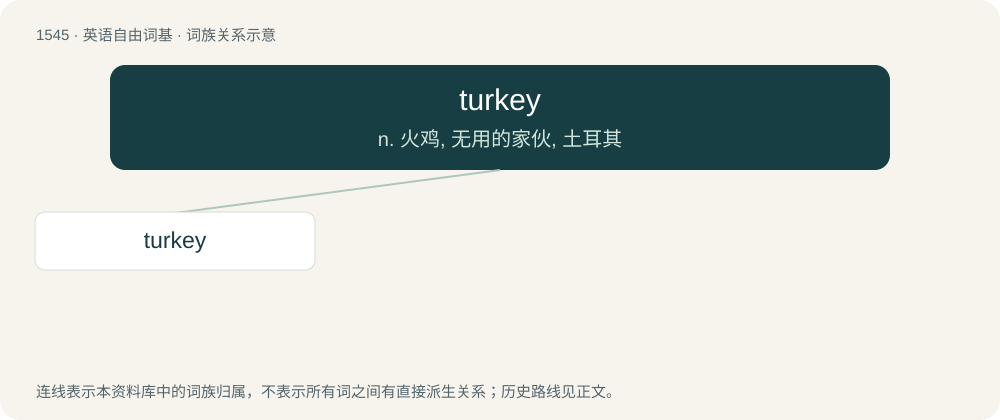

# 1632 · turkey — n. 火鸡, 无用的家伙, 土耳其

[总目录](../00_总目录_按常用程度.md)

**类型**：英语自由词基　｜　**来源语言**：见词源记录

## 核心含义与来源

- 核心含义：n. 火鸡, 无用的家伙, 土耳其
- 英文含义：A wild turkey of Meleagris gallopavo.
- 词形：turkey

**来源记录 1**（名词；A wild turkey of Meleagris gallopavo.）

Clipping of turkey-cock and turkey-hen, originally denoting the guinea fowl, an African bird that was first imported to Europe through Turkey, but there is some controversy over the origin. The word was then transferred to the superficially similar North American bird Meleagris gallopavo.

## 词族图

## 单词速览（常用到不常用）

| 单词 | 音标 | 释义 |
|---|---|---|
| [turkey](#w-1) | 英 /ˈtɜːki/；美 /ˈtɝki/ | n. 火鸡, 无用的家伙, 土耳其 |

## 逐词详解

### 1. turkey

**词性**：名词　｜　**音标**：英 /ˈtɜːki/；美 /ˈtɝki/

**中文释义**：n. 火鸡, 无用的家伙, 土耳其

**英文义项**：A wild turkey of Meleagris gallopavo. / A domesticated bird of Meleagris gallopavo domesticus.

**词源与演化**：

Clipping of turkey-cock and turkey-hen, originally denoting the guinea fowl, an African bird that was first imported to Europe through Turkey, but there is some controversy over the origin. The word was then transferred to the superficially similar North American bird Meleagris gallopavo.

**例句**：

> The turkey cut in front of me and then berated me for running into him.

该用例对应义项：A foolish or inept person.
