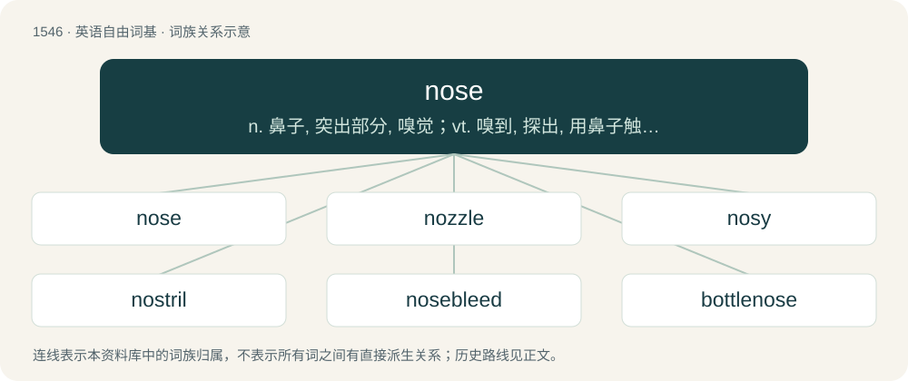

# 1633 · nose — n. 鼻子, 突出部分, 嗅觉；vt. 嗅到, 探出, 用鼻子触；vi. 闻, 嗅, 探听, 告密

[总目录](../00_总目录_按常用程度.md)

**类型**：英语自由词基　｜　**来源语言**：见词源记录

## 核心含义与来源

- 核心含义：n. 鼻子, 突出部分, 嗅觉；vt. 嗅到, 探出, 用鼻子触；vi. 闻, 嗅, 探听, 告密
- 英文含义：A protuberance on the face housing the nostrils, which are used to breathe or smell.
- 词形：nose

**来源记录 1**（名词；A protuberance on the face housing the nostrils, which are used to breathe or smell.）

From Middle English nose, from Old English nosu, from Proto-West Germanic \*nosu, variant of \*nasō, old dual from Proto-Indo-European \*néh₂s- ~ \*nh₂es- (“nose, nostril”). See also Saterland Frisian Noose, West Frisian noas, Dutch neus, Swedish nos, Norwegian nos (“snout”), Low German Nääs, German Nase, Swedish näsa, Norwegian nese, Danish næse (“nose”); also Latin nāris (“nostril”), nāsus (“nose”), Lithuanian nósis, Russian нос (nos), Sanskrit नासा (nā́sā, “nostrils”).

## 词族图

## 单词速览（常用到不常用）

| 单词 | 音标 | 释义 |
|---|---|---|
| [nose](#w-1) | /nəuz/ | n. 鼻子, 突出部分, 嗅觉；vt. 嗅到, 探出, 用鼻子触；vi. 闻, 嗅, 探听, 告密 |
| [nozzle](#w-2) | /ˈnɒzəl/ | n. 管口, 喷嘴；\[化\] 喷口 |
| [nosy](#w-3) | 英 /ˈnəʊziː/；美 /ˈnoʊzi/ | a. 大鼻子的, 好管闲事的, 爱打听的；n. 大鼻者 |
| [nostril](#w-4) | 英 /ˈnɒs.tɹɪl/；美 /ˈnɑ.stɹəl/ | n. 鼻孔；\[医\] 鼻孔 |
| [nosebleed](#w-5) | 英 /ˈnəʊzˌbliːd/；美 /ˈnoʊzˌblid/ | n. 鼻出血；\[医\] 鼻出血, 衄血 |
| [bottlenose](#w-6) | /ˈbɒtəlnəʊz/ | n. \[动\]宽吻海豚 |
| [nosedive](#w-7) | /ˈnəʊzdaɪv/ | vi. 俯冲, (价格)猛跌, 暴落 |

## 逐词详解

### 1. nose

**词性**：名词　｜　**音标**：/nəuz/

**中文释义**：n. 鼻子, 突出部分, 嗅觉；vt. 嗅到, 探出, 用鼻子触；vi. 闻, 嗅, 探听, 告密

**英文义项**：A protuberance on the face housing the nostrils, which are used to breathe or smell. / A snout, the nose of an animal.

**词源与演化**：

From Middle English nose, from Old English nosu, from Proto-West Germanic \*nosu, variant of \*nasō, old dual from Proto-Indo-European \*néh₂s- ~ \*nh₂es- (“nose, nostril”). See also Saterland Frisian Noose, West Frisian noas, Dutch neus, Swedish nos, Norwegian nos (“snout”), Low German Nääs, German Nase, Swedish näsa, Norwegian nese, Danish næse (“nose”); also Latin nāris (“nostril”), nāsus (“nose”), Lithuanian nósis, Russian нос (nos), Sanskrit नासा (nā́sā, “nostrils”).

**例句**：

> It is essential that a winetaster develops a good nose.

该用例对应义项：The skill in recognising bouquet.

### 2. nozzle

**词性**：名词　｜　**音标**：/ˈnɒzəl/

**中文释义**：n. 管口, 喷嘴；\[化\] 喷口

**英文义项**：A short tube, usually tapering, forming the vent of a hose or pipe. / A short outlet or inlet pipe projecting from the end or side of a hollow vessel, as a steam-engine cylinder or a steam boiler.

**构词拆分**：nose + -le (diminutive suffix)

**词源与演化**：

From Middle English noselle, equivalent to nose + -le (diminutive suffix). Compare typologically Russian сопло (soplo) (&lt;~ сопе́ть (sopétʹ), whence also сопа́тка (sopátka)).

**例句**：

> The shape of the nozzle prevents the use of aftermarket eartips.

该用例对应义项：The part of an earbud that accommodates eartips.

### 3. nosy

**词性**：形容词　｜　**音标**：英 /ˈnəʊziː/；美 /ˈnoʊzi/

**中文释义**：a. 大鼻子的, 好管闲事的, 爱打听的；n. 大鼻者

**英文义项**：Prying, inquisitive or curious in other’s affairs; tending to snoop or meddle. / Having a large or elongated nose.

**构词拆分**：nose + -y + nose + -y

**词源与演化**：

From nose + -y (adjectival suffix), or from nose + -y (diminutive suffix).

**例句**：

> They built tall fences, yet the nosy neighbors always seemed to know everything about them.

该用例对应义项：Prying, inquisitive or curious in other’s affairs; tending to snoop or meddle.

### 4. nostril

**词性**：名词　｜　**音标**：英 /ˈnɒs.tɹɪl/；美 /ˈnɑ.stɹəl/

**中文释义**：n. 鼻孔；\[医\] 鼻孔

**英文义项**：Either of the two orifices located on the nose (or on the beak of a bird); used as a passage for air and other gases to travel the nasal passages.

**构词拆分**：By surface analysis, nose + thirl (“hole”)

**词源与演化**：

From Middle English nostrille, from Old English nosþyrel. Compare Old Frisian nosterle (“nostril”), modern West Frisian noaster (“nostrill”). Compare also Middle Low German noster (“nostril”), from Proto-Germanic \*nustriz (“nostril”). By surface analysis, nose + thirl (“hole”).

**例句**：

> When my left nostril is blocked, I breathe through my right nostril.

### 5. nosebleed

**词性**：名词　｜　**音标**：英 /ˈnəʊzˌbliːd/；美 /ˈnoʊzˌblid/

**中文释义**：n. 鼻出血；\[医\] 鼻出血, 衄血

**英文义项**：Haemorrhage from the nose (usually, blood flow exiting the nostrils that originates from the nasal cavity). / Mental overload (usually attained as a result of having to comprehend new and/or complex concepts or languages that one is not particularly skilled with).

**构词拆分**：From nose + bleed.

**词源与演化**：

From nose + bleed.

**例句**：

> This is the first time I've ever had a nosebleed in winter.

### 6. bottlenose

**词性**：名词　｜　**音标**：/ˈbɒtəlnəʊz/

**中文释义**：n. \[动\]宽吻海豚

**英文义项**：bottlenose dolphin. / bottlenose whale.

**构词拆分**：bottle + nose

**词源与演化**：

From bottle + nose. The creatures have a bottle-shaped nose.

**例句**：

> We were boating on the Gulf of Mexico and saw bottlenose dolphins.

### 7. nosedive

**词性**：名词　｜　**音标**：/ˈnəʊzdaɪv/

**中文释义**：vi. 俯冲, (价格)猛跌, 暴落

**英文义项**：A headfirst fall or jump. / A drop in altitude with the nose of the craft angled downwards.

**构词拆分**：nose + dive

**词源与演化**：

From nose + dive.

**例句**：

> The stock took a nosedive.

该用例对应义项：a sudden sharp drop or rapid decline
