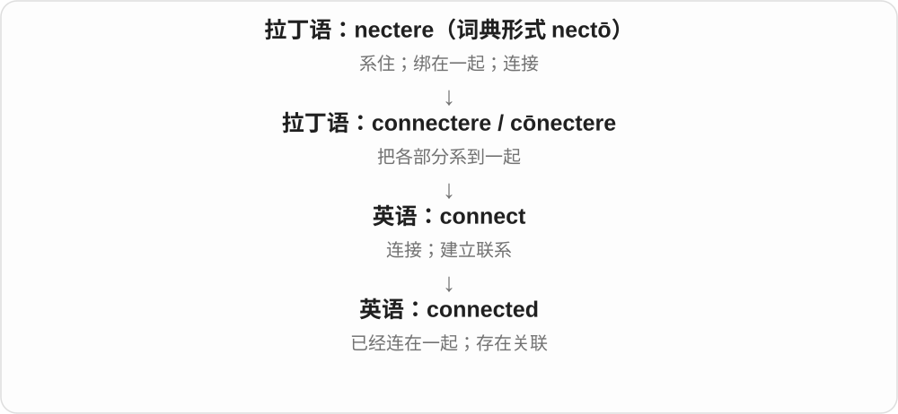
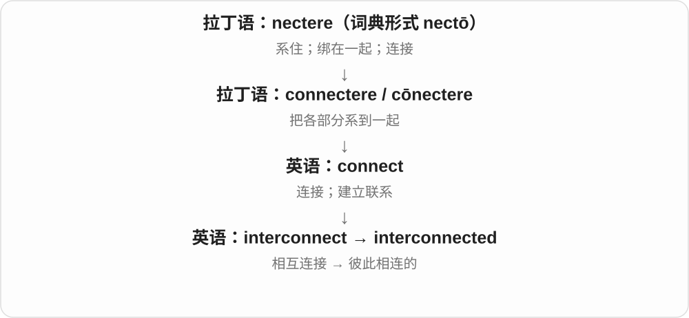

# 1635 · connected — 连接完成的状态与联系感

[逐词精讲目录](../00_逐词精讲目录.md) · [总目录](../00_总目录_按常用程度.md)

## 核心词根与来源

能接通、有关联、有人际联系是不同场景，不是所有 connected 都在说插上电线。

**CONNECTED：实体接上，也可事情相关、人与人有联系**

connected → unconnected、connectedness；interconnected 彼此交连。

- **相连及其否定、状态名词**：connected · unconnected · connectedness
- **彼此交连**：interconnected

## 词形与演化规律

con- + nectere → connect；connect + -ed；un- + connected；connected + -ness；inter- + connected。

## 单词速览（按词族由简到繁）

同一基础词的相关扩展放在一起，先读基础形式，再读扩展；各组之间优先读常用的。具体词源关系见各词讲解。

| 单词 | 音标 | 核心意思 |
|---|---|---|
| [connected](#w-1) | /kəˈnektɪd/ | 相连的；相关的；有人脉的 |
| [connectedness](#w-4) | /kəˈnektɪdnəs/ | 相连状态、关联性；联系感、归属联系 |
| [interconnected](#w-2) | 英 /ˌɪntəkəˈnektɪd/；美 /ˌɪntərkəˈnektɪd/ | 相互关联的；彼此相连的 |
| [unconnected](#w-3) | /ˌʌnkəˈnektɪd/ | 未连接的；无关的、彼此没有联系的 |

## 逐词讲解

### 1. connected — 相连的；相关的；有人脉的

**音标**：/kəˈnektɪd/

**先抓住这个画面**

connected 表示线已经接上了：设备能通，事情有关，人与人之间也可以保持联系。

**怎么拆**

connect + -ed，既是过去分词，也可作形容词。

**怎么变成今天的意思**

它描述连接形成后的状态。一个 connected person 在特定语境可指认识重要人物，但仅说人际关系好时要看上下文。

**常见搭配与例句**

be connected to…；be connected with…；stay connected；closely connected events。

> The two rooms are connected by a narrow corridor.

这两个房间由一条狭窄走廊相连。

> These decisions are closely connected.

这些决定彼此密切相关。

**别混淆**

connected 是连着的；connective 是起连接作用的。connected devices 是相连设备，connective tissue 是帮助连接和支持的组织。

### 2. connectedness — 相连状态、关联性；联系感、归属联系

**音标**：/kəˈnektɪdnəs/

**先抓住这个画面**

不是数一共有几根线，而是看各部分连在一起的状态，或一个人觉得自己与他人有联系。

**怎么拆**

connected + -ness，把相连的性质、状态名词化。社交、心理语境可说联系感，数学、网络等语境有更具体的定义。

**怎么变成今天的意思**

**拉丁 con- + nectere → connectere → connect**  
共同 + 系结 → 连接

↓

**connect + -ed → connected**  
连着、有关联；也可人脉广

↓

**connected + -ness → connectedness**  
相连、有关联的状态；主观联系感

social connectedness 社会联系感，a sense of connectedness 联系感，the connectedness of a network 网络连通性。

**常见搭配与例句**

social connectedness；a sense of connectedness；network connectedness。

> The club gave her a sense of connectedness.

俱乐部让她感到与别人有了联系。

> The study examined connectedness within the network.

研究考察了网络内部的连通情况。

**别混淆**

connectedness 关注相连状态、联系感；connections 可具体一条条联系、人脉，不完全等于连接数量。

### 3. interconnected — 相互关联的；彼此相连的

**音标**：英 /ˌɪntəkəˈnektɪd/；美 /ˌɪntərkəˈnektɪd/

**先抓住这个画面**

interconnected 像拉动网的一角，其他地方也跟着动：问题、行业或系统彼此有关联。

**怎么拆**

inter- + connected，也可视为 interconnect 的过去分词形容词。

**怎么变成今天的意思**

它描述网已经形成的状态。有联系不一定等于互相依赖到缺一不可，具体影响强弱还要看情况。

**常见搭配与例句**

interconnected systems；interconnected problems；closely interconnected；an interconnected world。

> Housing, transport, and employment are deeply interconnected.

住房、交通和就业之间有很深的联系。

> The building contains several interconnected courtyards.

这座建筑包含几个彼此相通的庭院。

**别混淆**

interconnected 强调存在连接；interdependent 更强调相互依赖。系统可以联网，但仍能独立工作。

### 4. unconnected — 未连接的；无关的、彼此没有联系的

**音标**：/ˌʌnkəˈnektɪd/

**先抓住这个画面**

电缆没接上，是实体不通；两件事只是同时发生却没有关系，也可以是 unconnected。

**怎么拆**

un- 否定 + connected，后者为 connect + -ed；否定连接状态，不一定说先连上又拆掉。

**怎么变成今天的意思**

**拉丁 con- + nectere → connectere → connect**  
共同 + 系结 → 连接

↓

**connect + -ed → connected**  
连着、有关联；也可人脉广

↓

**un-、-ness 等现代派生**  
未相连；相连状态、联系感

unconnected events 无关事件，unconnected with 与……无关，an unconnected cable 未接上的电缆。

**常见搭配与例句**

unconnected events；unconnected with；an unconnected cable。

> The two complaints were unconnected.

两起投诉互不相关。

> An unconnected cable lay behind the desk.

一根没接上的电缆放在桌子后面。

**别混淆**

unconnected 可以从来没接过；disconnected 常可强调断开，也有疏离、话不连贯等语境。

## 这一组要分清什么

unconnected 不一定曾连过；disconnected 可断开；connectedness 不是简单联系人数量。

## 串起来练习

The interconnected groups created a sense of connectedness.

彼此往来的小组让成员产生了联系感。
