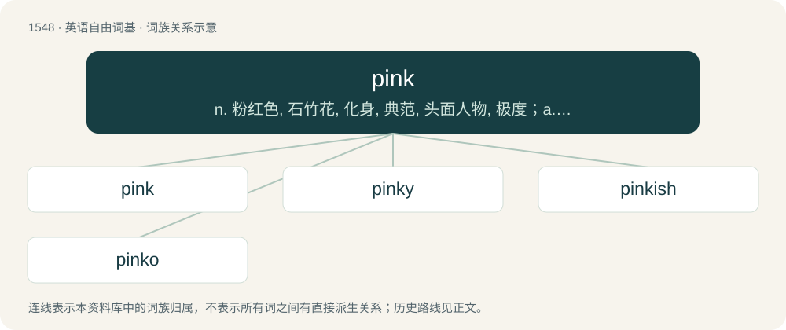

# 1635 · pink — n. 粉红色, 石竹花, 化身, 典范, 头面人物, 极度；a. 粉红的, 石竹科的, 比较激进的, 脸色发红的, 精致的, 有点下流的；vt. 刺, 扎, 刺痛, 射伤, 使面红耳赤, 使变粉红色

[总目录](../00_总目录_按常用程度.md)

**类型**：英语自由词基　｜　**来源语言**：见词源记录

## 核心含义与来源

- 核心含义：n. 粉红色, 石竹花, 化身, 典范, 头面人物, 极度；a. 粉红的, 石竹科的, 比较激进的, 脸色发红的, 精致的, 有点下流的；vt. 刺, 扎, 刺痛, 射伤, 使面红耳赤, 使变粉红色
- 英文含义：A color reminiscent of pinks, the flowers.
- 词形：pink

**多个词源／构词路径**：同一拼写可能有不同来源；以下按词性和含义分别列出。

**来源记录 1**（名词；A color reminiscent of pinks, the flowers.）

Origin uncertain; perhaps from Dutch pinken (“to blink”) or the English verb pink from the same source. Perhaps from the notion of the petals being pinked. An earlier word for similar flesh-like colors, mostly displaced by pink, was incarnation (\[1300s\]; see Etymonline) and carnation.

**来源记录 2**（名词；A common minnow (Phoxinus phoxinus0.）

Unknown. Some lexicographers suggest comparison to regional German Pinke (“minnow; small salmon”), but this is not widely accepted.

**来源记录 3**（动词；To decorate a piece of clothing or fabric by adding holes or by scalloping the fringe.）

Probably ultimately imitative, or from Dutch pingelen (“to do fine needlework”) or Low German \[Term?\]; compare Low German pinken (“hit, peck”) and Pinke (“big needle”).

**来源记录 4**（动词；Of a motor car, to emit a high "pinking" noise, usually as a result of ill-set ignition timing for the fuel used (in a spark ignition engine).）

Onomatopoeic. Compare ping.

## 词族图

## 单词速览（常用到不常用）

| 单词 | 音标 | 释义 |
|---|---|---|
| [pink](#w-1) | 英 /ˈpɪŋk/；/ˈpiŋk/ | n. 粉红色, 石竹花, 化身, 典范, 头面人物, 极度；a. 粉红的, 石竹科的, 比较激进的, 脸色发红的, 精致的, 有点下流的；vt. 刺, 扎, 刺痛, 射伤, 使面红耳赤, 使变粉红色 |
| [pinky](#w-2) | /ˈpɪŋki/ | a. 带淡红色的, 比较激进的 |
| [pinkish](#w-3) | /ˈpɪŋkɪʃ/ | a. 略带桃色的 |
| [pinko](#w-4) | 英 /ˈpɪŋkəʊ/；美 /ˈpɪŋkoʊ/ | n. 政治观点有点左倾的人 |

## 逐词详解

### 1. pink

**词性**：名词　｜　**音标**：英 /ˈpɪŋk/；/ˈpiŋk/

**中文释义**：n. 粉红色, 石竹花, 化身, 典范, 头面人物, 极度；a. 粉红的, 石竹科的, 比较激进的, 脸色发红的, 精致的, 有点下流的；vt. 刺, 扎, 刺痛, 射伤, 使面红耳赤, 使变粉红色

**英文义项**：A color reminiscent of pinks, the flowers. / Magenta, the colour evoked by red and blue light when combined.

**词源与演化**：

Origin uncertain; perhaps from Dutch pinken (“to blink”) or the English verb pink from the same source. Perhaps from the notion of the petals being pinked. An earlier word for similar flesh-like colors, mostly displaced by pink, was incarnation (\[1300s\]; see Etymonline) and carnation.

**例句**：

> This garden in particular has a beautiful bed of pinks.

该用例对应义项：Any of various flowers of that colour in the genus Dianthus, sometimes called carnations.

### 2. pinky

**词性**：形容词　｜　**音标**：/ˈpɪŋki/

**中文释义**：a. 带淡红色的, 比较激进的

**英文义项**：Pinkish.

**构词拆分**：pink + -y

**词源与演化**：

From pink + -y.

**例句**：

> I'm so fancy, I lift my pinky when I hold the steering wheel.

### 3. pinkish

**词性**：形容词　｜　**音标**：/ˈpɪŋkɪʃ/

**中文释义**：a. 略带桃色的

**英文义项**：Somewhat pink.

**构词拆分**：pink + -ish

**词源与演化**：

From pink + -ish.

**例句**：

> The first light of dawn tinged the clouds with a pinkish hue.

### 4. pinko

**词性**：名词　｜　**音标**：英 /ˈpɪŋkəʊ/；美 /ˈpɪŋkoʊ/

**中文释义**：n. 政治观点有点左倾的人

**英文义项**：A socialist, particularly one who is not completely communist.

**构词拆分**：pink + -o

**词源与演化**：

From pink + -o, a variation of red (“Communist”, noun), as pink is a lighter, more diluted form.

**例句**：

> Tom called John a pinko, then John called Tom a fascist.
