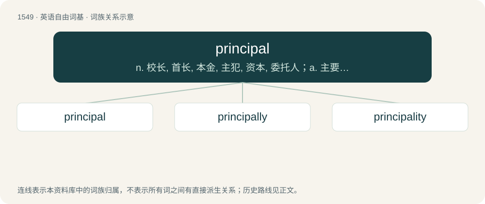

# 1636 · principal — n. 校长, 首长, 本金, 主犯, 资本, 委托人；a. 主要的, 最重要的, 首要的

[总目录](../00_总目录_按常用程度.md)

**类型**：英语自由词基　｜　**来源语言**：见词源记录

## 核心含义与来源

- 核心含义：n. 校长, 首长, 本金, 主犯, 资本, 委托人；a. 主要的, 最重要的, 首要的
- 英文含义：Primary; most important; first level in importance.
- 词形：principal

**来源记录 1**（形容词；Primary; most important; first level in importance.）

From Middle English principal, from Old French principal, from Latin prīncipālis.

## 词族图

## 单词速览（常用到不常用）

| 单词 | 音标 | 释义 |
|---|---|---|
| [principal](#w-1) | 英 /ˈpɹɪn.sɪ.pəl/ | n. 校长, 首长, 本金, 主犯, 资本, 委托人；a. 主要的, 最重要的, 首要的 |
| [principally](#w-2) | /ˈprinsəpəli/ | adv. 主要地, 大部分 |
| [principality](#w-3) | /pɹɪnsɪˈpælɪti/ | n. 公国, 封色, 侯国, 首长的职位, 校长的权力, 校长的职位, 首长的权力 |

## 逐词详解

### 1. principal

**词性**：形容词　｜　**音标**：英 /ˈpɹɪn.sɪ.pəl/

**中文释义**：n. 校长, 首长, 本金, 主犯, 资本, 委托人；a. 主要的, 最重要的, 首要的

**英文义项**：Primary; most important; first level in importance. / Chosen or assumed among a branch of possible values of a multi-valued function so that the function is single-valued.

**词源与演化**：

From Middle English principal, from Old French principal, from Latin prīncipālis.

**例句**：

> Two is the principal square root of 4. Both −2 and +2 are square roots of 4.

该用例对应义项：Chosen or assumed among a branch of possible values of a multi-valued function so that the function is single-valued.

### 2. principally

**词性**：副词　｜　**音标**：/ˈprinsəpəli/

**中文释义**：adv. 主要地, 大部分

**英文义项**：In a primary manner; pertaining to the principal of a matter.

**构词拆分**：By surface analysis, principal + -ly

**词源与演化**：

From Middle English principaly. By surface analysis, principal + -ly.

**例句**：

> The gladiolus comes principally from South Africa, where about fifty species have been discovered.

### 3. principality

**词性**：名词　｜　**音标**：/pɹɪnsɪˈpælɪti/

**中文释义**：n. 公国, 封色, 侯国, 首长的职位, 校长的权力, 校长的职位, 首长的权力

**英文义项**：A region or sovereign nation headed by a prince or princess. / A spiritual being, specifically in Christian angelology, the third lowest level of angels, ranked above archangels and below powers.

**构词拆分**：principal + -ity

**词源与演化**：

From Middle English principalte, principalite, from Anglo-Norman principalté, Middle French principalté, from Late Latin prīncipālitās, from Latin prīncipālis (“principal”) + -tās. Equivalent to principal + -ity.

**例句**：

> The Principality of Liechtenstein was established within the Holy Roman Empire in 1719.
