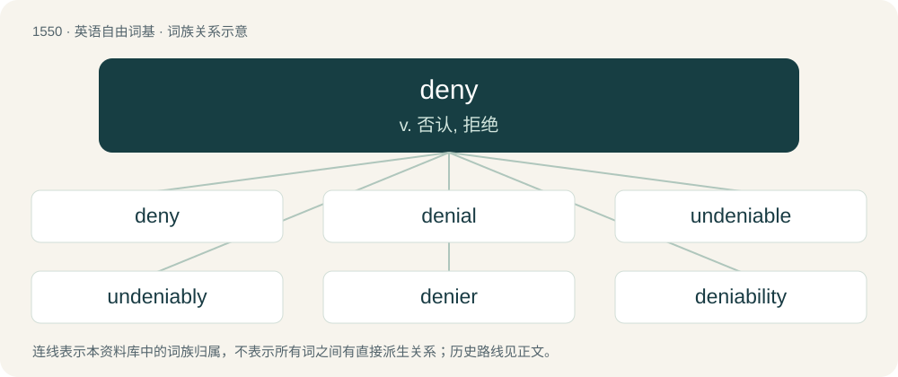

# 1638 · deny — v. 否认, 拒绝

[总目录](../00_总目录_按常用程度.md)

**类型**：英语自由词基　｜　**来源语言**：见词源记录

## 核心含义与来源

- 核心含义：v. 否认, 拒绝
- 英文含义：To disallow or reject.
- 词形：deny

**来源记录 1**（动词；To disallow or reject.）

From Middle English denyen, from Old French denoier (“to deny, to repudiate”) (French dénier), from Latin denegare (“to deny, to refuse”), from de- (“away”) and negare (“to refuse”), the latter ultimately from Proto-Indo-European \*né (“no, not”). Doublet of denegate.

## 词族图

## 单词速览（常用到不常用）

| 单词 | 音标 | 释义 |
|---|---|---|
| [deny](#w-1) | 英 /dɪˈnaɪ/；美 /dəˈnaɪ/ | v. 否认, 拒绝 |
| [denial](#w-2) | 英 /dɪˈnaɪ.əl/ | n. 否认；\[法\] 否定, 否认, 拒绝接受 |
| [undeniable](#w-3) | 英 /ˌʌn.dɪˈnaɪ.(j)ə.bəɫ/ | a. 不可否认的 |
| [undeniably](#w-4) |  | adv. 确凿无疑地；不可否认地 |
| [denier](#w-5) | /dɪˈnaɪə(ɹ)/ | 【英文】One who denies or forbids something. |
| [deniability](#w-6) | 英 /dɪˌnaɪ(j)əˈbɪlɪti/ | n. 推诿不知情的本领；否认本领 |

## 逐词详解

### 1. deny

**词性**：动词　｜　**音标**：英 /dɪˈnaɪ/；美 /dəˈnaɪ/

**中文释义**：v. 否认, 拒绝

**英文义项**：To disallow or reject. / To assert that something is not true.

**词源与演化**：

From Middle English denyen, from Old French denoier (“to deny, to repudiate”) (French dénier), from Latin denegare (“to deny, to refuse”), from de- (“away”) and negare (“to refuse”), the latter ultimately from Proto-Indo-European \*né (“no, not”). Doublet of denegate.

**例句**：

> I deny that I was at the party.

该用例对应义项：To assert that something is not true.

### 2. denial

**词性**：名词　｜　**音标**：英 /dɪˈnaɪ.əl/

**中文释义**：n. 否认；\[法\] 否定, 否认, 拒绝接受

**英文义项**：An assertion of untruth. / The negation in logic.

**构词拆分**：deny + -al

**词源与演化**：

From deny + -al.

**例句**：

> The denial of medical treatment to those who cannot afford to pay is scandalous.

该用例对应义项：A refusal or failure to provide or grant something that is requested or desired.

### 3. undeniable

**词性**：形容词　｜　**音标**：英 /ˌʌn.dɪˈnaɪ.(j)ə.bəɫ/

**中文释义**：a. 不可否认的

**英文义项**：Irrefutable, or impossible to deny.

**构词拆分**：un- + deny + -able

**词源与演化**：

From un- + deny + -able, compare deniable.

**例句**：

> Some believe that there is undeniable evidence of UFOs.

该用例对应义项：Irrefutable, or impossible to deny.

### 4. undeniably

**词性**：副词

**中文释义**：adv. 确凿无疑地；不可否认地

**英文义项**：In an undeniable manner, or to an undeniable extent. / Used as a modal adverb to assert that the indicated statement is undeniable.

**构词拆分**：undeniable + -ly；un- + deny + -ably

**词源与演化**：

From undeniable + -ly, equivalent to un- + deny + -ably.

**例句**：

> The third movie was undeniably the best.

该用例对应义项：Used as a modal adverb to assert that the indicated statement is undeniable.

### 5. denier

**词性**：名词　｜　**音标**：/dɪˈnaɪə(ɹ)/

**英文义项**：One who denies or forbids something. / One who denies the existence of something.

**构词拆分**：deny + -er

**词源与演化**：

From deny + -er.

### 6. deniability

**词性**：名词　｜　**音标**：英 /dɪˌnaɪ(j)əˈbɪlɪti/

**中文释义**：n. 推诿不知情的本领；否认本领

**英文义项**：The condition of being deniable. / The extent to which something is deniable.

**构词拆分**：deny + -ability

**词源与演化**：

From deny + -ability.

**例句**：

> The plausible deniability associated with hacking has ushered in an era of cyber warfare.
