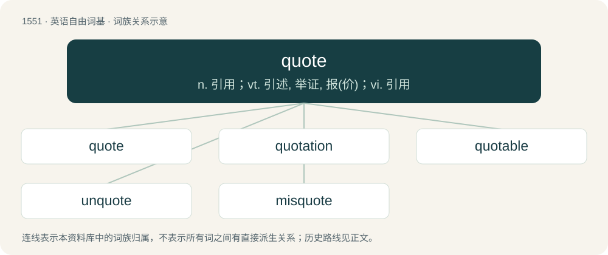

# 1639 · quote — n. 引用；vt. 引述, 举证, 报(价)；vi. 引用

[总目录](../00_总目录_按常用程度.md)

**类型**：英语自由词基　｜　**来源语言**：见词源记录

## 核心含义与来源

- 核心含义：n. 引用；vt. 引述, 举证, 报(价)；vi. 引用
- 英文含义：A statement attributed to a person; a quotation.
- 词形：quote

**来源记录 1**（名词；A statement attributed to a person; a quotation.）

From Middle English quoten, coten (“to mark (a book) with chapter numbers or marginal references”), from Old French coter, from Medieval Latin quotāre (“to distinguish by numbers, number chapters”), itself from Latin quotus (“which, what number (in sequence)”), from quot (“how many”) and related to quis (“who”). The sense developed via “to give as a reference, to cite as an authority” to “to copy out exact words” (since 1680); the business sense “to state the price of a commodity” (1866) revives the etymological meaning. The noun, in the sense of “quotation,” is attested from 1885; see also usage note, below.

## 词族图

## 单词速览（常用到不常用）

| 单词 | 音标 | 释义 |
|---|---|---|
| [quote](#w-1) | /kwəʊt/ | n. 引用；vt. 引述, 举证, 报(价)；vi. 引用 |
| [quotation](#w-2) | 美 /kwoʊˈteɪʃn̩/ | n. 引用语, 语录, 牌价, 报价；\[化\] 报价 |
| [quotable](#w-3) | /ˈkwəʊtəbəl/ | a. 可引用的, 有引用价值的, 适于引用的 |
| [unquote](#w-4) | /.ʌnˈkwəut/ | vi. 结束(引文)；\[经\] 无交易 |
| [misquote](#w-5) | /mɪsˈkwəʊt/ | v. 错误地引用 |

## 逐词详解

### 1. quote

**词性**：名词　｜　**音标**：/kwəʊt/

**中文释义**：n. 引用；vt. 引述, 举证, 报(价)；vi. 引用

**英文义项**：A statement attributed to a person; a quotation. / A quotation mark.

**词源与演化**：

From Middle English quoten, coten (“to mark (a book) with chapter numbers or marginal references”), from Old French coter, from Medieval Latin quotāre (“to distinguish by numbers, number chapters”), itself from Latin quotus (“which, what number (in sequence)”), from quot (“how many”) and related to quis (“who”). The sense developed via “to give as a reference, to cite as an authority” to “to copy out exact words” (since 1680); the business sense “to state the price of a commodity” (1866) revives the etymological meaning. The noun, in the sense of “quotation,” is attested from 1885; see also usage note, below.

**例句**：

> After going over the hefty quotes, the board decided it was cheaper to have the project executed by its own staff.

该用例对应义项：A summary of work to be done with a set price; a quotation.

### 2. quotation

**词性**：名词　｜　**音标**：美 /kwoʊˈteɪʃn̩/

**中文释义**：n. 引用语, 语录, 牌价, 报价；\[化\] 报价

**英文义项**：A fragment of a human expression that is repeated by somebody else, for example from literature or a famous speech. / The act of quoting someone or something.

**构词拆分**：quote + -ation

**词源与演化**：

The obsolete sense of “quota”, from Medieval Latin quotātiō, from Latin quotāre, is attested from the 15th century. The sense “fragment of verbal expression”, attested from the 17th century, may come from this source, or else from the verb quote + -ation.

**例句**：

> Let's get a quotation for repairing the roof before we decide whether it's worth doing.

该用例对应义项：A price that has been quoted for buying or selling.

### 3. quotable

**词性**：形容词　｜　**音标**：/ˈkwəʊtəbəl/

**中文释义**：a. 可引用的, 有引用价值的, 适于引用的

**英文义项**：Capable or worthy of being quoted

**构词拆分**：quote + -able

**词源与演化**：

From quote + -able.

**用法示例／搭配（非完整句）**：

> a quotable sentence

该用例对应义项：Capable or worthy of being quoted

### 4. unquote

**词性**：动词　｜　**音标**：/.ʌnˈkwəut/

**中文释义**：vi. 结束(引文)；\[经\] 无交易

**英文义项**：To convert (a quoted expression) back to its original form.

**构词拆分**：un- + quote

**词源与演化**：

From un- + quote; possibly an eggcorn of end quote.

### 5. misquote

**词性**：动词　｜　**音标**：/mɪsˈkwəʊt/

**中文释义**：v. 错误地引用

**英文义项**：To incorrectly recite or record a quotation.

**构词拆分**：mis- + quote

**词源与演化**：

From mis- + quote.
