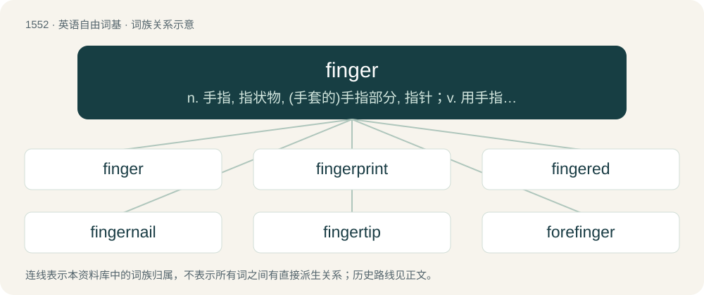

# 1640 · finger — n. 手指, 指状物, (手套的)手指部分, 指针；v. 用手指拨弄, 伸出；\[计\] 网络命令

[总目录](../00_总目录_按常用程度.md)

**类型**：英语自由词基　｜　**来源语言**：见词源记录

## 核心含义与来源

- 核心含义：n. 手指, 指状物, (手套的)手指部分, 指针；v. 用手指拨弄, 伸出；\[计\] 网络命令
- 英文含义：A slender jointed extremity of the human hand, (often) exclusive of the thumb, and the corresponding part, irrespective of including a thumb, in many other animals.
- 词形：finger

**来源记录 1**（名词；A slender jointed extremity of the human hand, (often) exclusive of the thumb, and the corresponding part, irrespective of including a thumb, in many other animals.）

From Middle English fynger, finger, from Old English finger (“finger”), from Proto-West Germanic \*fingr, from Proto-Germanic \*fingraz (“finger”), from Proto-Indo-European \*penkʷrós, from \*pénkʷe (“five”). Cognate with West Frisian finger, German and Low German Finger, Dutch vinger, Danish, Norwegian Bokmål, Norwegian Nynorsk, and Swedish finger, Faroese and Icelandic fingur; see also Old Armenian հինգեր-որդ (hinger-ord, “fifth”). More at five.

## 词族图

## 单词速览（常用到不常用）

| 单词 | 音标 | 释义 |
|---|---|---|
| [finger](#w-1) | 英 /ˈfɪŋɡəː/；美 /ˈfɪŋɡɚ/ | n. 手指, 指状物, (手套的)手指部分, 指针；v. 用手指拨弄, 伸出；\[计\] 网络命令 |
| [fingerprint](#w-2) | 美 /ˈfɪŋɡɚˌpɹɪnt/ | n. 指纹；vt. 采指纹 |
| [fingered](#w-3) | 英 /ˈfɪŋɡəd/；美 /ˈfɪŋɡɚd/ | a. 有指的, 被手指污染的 |
| [fingernail](#w-4) | 美 /ˈfɪŋɡɚˌneɪl/ | n. 手指甲 |
| [fingertip](#w-5) | 美 /ˈfɪŋɡɚˌtɪp/ | n. 指尖, 指套 |
| [forefinger](#w-6) | 英 /ˈfɔːˌfɪŋ.ɡə/；美 /ˈfɔɹˌfɪŋ.ɡɚ/ | n. 食指；\[医\] 食指, 示指 |
| [fingerboard](#w-7) | /ˈfiŋ^əbɔːd/ | n. 指板, 键盘 |
| [fingerless](#w-8) |  | a. 无指的, 失去指的 |

## 逐词详解

### 1. finger

**词性**：名词　｜　**音标**：英 /ˈfɪŋɡəː/；美 /ˈfɪŋɡɚ/

**中文释义**：n. 手指, 指状物, (手套的)手指部分, 指针；v. 用手指拨弄, 伸出；\[计\] 网络命令

**英文义项**：A slender jointed extremity of the human hand, (often) exclusive of the thumb, and the corresponding part, irrespective of including a thumb, in many other animals. / Similar or similar-looking extremities in other animals, particularly

**词源与演化**：

From Middle English fynger, finger, from Old English finger (“finger”), from Proto-West Germanic \*fingr, from Proto-Germanic \*fingraz (“finger”), from Proto-Indo-European \*penkʷrós, from \*pénkʷe (“five”). Cognate with West Frisian finger, German and Low German Finger, Dutch vinger, Danish, Norwegian Bokmål, Norwegian Nynorsk, and Swedish finger, Faroese and Icelandic fingur; see also Old Armenian հինգեր-որդ (hinger-ord, “fifth”). More at five.

**例句**：

> Humans have two hands and ten fingers. Each hand has one thumb and four fingers.

该用例对应义项：A slender jointed extremity of the human hand, (often) exclusive of the thumb, and the corresponding part, irrespective of including a thumb, in many other animals.

### 2. fingerprint

**词性**：名词　｜　**音标**：美 /ˈfɪŋɡɚˌpɹɪnt/

**中文释义**：n. 指纹；vt. 采指纹

**英文义项**：The natural pattern of ridges on the tips of human fingers, unique to each individual. / The pattern left on a surface where an uncovered fingertip has touched, especially as used to identify the person who touched the surface.

**构词拆分**：finger + print

**词源与演化**：

From finger + print.

**用法示例／搭配（非完整句）**：

> acoustic fingerprint

该用例对应义项：A unique combination of features that serves as an identification of something.

### 3. fingered

**词性**：形容词　｜　**音标**：英 /ˈfɪŋɡəd/；美 /ˈfɪŋɡɚd/

**中文释义**：a. 有指的, 被手指污染的

**英文义项**：Having fingers (of the specified kind). / Synonym of digitate.

**构词拆分**：From finger + -ed.

**词源与演化**：

From finger + -ed.

**例句**：

> The fingered roots of giant trees.

该用例对应义项：having or resembling a finger or fingers; often used in combination

### 4. fingernail

**词性**：名词　｜　**音标**：美 /ˈfɪŋɡɚˌneɪl/

**中文释义**：n. 手指甲

**英文义项**：The hard, flat translucent covering near the tip of a human finger, useful for scratching and fine manipulation.

**构词拆分**：finger + nail

**词源与演化**：

From Middle English finger neil(e); equivalent to finger + nail. Compare Middle English nayl of fynger (“fingernail”) and Old English handnæġl (“fingernail”). Compare also Saterland Frisian Fingernail (“fingernail”), West Frisian fingerneil (“fingernail”), Dutch vingernagel (“fingernail”), German Fingernagel (“fingernail”), Danish fingernegl (“fingernail”), Swedish fingernagel (“fingernail”), Norwegian fingernegl (“fingernail”), Icelandic fingurnögl (“fingernail”).

**例句**：

> I always keep a set of fingernail clippers in my guitar case.

### 5. fingertip

**词性**：名词　｜　**音标**：美 /ˈfɪŋɡɚˌtɪp/

**中文释义**：n. 指尖, 指套

**英文义项**：The tip of the human finger.

**构词拆分**：finger + tip

**词源与演化**：

From finger + tip. Compare tiptoe and toetip.

**例句**：

> We want to take some blood from your fingertip for examinination.

### 6. forefinger

**词性**：名词　｜　**音标**：英 /ˈfɔːˌfɪŋ.ɡə/；美 /ˈfɔɹˌfɪŋ.ɡɚ/

**中文释义**：n. 食指；\[医\] 食指, 示指

**英文义项**：The index finger: the first finger next to the thumb.

**构词拆分**：fore- + finger

**词源与演化**：

Mid-15th century, from Middle English forefynger; equivalent to fore- + finger.

**例句**：

> He picked up a butterfly between his thumb and forefinger.

### 7. fingerboard

**词性**：名词　｜　**音标**：/ˈfiŋ^əbɔːd/

**中文释义**：n. 指板, 键盘

**英文义项**：A flat or roughly flat strip on the neck of a stringed instrument, against which the strings are pressed to shorten the vibrating length and produce notes of higher pitches. / A miniature skateboard or snowboard that is propelled by the fingers.

**构词拆分**：finger + board

**词源与演化**：

From finger + board.

### 8. fingerless

**词性**：形容词

**中文释义**：a. 无指的, 失去指的

**英文义项**：Without fingers owing to either a birth defect or amputation. / With holes, such that the fingers are not covered.

**构词拆分**：finger + -less

**词源与演化**：

From finger + -less.

**用法示例／搭配（非完整句）**：

> born with a fingerless hand

该用例对应义项：Without fingers owing to either a birth defect or amputation.
