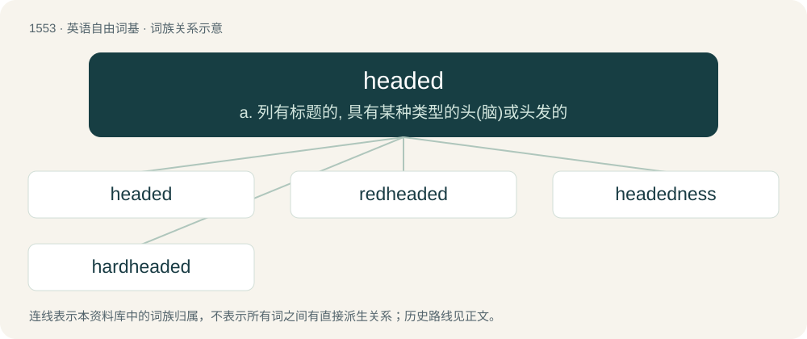

# 1642 · headed — a. 列有标题的, 具有某种类型的头(脑)或头发的

[总目录](../00_总目录_按常用程度.md)

**类型**：英语自由词基　｜　**来源语言**：见词源记录

## 核心含义与来源

- 核心含义：a. 列有标题的, 具有某种类型的头(脑)或头发的
- 英文含义：Of a sheet of paper: having the sender's name, address, etc. preprinted at the top.
- 词形：headed

**多个词源／构词路径**：同一拼写可能有不同来源；以下按词性和含义分别列出。

**来源记录 1**（形容词；Of a sheet of paper: having the sender's name, address, etc. preprinted at the top.）

From head (“noun”) + -ed.

**来源记录 2**（形容词；Heading in a certain direction.）

See head (verb).

## 词族图

## 单词速览（常用到不常用）

| 单词 | 音标 | 释义 |
|---|---|---|
| [headed](#w-1) | /ˈhɛdɪd/ | a. 列有标题的, 具有某种类型的头(脑)或头发的 |
| [redheaded](#w-2) | /ˈredˈhedid/ | a. 红发的, 红头羽毛的 |
| [headedness](#w-3) |  | 【英文】The state or quality of having a particular type of head (in various senses). |
| [hardheaded](#w-4) | /ˈhɑːdˈhedid/ | a. 不易激动的, 冷静的, 脚踏实地的, 无懈可击的 |

## 逐词详解

### 1. headed

**词性**：形容词　｜　**音标**：/ˈhɛdɪd/

**中文释义**：a. 列有标题的, 具有某种类型的头(脑)或头发的

**英文义项**：Of a sheet of paper: having the sender's name, address, etc. preprinted at the top. / Having a head or brain with specified characteristics.

**构词拆分**：head + -ed

**词源与演化**：

From head (“noun”) + -ed.

**用法示例／搭配（非完整句）**：

> a large-headed caricature of a politician

该用例对应义项：Having a head or brain with specified characteristics.

### 2. redheaded

**词性**：形容词　｜　**音标**：/ˈredˈhedid/

**中文释义**：a. 红发的, 红头羽毛的

**英文义项**：Having red hair. / Having a red head.

**构词拆分**：red + headed

**词源与演化**：

From red + headed.

**例句**：

> That little redheaded girl they have over at Cuthbert's is as smart as they make 'em.

### 3. headedness

**词性**：名词

**英文义项**：The state or quality of having a particular type of head (in various senses).

**构词拆分**：headed + -ness

**词源与演化**：

From headed + -ness.

### 4. hardheaded

**词性**：形容词　｜　**音标**：/ˈhɑːdˈhedid/

**中文释义**：a. 不易激动的, 冷静的, 脚踏实地的, 无懈可击的

**英文义项**：Stubborn; wilful. / Realistic; pragmatic.

**构词拆分**：hard + headed

**词源与演化**：

From hard + headed. First appears c. mid-15th century in the writings of Osbern Bokenam.
