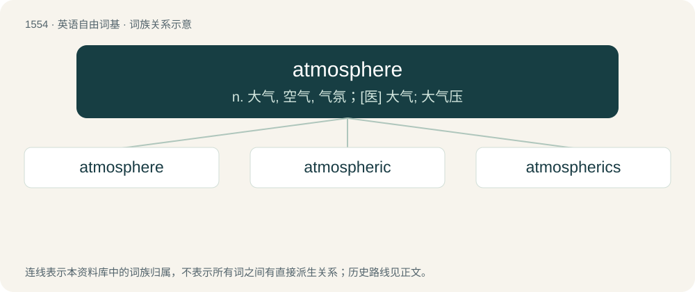

# 1643 · atmosphere — n. 大气, 空气, 气氛；\[医\] 大气; 大气压

[总目录](../00_总目录_按常用程度.md)

**类型**：英语自由词基　｜　**来源语言**：见词源记录

## 核心含义与来源

- 核心含义：n. 大气, 空气, 气氛；\[医\] 大气; 大气压
- 英文含义：The gases surrounding the Earth or any astronomical body.
- 词形：atmosphere

**来源记录 1**（名词；The gases surrounding the Earth or any astronomical body.）

Borrowed from French atmosphère, from New Latin atmosphaera, from Ancient Greek ἀτμός (atmós, “steam”) + σφαῖρα (sphaîra, “sphere”); corresponding to atmo- + -sphere.

## 词族图

## 单词速览（常用到不常用）

| 单词 | 音标 | 释义 |
|---|---|---|
| [atmosphere](#w-1) | 英 /ˈætməsˌfɪə/；美 /ˈætməsˌfɪɹ/ | n. 大气, 空气, 气氛；\[医\] 大气; 大气压 |
| [atmospheric](#w-2) | 英 /ˌætməsˈfɛɹɪk/；/ˌætməsˈfɪɹɪk/ | a. 大气的；\[医\] 大气的; 大气压的 |
| [atmospherics](#w-3) | /,ætməsˈferiks/ | n. 天电, 大气干扰；\[电\] 天电 |

## 逐词详解

### 1. atmosphere

**词性**：名词　｜　**音标**：英 /ˈætməsˌfɪə/；美 /ˈætməsˌfɪɹ/

**中文释义**：n. 大气, 空气, 气氛；\[医\] 大气; 大气压

**英文义项**：The gases surrounding the Earth or any astronomical body. / The air in a particular place.

**构词拆分**：atmo- + -sphere

**词源与演化**：

Borrowed from French atmosphère, from New Latin atmosphaera, from Ancient Greek ἀτμός (atmós, “steam”) + σφαῖρα (sphaîra, “sphere”); corresponding to atmo- + -sphere.

**例句**：

> The atmosphere for the football match was great.

该用例对应义项：The apparent mood felt in an environment.

### 2. atmospheric

**词性**：形容词　｜　**音标**：英 /ˌætməsˈfɛɹɪk/；/ˌætməsˈfɪɹɪk/

**中文释义**：a. 大气的；\[医\] 大气的; 大气压的

**英文义项**：Of, relating to, produced by, or coming from the atmosphere. / Translucent or hazy.

**构词拆分**：atmosphere + -ic

**词源与演化**：

From atmospher(e) + -ic.

**用法示例／搭配（非完整句）**：

> a dark atmospheric thriller

该用例对应义项：Evoking a particular emotional or aesthetic quality.

### 3. atmospherics

**词性**：名词　｜　**音标**：/,ætməsˈferiks/

**中文释义**：n. 天电, 大气干扰；\[电\] 天电

**英文义项**：Radio interference caused by pulses of electromagnetic radiation in the atmosphere as the result of lightning and other events (both natural and man-made) / Elements of the overall background atmosphere.

**构词拆分**：atmosphere + -ics

**词源与演化**：

From atmosphere + -ics.
