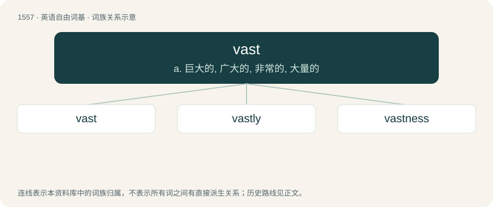

# 1647 · vast — a. 巨大的, 广大的, 非常的, 大量的

[总目录](../00_总目录_按常用程度.md)

**类型**：英语自由词基　｜　**来源语言**：见词源记录

## 核心含义与来源

- 核心含义：a. 巨大的, 广大的, 非常的, 大量的
- 英文含义：Very large or wide (literally or figuratively).
- 词形：vast

**来源记录 1**（形容词；Very large or wide (literally or figuratively).）

From Middle French vaste, from Latin vastus (“void, immense”). Related to waste and German Wüste.

## 词族图

## 单词速览（常用到不常用）

| 单词 | 音标 | 释义 |
|---|---|---|
| [vast](#w-1) | 英 /vɑːst/；美 /væst/ | a. 巨大的, 广大的, 非常的, 大量的 |
| [vastly](#w-2) | 美 /ˈvæstli/ | adv. 广大地, 许多, 巨大 |
| [vastness](#w-3) | /ˈvæstnəs/ | n. 巨大, 广大, 广漠 |

## 逐词详解

### 1. vast

**词性**：形容词　｜　**音标**：英 /vɑːst/；美 /væst/

**中文释义**：a. 巨大的, 广大的, 非常的, 大量的

**英文义项**：Very large or wide (literally or figuratively). / Very great in size, amount, degree, intensity, or especially extent.

**词源与演化**：

From Middle French vaste, from Latin vastus (“void, immense”). Related to waste and German Wüste.

**例句**：

> There is a vast difference between them.

该用例对应义项：Very large or wide (literally or figuratively).

### 2. vastly

**词性**：副词　｜　**音标**：美 /ˈvæstli/

**中文释义**：adv. 广大地, 许多, 巨大

**英文义项**：Greatly, in a vast manner.

**构词拆分**：vast + -ly

**词源与演化**：

From vast + -ly.

**例句**：

> How do you approach learning languages that have vastly different cultural contexts?

### 3. vastness

**词性**：名词　｜　**音标**：/ˈvæstnəs/

**中文释义**：n. 巨大, 广大, 广漠

**英文义项**：The quality of being vast. / Something vast.

**构词拆分**：vast + -ness

**词源与演化**：

From vast + -ness.

**例句**：

> Comments have a mysterious way of getting lost in the vastness of Tatoebastan.
