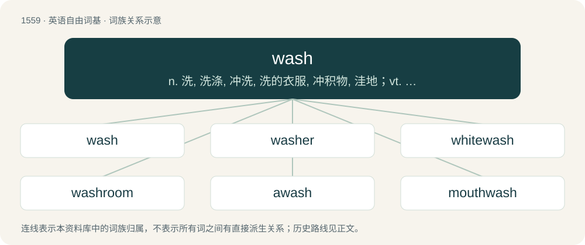

# 1648 · wash — n. 洗, 洗涤, 冲洗, 洗的衣服, 冲积物, 洼地；vt. 洗, 洗涤, 洗清, 用水冲洗, 流过, 弄湿, 粉刷, 镀金属薄层于；vi. 洗涤, 洗澡, 被冲蚀, 漂浮

[总目录](../00_总目录_按常用程度.md)

**类型**：英语自由词基　｜　**来源语言**：见词源记录

## 核心含义与来源

- 核心含义：n. 洗, 洗涤, 冲洗, 洗的衣服, 冲积物, 洼地；vt. 洗, 洗涤, 洗清, 用水冲洗, 流过, 弄湿, 粉刷, 镀金属薄层于；vi. 洗涤, 洗澡, 被冲蚀, 漂浮
- 英文含义：To clean with water.
- 词形：wash

**来源记录 1**（动词；To clean with water.）

From Middle English wasshen, waschen, weschen (“to wash”), from Old English wascan (“to wash”), from Proto-West Germanic \*waskan (“to wash”), from Proto-Germanic \*waskaną, \*watskaną (“to wash, get wet”), from Proto-Indo-European \*wed- (“wet, water”). Cognate with Saterland Frisian waaske (“to wash”), West Frisian waskje (“to wash”), Dutch wassen, wasschen (“to wash”), Low German waschen (“to wash”), German waschen (“to wash”), Danish vaske (“to wash”), Faroese and Icelandic vaska (“to wash”), Norwegian Bokmål vaske (“to wash”), Norwegian Nynorsk vaske, vaska (“to wash”), Swedish vaska (“to wash”). The noun is cognate with Saterland Frisian Waaske (“wash”), West Frisian wask (“wash”), Dutch was (“wash”), Low German Wask, Waske (“wash”), German Wäsche (“wash”), Danish, Norwegian, and Swedish vask (“wash”).

## 词族图

## 单词速览（常用到不常用）

| 单词 | 音标 | 释义 |
|---|---|---|
| [wash](#w-1) | 英 /wɒʃ/；美 /wɑʃ/ | n. 洗, 洗涤, 冲洗, 洗的衣服, 冲积物, 洼地；vt. 洗, 洗涤, 洗清, 用水冲洗, 流过, 弄湿, 粉刷, 镀金属薄层于；vi. 洗涤, 洗澡, 被冲蚀, 漂浮 |
| [washer](#w-2) | 英 /ˈwɒʃə(ɹ)/；美 /ˈwɑʃɚ/ | n. 洗衣人, 垫圈, 洗衣机；\[化\] 洗涤器; 垫圈 |
| [whitewash](#w-3) | 美 /ˈʍaɪtˌwɑʃ/；/ˈwaɪtwɒʃ/ | n. 白色涂料, 粉饰, 得零分的惨败 |
| [washroom](#w-4) | Canada /ˈwɒʃrʊm/ | n. 盥洗室 |
| [awash](#w-5) | /əˈwɒʃ/ | a. 与水面齐平的, 被浪冲打的 |
| [mouthwash](#w-6) | /ˈmajθwɔʃ/ | n. 漱口剂, 洗口药 |
| [brainwash](#w-7) | /ˈbɹeɪnwɒʃ/ | n. 洗脑；vt. 对人洗脑 |
| [washable](#w-8) | /ˈwɔʃəbl/ | a. 可洗的, 耐洗的 |
| [washy](#w-9) | /ˈwɒʃi/ | a. 稀薄的, 水分多的, 多水的, 淡的, 退色的, 乏味的, 脆弱的 |
| [hogwash](#w-10) | 英 /ˈhɒɡ.wɒʃ/；美 /ˈhɔɡ.wɑʃ/ | n. 泔脚, 废话, 空洞的作品 |
| [washcloth](#w-11) | 英 /ˈwɒʃ.klɒθ/；美 /ˈwɔʃ.klɔθ/ | n. 毛巾, 浴巾 |
| [washboard](#w-12) | /ˈwɒːʃbɒːd/ | n. 洗衣板 |
| [backwash](#w-13) | 英 /ˈbæk.wɒʃ/；美 /ˈbæk.wɑʃ/ | n. (划桨引起的)反流, 激流区, 反响；\[机\] 逆吹 |

## 逐词详解

### 1. wash

**词性**：动词　｜　**音标**：英 /wɒʃ/；美 /wɑʃ/

**中文释义**：n. 洗, 洗涤, 冲洗, 洗的衣服, 冲积物, 洼地；vt. 洗, 洗涤, 洗清, 用水冲洗, 流过, 弄湿, 粉刷, 镀金属薄层于；vi. 洗涤, 洗澡, 被冲蚀, 漂浮

**英文义项**：To clean with water. / To carry away or erode by the force of water in motion.

**词源与演化**：

From Middle English wasshen, waschen, weschen (“to wash”), from Old English wascan (“to wash”), from Proto-West Germanic \*waskan (“to wash”), from Proto-Germanic \*waskaną, \*watskaną (“to wash, get wet”), from Proto-Indo-European \*wed- (“wet, water”). Cognate with Saterland Frisian waaske (“to wash”), West Frisian waskje (“to wash”), Dutch wassen, wasschen (“to wash”), Low German waschen (“to wash”), German waschen (“to wash”), Danish vaske (“to wash”), Faroese and Icelandic vaska (“to wash”), Norwegian Bokmål vaske (“to wash”), Norwegian Nynorsk vaske, vaska (“to wash”), Swedish vaska (“to wash”). The noun is cognate with Saterland Frisian Waaske (“wash”), West Frisian wask (“wash”), Dutch was (“wash”), Low German Wask, Waske (“wash”), German Wäsche (“wash”), Danish, Norwegian, and Swedish vask (“wash”).

**例句**：

> Dishwashers wash dishes way more efficiently than most humans.

该用例对应义项：To clean with water.

### 2. washer

**词性**：名词　｜　**音标**：英 /ˈwɒʃə(ɹ)/；美 /ˈwɑʃɚ/

**中文释义**：n. 洗衣人, 垫圈, 洗衣机；\[化\] 洗涤器; 垫圈

**英文义项**：Something that washes; especially an appliance such as a washing machine or dishwasher. / A person who washes (especially clothes) for a living; a washerman or washerwoman.

**构词拆分**：wash + -er

**词源与演化**：

From Middle English wasshere, wassher, equivalent to wash + -er. Cognate with Dutch wasser, German Wäscher.

**例句**：

> The window washer lost his grip and fell to his death.

### 3. whitewash

**词性**：动词　｜　**音标**：美 /ˈʍaɪtˌwɑʃ/；/ˈwaɪtwɒʃ/

**中文释义**：n. 白色涂料, 粉饰, 得零分的惨败

**英文义项**：To paint (a building, a wall, etc.) a bright white with whitewash. / To distort or give a misleading account of (history, a narrative, etc.) by discounting the participation of people of colour and focusing on white people.

**构词拆分**：white (adjective) + wash (noun)；white (adjective) + wash (verb)

**词源与演化**：

The noun is derived from white (adjective) + wash (noun). Noun sense 5.1 (“medicinal preparation for treating skin diseases”) is a calque of New Latin lōtiō alba (literally “white wash”). The verb is derived partly from white (adjective) + wash (verb), and partly from the noun.

**例句**：

> The houses looked very bright after they had whitewashed the whole neighbourhood.

该用例对应义项：To paint (a building, a wall, etc.) a bright white with whitewash.

### 4. washroom

**词性**：名词　｜　**音标**：Canada /ˈwɒʃrʊm/

**中文释义**：n. 盥洗室

**英文义项**：A room intended to wash the face and hands. / A room with a toilet, particularly a public toilet.

**构词拆分**：wash + room

**词源与演化**：

From wash + room in reference to its sinks, but generally used euphemistically outside of Canada and the United States.

**例句**：

> I'm bursting for a wee and I can't find a washroom.

### 5. awash

**词性**：形容词　｜　**音标**：/əˈwɒʃ/

**中文释义**：a. 与水面齐平的, 被浪冲打的

**英文义项**：Washed by the waves or tide (of a rock or strip of shore, or of an anchor, etc., when flush with the surface of the water, so that the waves break over it); covered with water. / Covered, overspread (with or in something).

**构词拆分**：a- + wash

**词源与演化**：

From a- + wash.

**例句**：

> The main deck was afloat (or awash).

该用例对应义项：covered with water

### 6. mouthwash

**词性**：名词　｜　**音标**：/ˈmajθwɔʃ/

**中文释义**：n. 漱口剂, 洗口药

**英文义项**：A liquid used to clean one's mouth.

**构词拆分**：mouth + wash

**词源与演化**：

From mouth + wash.

**例句**：

> Stop using my mouthwash to make mixed drinks. That's not what it's for.

### 7. brainwash

**词性**：动词　｜　**音标**：/ˈbɹeɪnwɒʃ/

**中文释义**：n. 洗脑；vt. 对人洗脑

**英文义项**：To affect one's mind by using extreme mental pressure or any other mind-affecting process. (e.g. hypnosis) / To take from an electronically controlled machine its stored-up information; to erase a computer's programming. (1960)

**构词拆分**：brain + wash

**词源与演化**：

From brain + wash, a calque of Chinese 洗腦 /洗脑 (xǐnǎo), literally to wash the brain. Usage via U.S. military during the Korean War.

**例句**：

> The news media brainwashed many people.

该用例对应义项：To persuade completely and forcibly.

### 8. washable

**词性**：形容词　｜　**音标**：/ˈwɔʃəbl/

**中文释义**：a. 可洗的, 耐洗的

**英文义项**：Capable of being washed without being damaged; especially by a specified method, for example machine-washable.

**构词拆分**：wash + -able

**词源与演化**：

From wash + -able.

**例句**：

> Acrylic blankets are both warm and washable.

该用例对应义项：capable of being washed without injury

### 9. washy

**词性**：形容词　｜　**音标**：/ˈwɒʃi/

**中文释义**：a. 稀薄的, 水分多的, 多水的, 淡的, 退色的, 乏味的, 脆弱的

**英文义项**：Watery; damp; soft. / Lacking substance or strength; weak; thin; dilute; feeble.

**构词拆分**：wash + -y

**词源与演化**：

From wash + -y.

**用法示例／搭配（非完整句）**：

> washy resolutions

该用例对应义项：Lacking substance or strength; weak; thin; dilute; feeble.

### 10. hogwash

**词性**：名词　｜　**音标**：英 /ˈhɒɡ.wɒʃ/；美 /ˈhɔɡ.wɑʃ/

**中文释义**：n. 泔脚, 废话, 空洞的作品

**英文义项**：Foolish talk or writing; nonsense. / A mixture of solid and liquid food scraps fed to pigs; swill.

**构词拆分**：hog + wash

**词源与演化**：

From Middle English \*hoggewasch (found only as Middle English hoggyswasch (“refuse of the kitchen for feeding pigs”, literally “hog's wash”)), equivalent to hog + wash.

**例句**：

> I think that's a lot of hogwash.

### 11. washcloth

**词性**：名词　｜　**音标**：英 /ˈwɒʃ.klɒθ/；美 /ˈwɔʃ.klɔθ/

**中文释义**：n. 毛巾, 浴巾

**英文义项**：A small cloth used to wash the face and body.

**构词拆分**：wash + cloth

**词源与演化**：

From wash + cloth.

**例句**：

> Mary always liked to use a blue washcloth in the shower.

### 12. washboard

**词性**：名词　｜　**音标**：/ˈwɒːʃbɒːd/

**中文释义**：n. 洗衣板

**英文义项**：A board with a corrugated surface against which laundry may be rubbed. / Such a board used as a simple percussion instrument.

**构词拆分**：wash + board

**词源与演化**：

From wash + board.

**用法示例／搭配（非完整句）**：

> washboard road

该用例对应义项：A stretch of ripples or bumps on a dirt or gravel road caused by interaction between traffic and road surface.

### 13. backwash

**词性**：名词　｜　**音标**：英 /ˈbæk.wɒʃ/；美 /ˈbæk.wɑʃ/

**中文释义**：n. (划桨引起的)反流, 激流区, 反响；\[机\] 逆吹

**英文义项**：A backward flow of water, as from oars, a propeller, breaking waves, etc. / The similar flow of air from an aircraft engine.

**构词拆分**：back + wash

**词源与演化**：

From back + wash.

**例句**：

> The waves broke, and the backwash rushed over the sand.
