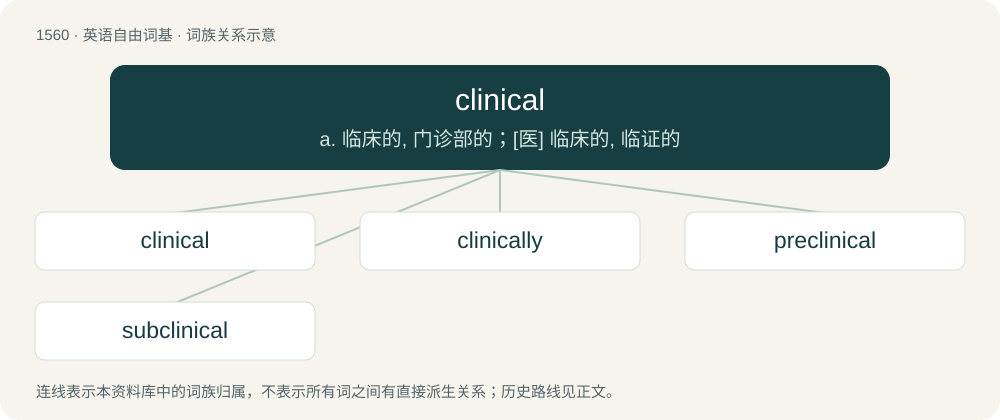

# 1649 · clinical — a. 临床的, 门诊部的；\[医\] 临床的, 临证的

[总目录](../00_总目录_按常用程度.md)

**类型**：英语自由词基　｜　**来源语言**：见词源记录

## 核心含义与来源

- 核心含义：a. 临床的, 门诊部的；\[医\] 临床的, 临证的
- 英文含义：Dealing with the practical management of patients, in practice at the point of care; as contrasted with other health care venues (see clinical medicine for more explanation).
- 词形：clinical

**来源记录 1**（形容词；Dealing with the practical management of patients, in practice at the point of care; as contrasted with other health care venues (see clinical medicine for more explanation).）

From clinic + -al.

## 词族图

## 单词速览（常用到不常用）

| 单词 | 音标 | 释义 |
|---|---|---|
| [clinical](#w-1) | /ˈklɪn.ɪ.kəl/ | a. 临床的, 门诊部的；\[医\] 临床的, 临证的 |
| [clinically](#w-2) |  | adv. 临床, 临诊, 冷静, 不偏不倚, 分析 |
| [preclinical](#w-3) | /priːˈklinikəl/ | a. 临床使用前的；\[医\] 临证前期的, 临床前的 |
| [subclinical](#w-4) | /sʌbˈklinikl/ | a. 无临床症状的, 轻度不正常的, 症状不明显的, 亚临床的；\[医\] 临床症状不显的, 亚临床的 |

## 逐词详解

### 1. clinical

**词性**：形容词　｜　**音标**：/ˈklɪn.ɪ.kəl/

**中文释义**：a. 临床的, 门诊部的；\[医\] 临床的, 临证的

**英文义项**：Dealing with the practical management of patients, in practice at the point of care; as contrasted with other health care venues (see clinical medicine for more explanation). / Of or pertaining to a clinic, such as a medical clinic or law clinic.

**构词拆分**：clinic + -al

**词源与演化**：

From clinic + -al.

**例句**：

> Medicine is now more often practiced in a clinical setting than in the home.

该用例对应义项：Of or pertaining to a clinic, such as a medical clinic or law clinic.

### 2. clinically

**词性**：副词

**中文释义**：adv. 临床, 临诊, 冷静, 不偏不倚, 分析

**英文义项**：In a clinical manner: dispassionately or analytically. / In the setting of a medical clinic; in a clinical setting; (of a health condition) to a degree high enough to be relevant to clinical practice.

**构词拆分**：clinical + -ly

**词源与演化**：

From clinical + -ly.

**例句**：

> Mild electrolyte disturbances are usually not clinically apparent, but if they worsen, symptoms begin.

该用例对应义项：In the setting of a medical clinic; in a clinical setting; (of a health condition) to a degree high enough to be relevant to clinical practice.

### 3. preclinical

**词性**：形容词　｜　**音标**：/priːˈklinikəl/

**中文释义**：a. 临床使用前的；\[医\] 临证前期的, 临床前的

**英文义项**：Describing the period of a disease before any symptoms appear / Describing a test or trial of a new pharmaceutical on animals (or in vitro) rather than on humans

**构词拆分**：pre- + clinical

**词源与演化**：

From pre- + clinical.

### 4. subclinical

**词性**：形容词　｜　**音标**：/sʌbˈklinikl/

**中文释义**：a. 无临床症状的, 轻度不正常的, 症状不明显的, 亚临床的；\[医\] 临床症状不显的, 亚临床的

**英文义项**：Without signs and symptoms that are detectable by physical examination or laboratory test; not clinically manifest. / Where some criteria are met but not enough to reach the status of a clinical diagnosis.

**构词拆分**：sub- + clinical

**词源与演化**：

From sub- + clinical.

**例句**：

> Some conditions may remain subclinical until they resolve without intervention, whereas others worsen from subclinical to clinical status.

该用例对应义项：Without signs and symptoms that are detectable by physical examination or laboratory test; not clinically manifest.
