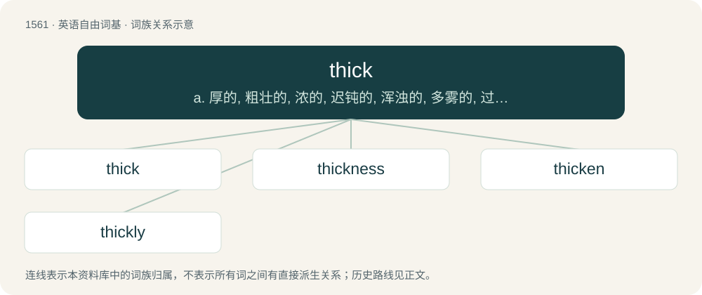

# 1650 · thick — a. 厚的, 粗壮的, 浓的, 迟钝的, 浑浊的, 多雾的, 过分的, 口齿不清的；adv. 厚地, 密地, 浓浓地；n. 最浓处, 最厚处, 最密集处

[总目录](../00_总目录_按常用程度.md)

**类型**：英语自由词基　｜　**来源语言**：见词源记录

## 核心含义与来源

- 核心含义：a. 厚的, 粗壮的, 浓的, 迟钝的, 浑浊的, 多雾的, 过分的, 口齿不清的；adv. 厚地, 密地, 浓浓地；n. 最浓处, 最厚处, 最密集处
- 英文含义：Relatively great in extent from one surface to the opposite in its smallest solid dimension.
- 词形：thick

**来源记录 1**（形容词；Relatively great in extent from one surface to the opposite in its smallest solid dimension.）

From Middle English thikke, from Old English þicce (“thick, dense”), from Proto-West Germanic \*þikkwī, from Proto-Germanic \*þekuz (“thick”), from Proto-Indo-European \*tégus (“thick”). Cognates Cognate with North Frisian sjok, tjok, tjuk, tschok (“thick”), Saterland Frisian tjuk (“thick”), West Frisian dik, tuuk (“thick”), Central Franconian deck (“thick”), Cimbrian dikh, dikhe (“thick”), Dutch dik (“thick”), German dick (“thick”), Luxembourgish déck (“thick”), Yiddish דיק (dik, “thick”), Danish tyk (“thick”), Elfdalian tiokk (“thick”), Faroese tjúkkur (“thick”), Icelandic þykkur (“thick”), Norwegian Bokmål and Norwegian Nynorsk tjukk, tykk (“thick”), Scanian tjykker (“thick”), Swedish tjock (“thick”); also Cornish and Welsh tew (“thick”), Irish tiubh, tiugh (“thick”), Manx çhiu (“thick”), Scottish Gaelic tiugh (“thick”).

## 词族图

## 单词速览（常用到不常用）

| 单词 | 音标 | 释义 |
|---|---|---|
| [thick](#w-1) | 英 /θɪk/ | a. 厚的, 粗壮的, 浓的, 迟钝的, 浑浊的, 多雾的, 过分的, 口齿不清的；adv. 厚地, 密地, 浓浓地；n. 最浓处, 最厚处, 最密集处 |
| [thickness](#w-2) | /ˈθɪknəs/ | n. 厚度, 密度, 愚钝, 含混不清；\[医\] 厚度 |
| [thicken](#w-3) | 美 /ˈθɪkən/ | vi. 变浓, 变厚, 变得模糊, 变为复杂；vt. 使变厚, 加强, 使模糊 |
| [thickly](#w-4) | /ˈθɪkli/ | adv. 厚地；浓地 |

## 逐词详解

### 1. thick

**词性**：形容词　｜　**音标**：英 /θɪk/

**中文释义**：a. 厚的, 粗壮的, 浓的, 迟钝的, 浑浊的, 多雾的, 过分的, 口齿不清的；adv. 厚地, 密地, 浓浓地；n. 最浓处, 最厚处, 最密集处

**英文义项**：Relatively great in extent from one surface to the opposite in its smallest solid dimension. / Measuring a certain number of units in this dimension.

**词源与演化**：

From Middle English thikke, from Old English þicce (“thick, dense”), from Proto-West Germanic \*þikkwī, from Proto-Germanic \*þekuz (“thick”), from Proto-Indo-European \*tégus (“thick”). Cognates Cognate with North Frisian sjok, tjok, tjuk, tschok (“thick”), Saterland Frisian tjuk (“thick”), West Frisian dik, tuuk (“thick”), Central Franconian deck (“thick”), Cimbrian dikh, dikhe (“thick”), Dutch dik (“thick”), German dick (“thick”), Luxembourgish déck (“thick”), Yiddish דיק (dik, “thick”), Danish tyk (“thick”), Elfdalian tiokk (“thick”), Faroese tjúkkur (“thick”), Icelandic þykkur (“thick”), Norwegian Bokmål and Norwegian Nynorsk tjukk, tykk (“thick”), Scanian tjykker (“thick”), Swedish tjock (“thick”); also Cornish and Welsh tew (“thick”), Irish tiubh, tiugh (“thick”), Manx çhiu (“thick”), Scottish Gaelic tiugh (“thick”).

**例句**：

> He had such a thick neck that he had to turn his body to look to the side.

该用例对应义项：Heavy in build; thickset.

### 2. thickness

**词性**：名词　｜　**音标**：/ˈθɪknəs/

**中文释义**：n. 厚度, 密度, 愚钝, 含混不清；\[医\] 厚度

**英文义项**：The property of being thick (in dimension). / A measure of how thick (in dimension) something is.

**构词拆分**：thick + -ness

**词源与演化**：

From Middle English thikkenesse, thiknesse, from Old English þicnes (“thickness, viscosity, density, hardness; obscurity, cloud, darkness; thicket; depth, a thick body, anything thick or heavy”), from Proto-West Germanic \*þikkwīnassī (“thickness”), equivalent to thick + -ness. Cognate with West Frisian tsjokkens (“thickness”), Old High German dickinessī, dikkinissi, diknissi (“thickness, density”). Eclipsed non-native Middle English crassitude (“thickness”) from Latin crassitūdō (“thickness”).

**例句**：

> We upholstered the seat with three thicknesses of cloth to make it more comfortable to sit on.

该用例对应义项：A layer.

### 3. thicken

**词性**：动词　｜　**音标**：美 /ˈθɪkən/

**中文释义**：vi. 变浓, 变厚, 变得模糊, 变为复杂；vt. 使变厚, 加强, 使模糊

**英文义项**：To make thicker (in the sense of wider). / To make thicker (in the sense of more viscous).

**构词拆分**：thick + -en

**词源与演化**：

From Middle English thickenen, thikkenen, perhaps from Old Norse þykkna (“to thicken”); equivalent to thick + -en. Cognate with Swedish tjockna (“to thicken”), Icelandic þykkna (“to thicken”).

**用法示例／搭配（非完整句）**：

> to thicken a sauce

该用例对应义项：To make thicker (in the sense of more viscous).

### 4. thickly

**词性**：副词　｜　**音标**：/ˈθɪkli/

**中文释义**：adv. 厚地；浓地

**英文义项**：In a thick manner.

**构词拆分**：thick + -ly

**词源与演化**：

From Middle English thikly; equivalent to thick + -ly.

**例句**：

> Spread 1/4 lb softened margarine or cooking fat fairly thickly all over the surface.

该用例对应义项：with thickness; in a thick manner
