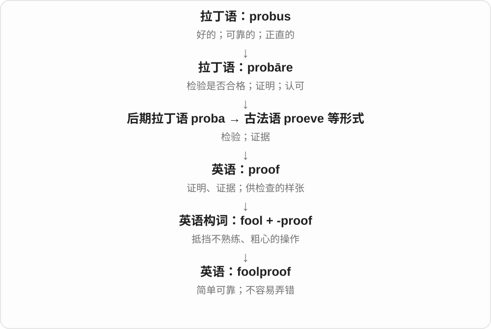

# 1651 · fool — 判断糊涂、受骗和欠考虑的冒险

[逐词精讲目录](../00_逐词精讲目录.md) · [总目录](../00_总目录_按常用程度.md)

## 核心词根与来源

重点放在具体判断和做法，而非只背傻瓜。会被骗、决定不周、轻率逞勇有各自搭配，设计能防误用又是反过来考虑这些问题。

**FOOL：判断没跟上，才会受骗或冒失**

fool → foolish → foolishly/foolishness；foolhardy 是缺少判断的大胆；foolproof 尽量防止误操作。

- **人、行为及其性质**：fool · foolish · foolishly · foolishness
- **风险判断与防误操作**：foolhardy · foolproof
- **fool → fools：人物名到欺骗动词**：fool · fools
- **clown：粗笨者到逗笑演员**：clown · clowns

## 词形与演化规律

follis → fol → fool；fool + -ish；foolish + -ly/-ness；fol hardi → foolhardy；fool + proof。

法语、拉丁风箱或皮囊材料，语义桥梁有推测。

与 fool 比较滑稽、愚蠢，不从拉丁 follis 派生。clown 较早是粗笨乡人、后有职业丑角义，远源有北欧、低地德语等分析，不能定成拉丁 colonus 农夫的直接借词。

## 单词速览（按词族由简到繁）

同一基础词的相关扩展放在一起，先读基础形式，再读扩展；各组之间优先读常用的。具体词源关系见各词讲解。

| 单词 | 音标 | 核心意思 |
|---|---|---|
| [fool](#w-1) | /fuːl/ | 蠢人、傻瓜；弄臣；欺骗；胡闹 |
| [foolish](#w-2) | /ˈfuːlɪʃ/ | 愚蠢的、不明智的；显得傻的 |
| [foolishness](#w-5) | /ˈfuːlɪʃnəs/ | 愚蠢、不明智；愚蠢行为、胡闹 |
| [foolishly](#w-6) | /ˈfuːlɪʃli/ | 愚蠢地、不明智地 |
| [fools](#w-7) | /fuːlz/ | 傻瓜、受骗者、弄臣〔复数〕；欺骗、骗过〔第三人称单数〕 |
| [foolproof](#w-3) | 英 /ˈfuːlpruːf/；美 /ˈfuːlpruːf/ | 容易操作、不易出错的；周全可靠的 |
| [foolhardy](#w-4) | 英 /ˈfuːlhɑːdi/；美 /ˈfuːlhɑːrdi/ | 鲁莽的、冒失逞勇的 |
| [clown](#w-8) | /klaʊn/ | 小丑、丑角；胡闹的人、蠢人；扮丑角、胡闹 |
| [clowns](#w-9) | /klaʊnz/ | 小丑、丑角、胡闹者〔复数〕；胡闹〔第三人称单数〕 |

## 逐词讲解

### 1. fool — 蠢人、傻瓜；弄臣；欺骗；胡闹

**音标**：/fuːl/

**先抓住这个画面**

可能说判断糊涂的人，也可能说被耍了的人；动词 fool you 是让你信了不该信的东西。

**怎么拆**

经古法语 fol 接拉丁 follis 风箱、皮囊，常用空鼓鼓的囊、空脑袋或鼓腮弄臣等解释语义桥梁，但不能当作唯一确证故事。动词由人物名词发展。

**怎么变成今天的意思**

**拉丁 follis → 古法语 fol → 英语 fool**  
风箱、皮囊等 → 蠢人、弄臣，具体语义桥梁有推测

↓

**英语动词与派生**  
愚人、受骗者 → 欺骗；foolish 不明智，foolhardy 莽撞

make a fool of someone 让某人出丑、耍人，fool someone 骗过某人，fool around 胡闹、闲混，April Fool’s Day 愚人节。文学里的 fool 还可指弄臣角色。

**常见搭配与例句**

make a fool of；fool someone；fool around；play the fool。

> The disguise fooled everyone except her brother.

那个伪装骗过了所有人，只有她哥哥看穿了。

> I felt like a fool when I realized my mistake.

意识到错误时，我觉得自己真傻。

**别混淆**

fool 可带侮辱，不能总淡译成可爱傻瓜；fool around 在有些语境还有暧昧或性关系义，需看上下文。full 满的元音不同。

### 2. foolish — 愚蠢的、不明智的；显得傻的

**音标**：/ˈfuːlɪʃ/

**先抓住这个画面**

不是仔细权衡后冒一点风险，而是判断没跟上：这个决定、想法或做法不明智。

**怎么拆**

fool + -ish，对应中古英语 folisch 等；-ish 在这里表具有某种性质，不只是有一点点傻。

**怎么变成今天的意思**

**拉丁 follis → 古法语 fol → 英语 fool**  
风箱、皮囊等 → 蠢人、弄臣，具体语义桥梁有推测

↓

**英语动词与派生**  
愚人、受骗者 → 欺骗；foolish 不明智，foolhardy 莽撞

↓

**fool + -ish → foolish**  
像愚人那样判断不当、不明智

a foolish mistake 愚蠢错误，a foolish decision 不明智的决定，feel foolish 感到自己很傻，it would be foolish to 做……会很不明智。

**常见搭配与例句**

a foolish mistake；a foolish decision；feel foolish。

> It would be foolish to ignore those warnings.

忽视那些提醒会很不明智。

> I felt foolish for getting the date wrong.

把日期弄错了，我觉得自己真傻。

**别混淆**

foolish 可评价一次行为，不一定说一个人永远不聪明；childish 幼稚、naive 天真、rash 轻率各有侧重。

### 3. foolishness — 愚蠢、不明智；愚蠢行为、胡闹

**音标**：/ˈfuːlɪʃnəs/

**先抓住这个画面**

把某一次傻做法或那种判断糊涂的性质打包成名词：这种不明智、这种胡闹。

**怎么拆**

foolish + -ness，性质、状态名词；中古英语已有对应形式。不必理解成许多个 fool 的集合。

**怎么变成今天的意思**

**拉丁 follis → 古法语 fol → 英语 fool**  
风箱、皮囊等 → 蠢人、弄臣，具体语义桥梁有推测

↓

**英语动词与派生**  
愚人、受骗者 → 欺骗；foolish 不明智，foolhardy 莽撞

↓

**foolish + -ness → foolishness**  
不明智的性质，也可指具体愚蠢做法

the foolishness of doing 做某事的不明智，youthful foolishness 年少胡闹，an act of foolishness 一次愚蠢行为。

**常见搭配与例句**

the foolishness of；youthful foolishness；an act of foolishness。

> She recognized the foolishness of trying to do everything alone.

她意识到试图独自包办一切很不明智。

> He laughed at his own youthful foolishness.

他笑起了自己年少时的胡闹。

**别混淆**

foolishness 常不可数；若要明确数一次行为，可说 an act of foolishness。不是 folly、stupidity 在任何语境都能无差别替换。

### 4. foolishly — 愚蠢地、不明智地

**音标**：/ˈfuːlɪʃli/

**先抓住这个画面**

用来回看动作：事情是以判断不周的方式做的，也常透出说话者后悔。

**怎么拆**

foolish + -ly，对应较早英语相应形式。副词修饰动作或整句评价，不是给名词再命名一种人。

**怎么变成今天的意思**

**拉丁 follis → 古法语 fol → 英语 fool**  
风箱、皮囊等 → 蠢人、弄臣，具体语义桥梁有推测

↓

**英语动词与派生**  
愚人、受骗者 → 欺骗；foolish 不明智，foolhardy 莽撞

↓

**fool → foolish → foolishly**  
愚人般不明智 → 不明智地行事

foolishly assume 想当然地误以为，foolishly ignore 愚蠢地忽视，foolishly spend 不明智地花钱。

**常见搭配与例句**

foolishly assume；foolishly ignore；act foolishly。

> I foolishly assumed the shop would still be open.

我想当然地以为商店还开着。

> He foolishly ignored the instructions and had to start again.

他不明智地忽略说明，只好重来。

**别混淆**

He foolishly agreed 是评价他答应得不明智，不一定说答应后没有履约；foolishly 的评价可能来自叙述者。

### 5. fools — 傻瓜、受骗者、弄臣〔复数〕；欺骗、骗过〔第三人称单数〕

**音标**：/fuːlz/

**先抓住这个画面**

做出不明智举动的人，或被人骗住的人，可以被叫 fools。动词 fools 则是让别人信了假的、判断错了。

**怎么拆**

fool 经古法语 fol 接拉丁 follis 风箱、皮囊，空脑袋等语义解释有推测；英语人物名词转欺骗动词。现代加 -s，/l/ 后读 /z/。

**怎么变成今天的意思**

**拉丁 follis → 法语 fol → fool**  
皮囊、风箱材料 → 愚人、弄臣，桥梁有推测

↓

**名词转动词；fool + -s → fools**  
多位愚人或受骗者；某物骗过人

make fools of people 愚弄人；fools the audience 骗过观众；look like fools 看起来像傻瓜。

**常见搭配与例句**

nobody fools her 没人骗得过她；fools in the story 故事里的傻瓜、弄臣。

> The clever trick fools the audience.

这个巧妙戏法骗过了观众的眼睛。

> The play gives its fools some of the wisest lines.

剧本把一些最有智慧的台词给了其中的弄臣角色。

**别混淆**

叫人 fools 通常带贬义。舞台弄臣或故事角色是身份用法，不能把所有出现都当成作者真的在骂人。

### 6. foolproof — 容易操作、不易出错的；周全可靠的

**音标**：英 /ˈfuːlpruːf/；美 /ˈfuːlpruːf/

**先抓住这个画面**

把容易弄错的地方提前堵上，让不熟悉的人也能顺利操作。

**怎么拆**

fool 笨人、不熟练的人 + -proof 能抵挡；原构词带有“不易被错误操作搞坏”的夸张。

**怎么变成今天的意思**

常修饰 method、system、plan。日常经常带夸张语气，不保证世界上绝无失败情形。

**常见搭配与例句**

a foolproof method；a foolproof plan。

> The guide offers a nearly foolproof way to fold the map.

指南提供了一种几乎不会出错的折地图方法。

> No backup plan is completely foolproof.

没有任何备用方案能保证万无一失。

**别混淆**

foolproof 指方法不易出错，不是说使用者真的愚蠢；ordinary mistake 与 fool 是不同层面的评价。

### 7. foolhardy — 鲁莽的、冒失逞勇的

**音标**：英 /ˈfuːlhɑːdi/；美 /ˈfuːlhɑːrdi/

**先抓住这个画面**

胆子走在判断前面，危险还没想明白就冲上去；不是没有勇气，而是勇气缺了分寸。

**怎么拆**

经古法语 fol hardi 愚蠢地大胆，可对应 fool + hardy。hardy 这里联系大胆、勇武那支，不是努力工作的 hard + y。

**怎么变成今天的意思**

**拉丁 follis → 古法语 fol → 英语 fool**  
风箱、皮囊等 → 蠢人、弄臣，具体语义桥梁有推测

↓

**英语动词与派生**  
愚人、受骗者 → 欺骗；foolish 不明智，foolhardy 莽撞

↓

**古法语 fol hardi → foolhardy**  
愚蠢而大胆 → 不顾危险的莽撞

a foolhardy attempt 鲁莽尝试，a foolhardy decision 冒失决定，it would be foolhardy to 不顾危险地做……。

**常见搭配与例句**

a foolhardy attempt；a foolhardy decision；foolhardy courage。

> It would be foolhardy to cross the flooded river.

冒险过那条涨水的河会很鲁莽。

> The rescue was brave, but entering without a plan would have been foolhardy.

营救很勇敢，但毫无计划就进去会是鲁莽。

**别混淆**

brave 可赞扬面对危险；foolhardy 批评未充分考虑危险。两者都可能很大胆，但评价方向不同。

### 8. clown — 小丑、丑角；胡闹的人、蠢人；扮丑角、胡闹

**音标**：/klaʊn/

**先抓住这个画面**

舞台上故意跌跌撞撞逗人笑，是 a clown；生活中嫌某人胡闹、做事蠢，也可能这样叫他，语气就不再是职业名称那么中性。

**怎么拆**

较早有粗笨乡人、举止粗鲁者义，远源未定，可能接北欧、低地德语相似材料；后来发展出舞台职业丑角，再有胡闹、可鄙者等用法。

**怎么变成今天的意思**

**clown 较早：粗笨、举止粗鲁的乡人**  
远源未定，有北欧、低地德语等分析

↓

**舞台职业丑角 → 小丑；再用作蠢人、胡闹者**  
名词又可形成 clown around 胡闹的动作

a circus clown 是马戏小丑；the class clown 是班上爱逗笑的人；clown around 是胡闹、耍宝。

**常见搭配与例句**

a circus clown；a class clown；clown around。

> The clown made the children laugh.

小丑把孩子们逗笑了。

> Stop trying to clown around and listen for a moment.

别再胡闹了，认真听一会儿。

**别混淆**

clown 是职业时不必贬低个人，叫人 You clown! 则可能侮辱；joker 可以偏爱开玩笑，不总有粗笨的感觉。

### 9. clowns — 小丑、丑角、胡闹者〔复数〕；胡闹〔第三人称单数〕

**音标**：/klaʊnz/

**先抓住这个画面**

一群演员是 clowns；一群做事很不靠谱的人被骂 clowns，也是同一名词的贬义引申。

**怎么拆**

clown + -s，/n/ 后读 /z/；职业、评价名词复数与动词三单同形。

**怎么变成今天的意思**

**clown 较早：粗笨、举止粗鲁的乡人**  
远源未定，有北欧、低地德语等分析

↓

**舞台职业丑角 → 小丑；再用作蠢人、胡闹者**  
名词又可形成 clown around 胡闹的动作

↓

**clown + -s → clowns**  
多个小丑、胡闹者；或某人胡闹

circus clowns 说职业；he clowns around 说他总耍宝；these clowns 评价具体人时可能很不客气。

**常见搭配与例句**

circus clowns；a group of clowns；clowns around in class。

> The clowns performed a short routine between the acts.

两场节目之间，小丑们表演了一段短节目。

> He always clowns around when the camera appears.

镜头一出现，他就总要耍宝。

**别混淆**

clowns 与 comedians 都可逗笑，但表演传统不同；comedian 可做脱口秀，不必装扮成小丑。

## 这一组要分清什么

fool 可侮辱；foolish 不只稍微傻；foolhardy 不是单纯赞勇敢；foolproof 日常强调容易正确用，不保证绝对不出错。

## 串起来练习

A foolproof checklist can reduce mistakes, but ignoring it would be foolish.

一份便于正确使用的检查单能减少错误，但无视它就很不明智。
