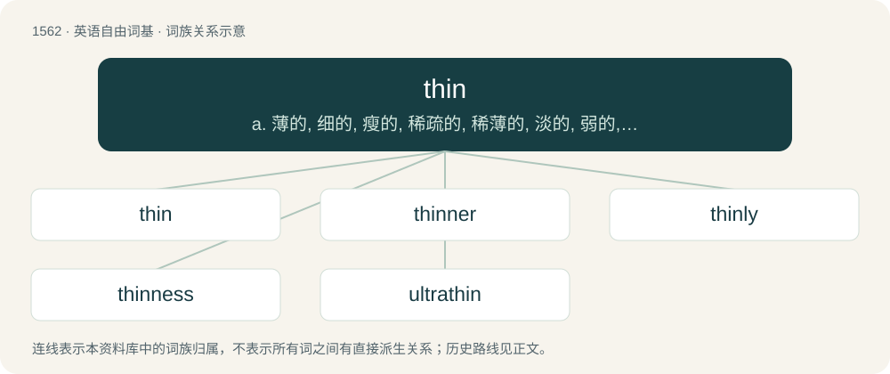

# 1651 · thin — a. 薄的, 细的, 瘦的, 稀疏的, 稀薄的, 淡的, 弱的, 空洞的；vt. 使变薄, 使变细, 使稀少, 使淡；vi. 变薄, 变细, 变少, 变淡

[总目录](../00_总目录_按常用程度.md)

**类型**：英语自由词基　｜　**来源语言**：见词源记录

## 核心含义与来源

- 核心含义：a. 薄的, 细的, 瘦的, 稀疏的, 稀薄的, 淡的, 弱的, 空洞的；vt. 使变薄, 使变细, 使稀少, 使淡；vi. 变薄, 变细, 变少, 变淡
- 英文含义：Having little thickness or extent from one surface to its opposite.
- 词形：thin

**来源记录 1**（形容词；Having little thickness or extent from one surface to its opposite.）

From Middle English thinne, thünne, thenne, from Old English þynne, from Proto-West Germanic \*þunnī, from Proto-Germanic \*þunnuz (“thin”) – compare \*þanjaną (“to stretch, spread out”) – from Proto-Indo-European \*ténh₂us (“thin”), from \*ten- (“to stretch”). Cognate with German dünn, Dutch dun, West Frisian tin, Icelandic þunnur, Danish tynd, Swedish tunn, Latin tenuis, Irish tanaí, Welsh tenau, Latvian tievs, Polish cienki, Russian тонкий (tonkij), Sanskrit तनु (tanú, “thin”), Persian تنگ (tang, “narrow”). Doublet of tenuis. Also related to tenuous.

## 词族图

## 单词速览（常用到不常用）

| 单词 | 音标 | 释义 |
|---|---|---|
| [thin](#w-1) | /ˈθɪn/ | a. 薄的, 细的, 瘦的, 稀疏的, 稀薄的, 淡的, 弱的, 空洞的；vt. 使变薄, 使变细, 使稀少, 使淡；vi. 变薄, 变细, 变少, 变淡 |
| [thinner](#w-2) | 英 /ˈθɪnə(ɹ)/；美 /ˈθɪnɚ/ | n. 稀释剂；\[化\] 稀释剂 |
| [thinly](#w-3) | /ˈθɪnli/ | adv. 薄, 细, 瘦 |
| [thinness](#w-4) | /ˈθinis/ | n. 薄, 细, 瘦；\[医\] 薄, 弱 |
| [ultrathin](#w-5) | /ˈʌltrəθin/ | a. 超薄的,极细的 |

## 逐词详解

### 1. thin

**词性**：形容词　｜　**音标**：/ˈθɪn/

**中文释义**：a. 薄的, 细的, 瘦的, 稀疏的, 稀薄的, 淡的, 弱的, 空洞的；vt. 使变薄, 使变细, 使稀少, 使淡；vi. 变薄, 变细, 变少, 变淡

**英文义项**：Having little thickness or extent from one surface to its opposite. / Very narrow in all diameters; having a cross section that is small in all directions.

**词源与演化**：

From Middle English thinne, thünne, thenne, from Old English þynne, from Proto-West Germanic \*þunnī, from Proto-Germanic \*þunnuz (“thin”) – compare \*þanjaną (“to stretch, spread out”) – from Proto-Indo-European \*ténh₂us (“thin”), from \*ten- (“to stretch”). Cognate with German dünn, Dutch dun, West Frisian tin, Icelandic þunnur, Danish tynd, Swedish tunn, Latin tenuis, Irish tanaí, Welsh tenau, Latvian tievs, Polish cienki, Russian тонкий (tonkij), Sanskrit तनु (tanú, “thin”), Persian تنگ (tang, “narrow”). Doublet of tenuis. Also related to tenuous.

**例句**：

> The trees of a forest are thin; the corn or grass is thin.

该用例对应义项：Scarce; not close, crowded, or numerous; not filling the space.

### 2. thinner

**词性**：名词　｜　**音标**：英 /ˈθɪnə(ɹ)/；美 /ˈθɪnɚ/

**中文释义**：n. 稀释剂；\[化\] 稀释剂

**英文义项**：A liquid substance used to thin the consistency of another liquid. / Something that thins or thins out (another thing).

**构词拆分**：From thin + -er.

**词源与演化**：

From thin + -er.

**例句**：

> The new type of mechanical thinner allowed thinning of peach blossoms to be completed earlier.

该用例对应义项：Something that thins or thins out (another thing).

### 3. thinly

**词性**：副词　｜　**音标**：/ˈθɪnli/

**中文释义**：adv. 薄, 细, 瘦

**英文义项**：In a thin, loose, or scattered manner; scantily; not thickly. / Barely; hardly; with little attempt to conceal.

**构词拆分**：thin + -ly

**词源与演化**：

From Middle English þynnelich (“with thin material; thinly”); equivalent to thin + -ly.

**用法示例／搭配（非完整句）**：

> a thinly-veiled attack on my integrity

该用例对应义项：Barely; hardly; with little attempt to conceal.

### 4. thinness

**词性**：名词　｜　**音标**：/ˈθinis/

**中文释义**：n. 薄, 细, 瘦；\[医\] 薄, 弱

**英文义项**：The state or quality of being thin.

**构词拆分**：thin + -ness

**词源与演化**：

From Middle English thynnesse, from Old English þynnes (“thinness, slightness of density, lack of density, tenuity, fluidity, poverty, feebleness of sight, weakness”), equivalent to thin + -ness.

### 5. ultrathin

**词性**：形容词　｜　**音标**：/ˈʌltrəθin/

**中文释义**：a. 超薄的,极细的

**英文义项**：Extremely thin; of utmost thinness.

**构词拆分**：ultra- + thin

**词源与演化**：

From ultra- + thin.
