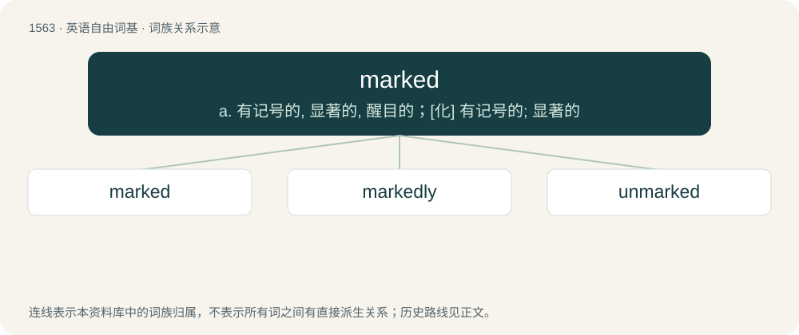

# 1652 · marked — a. 有记号的, 显著的, 醒目的；\[化\] 有记号的; 显著的

[总目录](../00_总目录_按常用程度.md)

**类型**：英语自由词基　｜　**来源语言**：见词源记录

## 核心含义与来源

- 核心含义：a. 有记号的, 显著的, 醒目的；\[化\] 有记号的; 显著的
- 英文含义：Having a visible or identifying mark.
- 词形：marked

**来源记录 1**（形容词；Having a visible or identifying mark.）

From mark (“sign, characteristic, visible impression”) + -ed. Less common disyllabic pronunciation (/ˈmɑː.kɪd/) is likely an analogy derived from markedness (explaining its restriction to sense 2).

## 词族图

## 单词速览（常用到不常用）

| 单词 | 音标 | 释义 |
|---|---|---|
| [marked](#w-1) | 英 /mɑːkt/；美 /mɑɹkt/ | a. 有记号的, 显著的, 醒目的；\[化\] 有记号的; 显著的 |
| [markedly](#w-2) | 英 /ˈmɑː.kɪd.li/；美 /ˈmɑɹ.kɪd.li/ | adv. 显著地, 醒目地, 明显地 |
| [unmarked](#w-3) | /.ʌnˈmɑːkt/ | a. 未被注意的, 无记号的, 无标志的 |

## 逐词详解

### 1. marked

**词性**：形容词　｜　**音标**：英 /mɑːkt/；美 /mɑɹkt/

**中文释义**：a. 有记号的, 显著的, 醒目的；\[化\] 有记号的; 显著的

**英文义项**：Having a visible or identifying mark. / Having a secret mark on the back for cheating.

**构词拆分**：mark (“sign, characteristic, visible impression”) + -ed

**词源与演化**：

From mark (“sign, characteristic, visible impression”) + -ed. Less common disyllabic pronunciation (/ˈmɑː.kɪd/) is likely an analogy derived from markedness (explaining its restriction to sense 2).

**例句**：

> The eighth century BC saw a marked increase in the general wealth of Cyprus.

该用例对应义项：Clearly evident; noticeable; conspicuous.

### 2. markedly

**词性**：副词　｜　**音标**：英 /ˈmɑː.kɪd.li/；美 /ˈmɑɹ.kɪd.li/

**中文释义**：adv. 显著地, 醒目地, 明显地

**英文义项**：In a marked manner; distinctly, noticeably, conspicuously.

**构词拆分**：marked + -ly

**词源与演化**：

From marked + -ly.

**例句**：

> Being markedly different as a teenager can get you taunted; as an adult it can make you famous.

该用例对应义项：In a marked manner; distinctly, noticeably, conspicuously.

### 3. unmarked

**词性**：形容词　｜　**音标**：/.ʌnˈmɑːkt/

**中文释义**：a. 未被注意的, 无记号的, 无标志的

**英文义项**：Not bearing identification. / Free from blemishes.

**构词拆分**：un- + marked

**词源与演化**：

From un- + marked.

**例句**：

> The use of that word in that context was unmarked.

该用例对应义项：Not marked; not standing out as unusual, or contrasting, in a given context.
