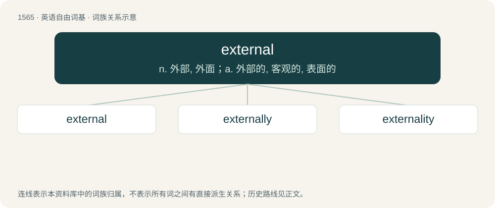

# 1653 · external — n. 外部, 外面；a. 外部的, 客观的, 表面的

[总目录](../00_总目录_按常用程度.md)

**类型**：英语自由词基　｜　**来源语言**：见词源记录

## 核心含义与来源

- 核心含义：n. 外部, 外面；a. 外部的, 客观的, 表面的
- 英文含义：Outside of something; on the exterior.
- 词形：external

**来源记录 1**（形容词；Outside of something; on the exterior.）

From Late Middle English, from Medieval Latin externus (“outward, external”), from exter/exterus (“on the outside, outward”).

## 词族图

## 单词速览（常用到不常用）

| 单词 | 音标 | 释义 |
|---|---|---|
| [external](#w-1) | 英 /ɪkˈstɜː.nəl/；美 /ɛkˈstɜɹ.nəl/ | n. 外部, 外面；a. 外部的, 客观的, 表面的 |
| [externally](#w-2) |  | adv. 在外部, 外表上, 从外面, 在外面, 从外部 |
| [externality](#w-3) | 英 /ɛkstəˈnælɪti/；美 /ɛkstɚˈnælɪti/ | n. 外形, 外在性 |

## 逐词详解

### 1. external

**词性**：形容词　｜　**音标**：英 /ɪkˈstɜː.nəl/；美 /ɛkˈstɜɹ.nəl/

**中文释义**：n. 外部, 外面；a. 外部的, 客观的, 表面的

**英文义项**：Outside of something; on the exterior. / Situated near or toward the surface of the body.

**词源与演化**：

From Late Middle English, from Medieval Latin externus (“outward, external”), from exter/exterus (“on the outside, outward”).

**例句**：

> This building has some external pipework.

该用例对应义项：Outside of something; on the exterior.

### 2. externally

**词性**：副词

**中文释义**：adv. 在外部, 外表上, 从外面, 在外面, 从外部

**英文义项**：on the surface or the outside

**构词拆分**：external + -ly

**词源与演化**：

From external + -ly.

**例句**：

> The candidate needs to be externally evaluated.

该用例对应义项：on or from the outside

### 3. externality

**词性**：名词　｜　**音标**：英 /ɛkstəˈnælɪti/；美 /ɛkstɚˈnælɪti/

**中文释义**：n. 外形, 外在性

**英文义项**：The state of being external or externalized. / A thing that is external relative to something else.

**构词拆分**：external + -ity

**词源与演化**：

From external + -ity. In the economic sense coined by British economist Alfred Marshall in 1890.

**例句**：

> Waste is a negative externality arising from consumption.

该用例对应义项：An impact, positive or negative, on any party not involved in a given economic transaction or act.
