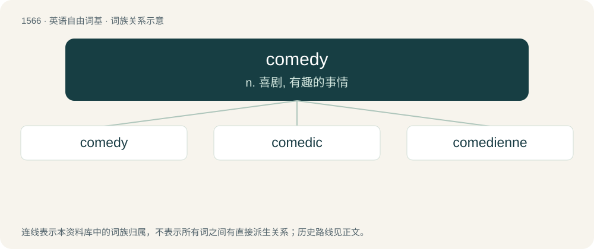

# 1654 · comedy — n. 喜剧, 有趣的事情

[总目录](../00_总目录_按常用程度.md)

**类型**：英语自由词基　｜　**来源语言**：见词源记录

## 核心含义与来源

- 核心含义：n. 喜剧, 有趣的事情
- 英文含义：a light, amusing play with a happy ending
- 词形：comedy

**来源记录 1**（名词；a light, amusing play with a happy ending）

Inherited from Middle English comedie, borrowed from Middle French comedie, from Latin cōmoedia, borrowed from Ancient Greek κωμῳδῐ́ᾱ (kōmōidĭ́ā), from κῶμος (kômos, “revel, carousing”) + ᾠδή (ōidḗ, “song”), or from κῶμος (kômos, “revel, carousing”) + ἀοιδός (aoidós, “singer, bard”). Doublet of commedia.

## 词族图

## 单词速览（常用到不常用）

| 单词 | 音标 | 释义 |
|---|---|---|
| [comedy](#w-1) | 英 /ˈkɒmədi/；美 /ˈkɑmədi/ | n. 喜剧, 有趣的事情 |
| [comedic](#w-2) | 英 /kəˈmiː.dɪk/ | a. 喜剧的 |
| [comedienne](#w-3) | 英 /kəˌmiːdɪˈɛn/；美 /kəˌmiːdiˈɛn/ | n. 喜剧女演员 |

## 逐词详解

### 1. comedy

**词性**：名词　｜　**音标**：英 /ˈkɒmədi/；美 /ˈkɑmədi/

**中文释义**：n. 喜剧, 有趣的事情

**英文义项**：a light, amusing play with a happy ending / a narrative poem with an agreeable ending (e.g., The Divine Comedy)

**词源与演化**：

Inherited from Middle English comedie, borrowed from Middle French comedie, from Latin cōmoedia, borrowed from Ancient Greek κωμῳδῐ́ᾱ (kōmōidĭ́ā), from κῶμος (kômos, “revel, carousing”) + ᾠδή (ōidḗ, “song”), or from κῶμος (kômos, “revel, carousing”) + ἀοιδός (aoidós, “singer, bard”). Doublet of commedia.

**例句**：

> Why would you be watching comedy when there are kids starving right now?

该用例对应义项：entertainment composed of jokes, satire, or humorous performance

### 2. comedic

**词性**：形容词　｜　**音标**：英 /kəˈmiː.dɪk/

**中文释义**：a. 喜剧的

**英文义项**：Relating to comedy.

**构词拆分**：comedy + -ic

**词源与演化**：

From comedy + -ic.

**用法示例／搭配（非完整句）**：

> It was done for comedic purposes

该用例对应义项：Relating to comedy.

### 3. comedienne

**词性**：名词　｜　**音标**：英 /kəˌmiːdɪˈɛn/；美 /kəˌmiːdiˈɛn/

**中文释义**：n. 喜剧女演员

**英文义项**：A female comedian.

**构词拆分**：comedy + -ienne

**词源与演化**：

Borrowed from French comédienne, equivalent to comedy + -ienne. Compare doyenne.
