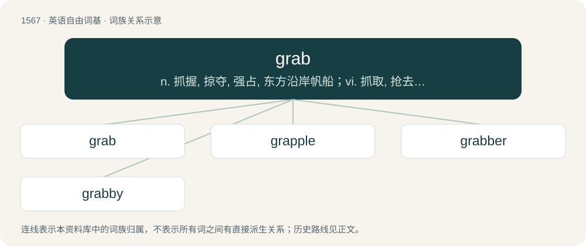

# 1655 · grab — n. 抓握, 掠夺, 强占, 东方沿岸帆船；vi. 抓取, 抢去；vt. 攫取, 捕获, 霸占

[总目录](../00_总目录_按常用程度.md)

**类型**：英语自由词基　｜　**来源语言**：见词源记录

## 核心含义与来源

- 核心含义：n. 抓握, 掠夺, 强占, 东方沿岸帆船；vi. 抓取, 抢去；vt. 攫取, 捕获, 霸占
- 英文含义：To grip suddenly; to seize; to clutch.
- 词形：grab

**多个词源／构词路径**：同一拼写可能有不同来源；以下按词性和含义分别列出。

**来源记录 1**（动词；To grip suddenly; to seize; to clutch.）

From Middle Dutch grabben or Middle Low German grabben (“to grasp, grab, seize, snatch”), from Old Saxon gravan, from Proto-West Germanic \*grabbōn, a secondary form of Proto-Germanic \*grabōną (“to gather, rake”), from Proto-Indo-European \*gʰrebʰ- (“to gather, rake, grab, seize”). Related to archaic German grappen (“to grab”), Danish grabbe (“to grab”), Swedish grabba (“to grab”), Old Norse grápa (“to seize, appropriate”), Middle English grappen (“to feel, grope, grasp, clutch”), Old English ġegræppian (“to seize”). Related also to Sanskrit गृह्णाति (gṛhṇā́ti), गृभ्णाति (gṛbhṇā́ti, “he seizes”), Avestan 𐬔𐬭𐬀𐬠 (grab, “to seize”)), Macedonian грабне (grabne, “to snatch”), Bulgarian грабя (grabja, “to rob, to grab”).

**来源记录 2**（名词；A two- or three-masted vessel used on the Malabar coast.）

From Arabic غُرَاب (ḡurāb) and Hindi ghurb?: crow, raven, a kind of Arab ship.

## 词族图

## 单词速览（常用到不常用）

| 单词 | 音标 | 释义 |
|---|---|---|
| [grab](#w-1) | 英 /ˈɡɹæb/；/ˈɡɹɛəb/ | n. 抓握, 掠夺, 强占, 东方沿岸帆船；vi. 抓取, 抢去；vt. 攫取, 捕获, 霸占 |
| [grapple](#w-2) | 英 /ˈɡɹæpəl/ | v. 抓住, 掌握；n. 抓住, 系紧, 掌握, 与...扭打 |
| [grabber](#w-3) | /ˈɡɹæb.ə(ɹ)/ | n. 贪心者, 强夺者, 强取者；\[计\] 爪钩 |
| [grabby](#w-4) | 美 /ˈɡɹæbi/ | a. 贪婪的 |

## 逐词详解

### 1. grab

**词性**：动词　｜　**音标**：英 /ˈɡɹæb/；/ˈɡɹɛəb/

**中文释义**：n. 抓握, 掠夺, 强占, 东方沿岸帆船；vi. 抓取, 抢去；vt. 攫取, 捕获, 霸占

**英文义项**：To grip suddenly; to seize; to clutch. / To make a sudden grasping or clutching motion (at something).

**词源与演化**：

From Middle Dutch grabben or Middle Low German grabben (“to grasp, grab, seize, snatch”), from Old Saxon gravan, from Proto-West Germanic \*grabbōn, a secondary form of Proto-Germanic \*grabōną (“to gather, rake”), from Proto-Indo-European \*gʰrebʰ- (“to gather, rake, grab, seize”). Related to archaic German grappen (“to grab”), Danish grabbe (“to grab”), Swedish grabba (“to grab”), Old Norse grápa (“to seize, appropriate”), Middle English grappen (“to feel, grope, grasp, clutch”), Old English ġegræppian (“to seize”). Related also to Sanskrit गृह्णाति (gṛhṇā́ti), गृभ्णाति (gṛbhṇā́ti, “he seizes”), Avestan 𐬔𐬭𐬀𐬠 (grab, “to seize”)), Macedonian грабне (grabne, “to snatch”), Bulgarian грабя (grabja, “to rob, to grab”).

**例句**：

> We'll just grab a sandwich and then we'll be on our way.

该用例对应义项：To consume something quickly.

### 2. grapple

**词性**：动词　｜　**音标**：英 /ˈɡɹæpəl/

**中文释义**：v. 抓住, 掌握；n. 抓住, 系紧, 掌握, 与...扭打

**英文义项**：To seize something and hold it firmly. / To wrestle or tussle.

**构词拆分**：grab + -le

**词源与演化**：

From Middle English \*grapplen (“to seize, lay hold of”), from Old English \*græpplian (“to seize”) (compare Old English ġegræppian (“to seize”)), from Proto-Germanic \*graipilōną, \*grabbalōną (“to seize”), from Proto-Indo-European \*gʰrebʰ- (“to take, seize, rake”), equivalent to grab + -le. Cognate with Dutch grabbelen (“to grope, scramble, scrabble”), German grabbeln (“to rummage, grope about”) and grapsen, grapschen (“to seize, grasp, grabble”). Influenced in some senses by grapple (“tool with claws or hooks”, noun) (see below). See further at grasp.

**用法示例／搭配（非完整句）**：

> to grapple with one's conscience

该用例对应义项：To ponder and intensely evaluate a problem; to struggle to deal with.

### 3. grabber

**词性**：名词　｜　**音标**：/ˈɡɹæb.ə(ɹ)/

**中文释义**：n. 贪心者, 强夺者, 强取者；\[计\] 爪钩

**英文义项**：One who, or that which, grabs or seizes. / Something that captures one's attention.

**构词拆分**：grab + -er

**词源与演化**：

From grab + -er.

### 4. grabby

**词性**：名词　｜　**音标**：美 /ˈɡɹæbi/

**中文释义**：a. 贪婪的

**英文义项**：Humanlike hand of some animals, mainly rodents and primates.

**构词拆分**：grab + -y

**词源与演化**：

From grab + -y.
