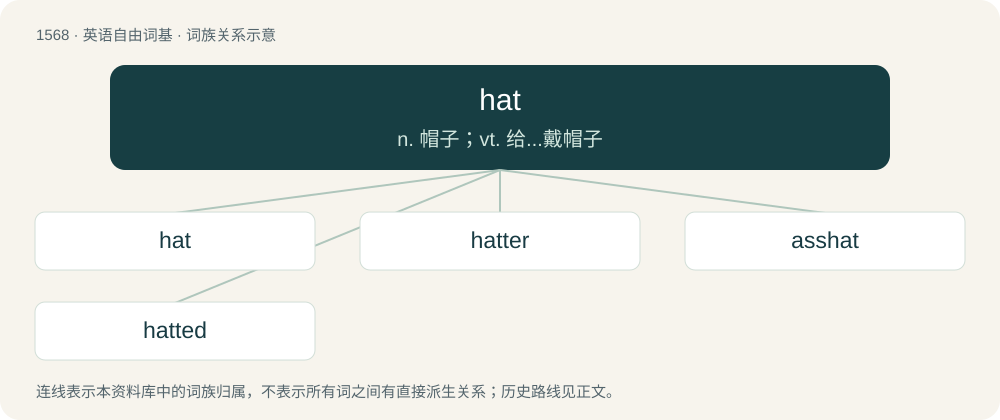

# 1656 · hat — n. 帽子；vt. 给...戴帽子

[总目录](../00_总目录_按常用程度.md)

**类型**：英语自由词基　｜　**来源语言**：见词源记录

## 核心含义与来源

- 核心含义：n. 帽子；vt. 给...戴帽子
- 英文含义：A covering for the head, often in the approximate form of a cone, dome or cylinder closed at its top end, and sometimes having a brim and other decoration.
- 词形：hat

**来源记录 1**（名词；A covering for the head, often in the approximate form of a cone, dome or cylinder closed at its top end, and sometimes having a brim and other decoration.）

From Middle English hat, from Old English hætt, from Proto-Germanic \*hattuz (“hat”), perhaps from a late PIE root Proto-Indo-European \*kedʰ- (“to guard, cover, care for, protect”) or wanderwort. Cognate with North Frisian and Danish hat (“hat”), Norwegian Bokmål, Norwegian Nynorsk, and Swedish hatt (“hat”), Icelandic hattur (“hat”), Finnish hattu (“hat”), Latin cassis (“helmet”), Lithuanian kudas (“bird's crest or tuft”), Avestan 𐬑𐬀𐬊𐬛𐬀 (xaoda, “hat”), Persian خود (xud, “helmet”), Welsh cadw (“to provide for, ensure”). Compare also hood. Verb sense 4 derives from a common English Wikipedia template used to collapse disruptive discussions, {{Hidden archive top}}, abbreviated as {{hat}}.

## 词族图

## 单词速览（常用到不常用）

| 单词 | 音标 | 释义 |
|---|---|---|
| [hat](#w-1) | 英 /hat/；美 /hæt/ | n. 帽子；vt. 给...戴帽子 |
| [hatter](#w-2) | /ˈhætə(ɹ)/ | n. 帽子制造者, 帽商 |
| [asshat](#w-3) | 美 /ˈæshæt/ | 【英文】An obnoxiously ignorant person; a fool. |
| [hatted](#w-4) | /ˈhætid/ | a. 戴着帽子的 |

## 逐词详解

### 1. hat

**词性**：名词　｜　**音标**：英 /hat/；美 /hæt/

**中文释义**：n. 帽子；vt. 给...戴帽子

**英文义项**：A covering for the head, often in the approximate form of a cone, dome or cylinder closed at its top end, and sometimes having a brim and other decoration. / A particular role or capacity that a person might fill.

**词源与演化**：

From Middle English hat, from Old English hætt, from Proto-Germanic \*hattuz (“hat”), perhaps from a late PIE root Proto-Indo-European \*kedʰ- (“to guard, cover, care for, protect”) or wanderwort. Cognate with North Frisian and Danish hat (“hat”), Norwegian Bokmål, Norwegian Nynorsk, and Swedish hatt (“hat”), Icelandic hattur (“hat”), Finnish hattu (“hat”), Latin cassis (“helmet”), Lithuanian kudas (“bird's crest or tuft”), Avestan 𐬑𐬀𐬊𐬛𐬀 (xaoda, “hat”), Persian خود (xud, “helmet”), Welsh cadw (“to provide for, ensure”). Compare also hood. Verb sense 4 derives from a common English Wikipedia template used to collapse disruptive discussions, {{Hidden archive top}}, abbreviated as {{hat}}.

**例句**：

> We're both in the hat: let's hope we come up against each other.

该用例对应义项：The lottery or draw itself.

### 2. hatter

**词性**：名词　｜　**音标**：/ˈhætə(ɹ)/

**中文释义**：n. 帽子制造者, 帽商

**英文义项**：A person who makes, sells, or repairs hats. / A person who lives alone in the bush.

**构词拆分**：hat + -er

**词源与演化**：

From Middle English hatter; equivalent to hat + -er.

**例句**：

> What if I'm my brother's hatter? Yes, I am, but is he my brother?

### 3. asshat

**词性**：名词　｜　**音标**：美 /ˈæshæt/

**英文义项**：An obnoxiously ignorant person; a fool.

**构词拆分**：ass + hat

**词源与演化**：

From ass + hat, from the slang expression have one's head up one's ass, thus, wearing the ass as a hat. The term is extended to people who are clueless or bumbling, who don't understand what is going on.

### 4. hatted

**词性**：形容词　｜　**音标**：/ˈhætid/

**中文释义**：a. 戴着帽子的

**英文义项**：Wearing a hat; wearing a specified type of hat. / Written with a circumflex ('^'). For example, â.

**构词拆分**：hat + -ed

**词源与演化**：

From hat + -ed.

**例句**：

> Two old ladies, neatly hatted and gloved.

该用例对应义项：wearing a hat or a hat of a particular kind
