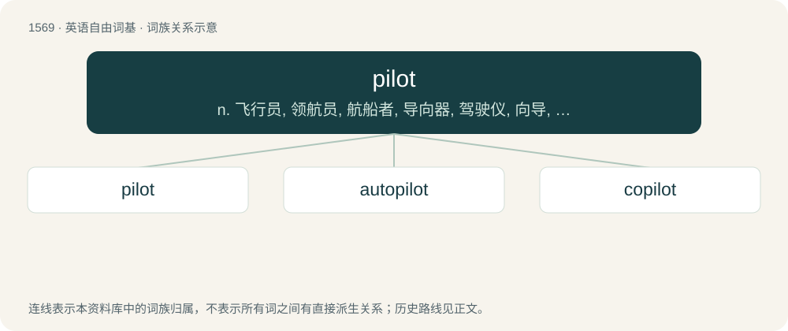

# 1658 · pilot — n. 飞行员, 领航员, 航船者, 导向器, 驾驶仪, 向导, 领导人；vt. 领航, 驾驶, 引导, 试用；a. 引导的, 控制的, 试点的

[总目录](../00_总目录_按常用程度.md)

**类型**：英语自由词基　｜　**来源语言**：见词源记录

## 核心含义与来源

- 核心含义：n. 飞行员, 领航员, 航船者, 导向器, 驾驶仪, 向导, 领导人；vt. 领航, 驾驶, 引导, 试用；a. 引导的, 控制的, 试点的
- 英文含义：A person who steers a ship, a helmsman.
- 词形：pilot

**来源记录 1**（名词；A person who steers a ship, a helmsman.）

From Middle French pilot, pillot, from Italian pilota, piloto, older also pedotta, pedot(t)o (the form in pil- is probably influenced by pileggiare (“to sail, navigate”)); ultimately from unattested Byzantine Greek \*πηδώτης (\*pēdṓtēs, “helmsman”), from Ancient Greek πηδόν (pēdón, “blade of an oar, oar”), hence also Ancient and Modern Greek πηδάλιον (pēdálion, “rudder”).

## 词族图

## 单词速览（常用到不常用）

| 单词 | 音标 | 释义 |
|---|---|---|
| [pilot](#w-1) | /ˈpaɪ̯.lət/ | n. 飞行员, 领航员, 航船者, 导向器, 驾驶仪, 向导, 领导人；vt. 领航, 驾驶, 引导, 试用；a. 引导的, 控制的, 试点的 |
| [autopilot](#w-2) | 英 /ˈɔːtəʊˌpaɪlət/；美 /ˈɔtoʊˌpaɪlət/ | \[化\] 自动驾驶仪 |
| [copilot](#w-3) | /ˈkəupailət/ | n. 副驾驶员 |

## 逐词详解

### 1. pilot

**词性**：名词　｜　**音标**：/ˈpaɪ̯.lət/

**中文释义**：n. 飞行员, 领航员, 航船者, 导向器, 驾驶仪, 向导, 领导人；vt. 领航, 驾驶, 引导, 试用；a. 引导的, 控制的, 试点的

**英文义项**：A person who steers a ship, a helmsman. / A person who knows well the depths, shoals, and currents of a harbor or coastal area, who is hired by a vessel to help navigate the harbor or coast.

**词源与演化**：

From Middle French pilot, pillot, from Italian pilota, piloto, older also pedotta, pedot(t)o (the form in pil- is probably influenced by pileggiare (“to sail, navigate”)); ultimately from unattested Byzantine Greek \*πηδώτης (\*pēdṓtēs, “helmsman”), from Ancient Greek πηδόν (pēdón, “blade of an oar, oar”), hence also Ancient and Modern Greek πηδάλιον (pēdálion, “rudder”).

**例句**：

> We would like to run a pilot in your facility before rolling out the program citywide.

该用例对应义项：Something serving as a test or trial.

### 2. autopilot

**词性**：名词　｜　**音标**：英 /ˈɔːtəʊˌpaɪlət/；美 /ˈɔtoʊˌpaɪlət/

**中文释义**：\[化\] 自动驾驶仪

**英文义项**：A mechanical, electrical, or hydraulic system used to guide a vehicle without assistance from a human being. / A state of mind where one no longer thinks about doing one's actions, but acts mechanically.

**构词拆分**：auto- + pilot

**词源与演化**：

From auto- + pilot.

**例句**：

> I've been doing this 12 hours non-stop, and am so hungry and tired that I've stopped thinking: I'm now on autopilot.

该用例对应义项：A state of mind where one no longer thinks about doing one's actions, but acts mechanically.

### 3. copilot

**词性**：名词　｜　**音标**：/ˈkəupailət/

**中文释义**：n. 副驾驶员

**英文义项**：A backup or assistant pilot of an aircraft. / An assistant, especially one that uses artificial intelligence.

**构词拆分**：From co- + pilot.

**词源与演化**：

From co- + pilot.

**例句**：

> All the passengers died, but the pilot and copilot survived.
