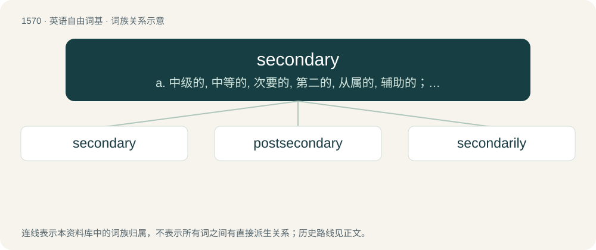

# 1659 · secondary — a. 中级的, 中等的, 次要的, 第二的, 从属的, 辅助的；\[化\] 仲(指CH-3...CH(CH-3)-型支链烃基或指二元胺及R-2CHOH型的醇); 第二

[总目录](../00_总目录_按常用程度.md)

**类型**：英语自由词基　｜　**来源语言**：见词源记录

## 核心含义与来源

- 核心含义：a. 中级的, 中等的, 次要的, 第二的, 从属的, 辅助的；\[化\] 仲(指CH-3...CH(CH-3)-型支链烃基或指二元胺及R-2CHOH型的醇); 第二
- 英文含义：Next in order to the first or primary; of second place in origin, rank, etc.
- 词形：secondary

**来源记录 1**（形容词；Next in order to the first or primary; of second place in origin, rank, etc.）

From Middle English secundarie, from Latin secundārius (“of the second class or quality”), from secundus (whence the English second) + -ārius (whence the English suffix -ary), equivalent to second + -ary; compare the French secondaire, the Italian secondario, the Occitan secundari, the Portuguese secundario, and the Spanish secundario.

## 词族图

## 单词速览（常用到不常用）

| 单词 | 音标 | 释义 |
|---|---|---|
| [secondary](#w-1) | 英 /ˈsɛkənd(ə)ɹɪ/；美 /ˈsɛkənˌdɛɹi/ | a. 中级的, 中等的, 次要的, 第二的, 从属的, 辅助的；\[化\] 仲(指CH-3...CH(CH-3)-型支链烃基或指二元胺及R-2CHOH型的醇); 第二 |
| [postsecondary](#w-2) |  | 高等教育 |
| [secondarily](#w-3) | /ˌsɛkənˈdɛɹəli/ | adv. 在第二, 在其次, 在第二位 |

## 逐词详解

### 1. secondary

**词性**：形容词　｜　**音标**：英 /ˈsɛkənd(ə)ɹɪ/；美 /ˈsɛkənˌdɛɹi/

**中文释义**：a. 中级的, 中等的, 次要的, 第二的, 从属的, 辅助的；\[化\] 仲(指CH-3...CH(CH-3)-型支链烃基或指二元胺及R-2CHOH型的醇); 第二

**英文义项**：Next in order to the first or primary; of second place in origin, rank, etc. / Originating from a deputy or delegated person or body.

**构词拆分**：second + -ary

**词源与演化**：

From Middle English secundarie, from Latin secundārius (“of the second class or quality”), from secundus (whence the English second) + -ārius (whence the English suffix -ary), equivalent to second + -ary; compare the French secondaire, the Italian secondario, the Occitan secundari, the Portuguese secundario, and the Spanish secundario.

**例句**：

> Yellow is a secondary light color, though a primary CMYK color.

该用例对应义项：Formed by mixing primary colors.

### 2. postsecondary

**词性**：形容词

**中文释义**：高等教育

**英文义项**：Of or pertaining to education or educational institutions subsequent to secondary school or high school.

**构词拆分**：post- + secondary

**词源与演化**：

From post- + secondary.

**例句**：

> In its revised budget, the government has increased funding for postsecondary education.

该用例对应义项：Of or pertaining to education or educational institutions subsequent to secondary school or high school.

### 3. secondarily

**词性**：副词　｜　**音标**：/ˌsɛkənˈdɛɹəli/

**中文释义**：adv. 在第二, 在其次, 在第二位

**英文义项**：With lesser importance.

**构词拆分**：By surface analysis, secondar(i) + -ly

**词源与演化**：

From Middle English secundarili. By surface analysis, secondar(i) + -ly.

**例句**：

> Primarily, this will cause deaths; secondarily, it will also cost a lot of money.

该用例对应义项：With lesser importance.
