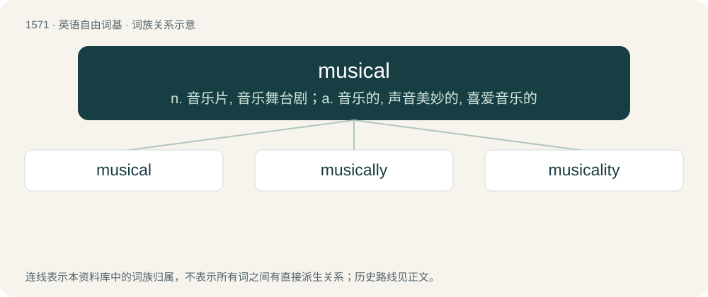

# 1661 · musical — n. 音乐片, 音乐舞台剧；a. 音乐的, 声音美妙的, 喜爱音乐的

[总目录](../00_总目录_按常用程度.md)

**类型**：英语自由词基　｜　**来源语言**：见词源记录

## 核心含义与来源

- 核心含义：n. 音乐片, 音乐舞台剧；a. 音乐的, 声音美妙的, 喜爱音乐的
- 英文含义：Of, belonging or relating to music, or to its performance or notation.
- 词形：musical

**来源记录 1**（形容词；Of, belonging or relating to music, or to its performance or notation.）

From Middle English musical, from Old French \[Term?\], from Medieval Latin mūsicālis, from Latin mūsica (“music”) + -ālis (suffix forming adjectives); equivalent to music + -al.

## 词族图

## 单词速览（常用到不常用）

| 单词 | 音标 | 释义 |
|---|---|---|
| [musical](#w-1) | /ˈmju.zɪ.kəl/ | n. 音乐片, 音乐舞台剧；a. 音乐的, 声音美妙的, 喜爱音乐的 |
| [musically](#w-2) | /ˈmjuːzɪkəli/ | adv. 音乐上 |
| [musicality](#w-3) | /ˌmju.zɪˈkæ.lɪ.ti/ | n. 和谐, 音乐才能, 悦耳 |

## 逐词详解

### 1. musical

**词性**：形容词　｜　**音标**：/ˈmju.zɪ.kəl/

**中文释义**：n. 音乐片, 音乐舞台剧；a. 音乐的, 声音美妙的, 喜爱音乐的

**英文义项**：Of, belonging or relating to music, or to its performance or notation. / Pleasing to the ear; sounding agreeably; having the qualities of music; melodious; harmonious.

**构词拆分**：music + -al

**词源与演化**：

From Middle English musical, from Old French \[Term?\], from Medieval Latin mūsicālis, from Latin mūsica (“music”) + -ālis (suffix forming adjectives); equivalent to music + -al.

**例句**：

> She had a musical voice.

该用例对应义项：Pleasing to the ear; sounding agreeably; having the qualities of music; melodious; harmonious.

### 2. musically

**词性**：副词　｜　**音标**：/ˈmjuːzɪkəli/

**中文释义**：adv. 音乐上

**英文义项**：In a musical manner. / In terms of music.

**构词拆分**：musical + -ly

**词源与演化**：

From Middle English musicallye, musikili; equivalent to musical + -ly.

**例句**：

> The wind chimes tinkled musically in the breeze.

该用例对应义项：In a musical manner.

### 3. musicality

**词性**：名词　｜　**音标**：/ˌmju.zɪˈkæ.lɪ.ti/

**中文释义**：n. 和谐, 音乐才能, 悦耳

**英文义项**：The condition of being musical. / Talent or sensitivity in the playing of music.

**构词拆分**：musical + -ity

**词源与演化**：

From musical + -ity.

**例句**：

> I read the novel out loud to better enjoy the musicality of the language.
