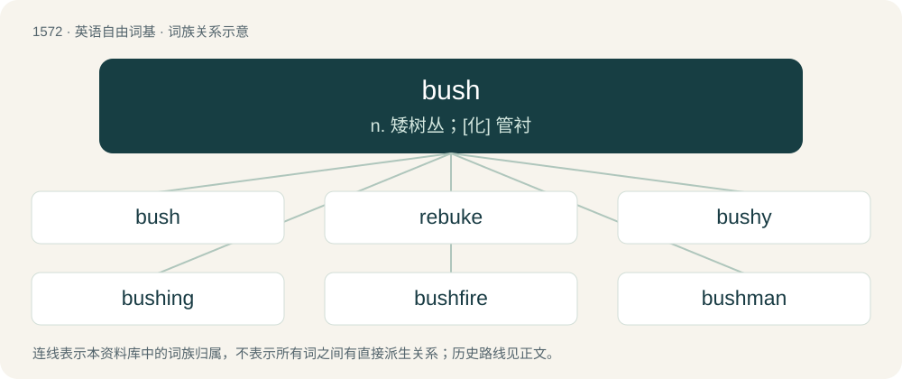

# 1662 · bush — n. 矮树丛；\[化\] 管衬

[总目录](../00_总目录_按常用程度.md)

**类型**：英语自由词基　｜　**来源语言**：见词源记录

## 核心含义与来源

- 核心含义：n. 矮树丛；\[化\] 管衬
- 英文含义：A woody plant distinguished from a tree by its multiple stems and lower height, being usually less than six metres tall; a horticultural rather than strictly botanical category.
- 词形：bush

**多个词源／构词路径**：同一拼写可能有不同来源；以下按词性和含义分别列出。

**来源记录 1**（名词；A woody plant distinguished from a tree by its multiple stems and lower height, being usually less than six metres tall; a horticultural rather than strictly botanical category.）

From Middle English bush, from Old English \*busċ, \*bysċ (“copse, grove, scrub”, in placenames), from Proto-West Germanic \*busk, from Proto-Germanic \*buskaz (“bush, thicket”), probably from Proto-Indo-European \*bʰuH- (“to grow”). Doublet of bosque. Cognates Cognate with Saterland Frisian Busk (“bush”), West Frisian bosk (“forest”), Dutch bos (“forest, wood”), German Busch (“bush, shrub; small forest, grove”), Luxembourgish Bësch (“forest, wood”), Danish, Norwegian Bokmål, and Norwegian Nynorsk busk (“bush, shrub”), Icelandic buski (“bush, shrub”), Swedish buske (“bush, shrub”), Persian بیشه (bêša/biše, “woods”). Latin and Romance forms (Latin boscus, Occitan bòsc, French bois, bûche and buisson, Italian bosco and boscaglia, Spanish bosque, Portuguese bosque) derive from the Germanic. Compare typologically Russian за́росли (zárosli) (akin to расти́ (rastí)). Also compare Russian быльё (bylʹjó) (distantly cognate via \*bʰuH-).

**来源记录 2**（名词；Tracts of land covered in natural vegetation that are largely undeveloped and uncultivated, typically distinguished from absolute wilderness by implying a degree of marginal human engagement or proximity to settlement edges.）

A semantic expansion of bush (see Etymology 1, archaic and dialectal sense of “thicket” or “small wood”), which survived in English dialects and London‐area toponyms (such as Shepherd’s Bush). In its native English form, the term inherently denoted a scrubby, localized feature. In British colonies, this specific sense was applied to the broader landscape, evolving into a mass noun for the wilderness. This development was likely reinforced by, or originated as a semantic loan from, the cognate older Dutch bosch (modern bos (“wood, forest”)), which had undergone a similar semantic shift in the Dutch settlements of North America (such as New Netherland) and later the Cape Colony. From the North American Dutch loan, English acquired the concept of “the bush” as a vast, untamed wilderness. Evidence of this early linguistic integration appears in late 17th‐century English records via compound calques from both major Dutch contact zones: the 1695 North American use of “bushloopers” (anglicized from Dutch boschlooper (“woods‐runner”)) and the 1699 Cape Colony reference to “Wild‐bush‐Men” (translating Cape Dutch Bosjesman). However, as an independent topographical noun describing the South African landscape, the English term is not securely attested until circa 1780. In Australian English, the term was used as early as 1790 by First Lieutenant Ralph Clark. As a native of Edinburgh, Clark would have been familiar with the Scots cognates buss and bush (retaining the archaic sense of a wood or clump of trees); this native linguistic framework likely made him highly receptive to the broader Dutch usage he encountered during his prior military service in the Netherlands and North America. Australia served as the crucible where these semantic threads merged. The widely spaced, scrubby eucalypt woodlands perfectly matched the native British English visual of a low‐canopied thicket, while their vastness fulfilled the Dutch concept of an untamed expanse. This convergence caused the term to rapidly supplant the traditional English woods and forest, as the open Australian landscape differed markedly from the dense, deciduous canopies of Europe. Via early 19th‐century trans‐Tasman trade and settlement routes out of New South Wales, the term was subsequently exported to New Zealand, where it was applied to the region’s dense, temperate rainforests. The adverbial usage of the term (dropping the preposition and article, as in go bush or head bush) likely originated in early 19th‐century New South Wales Pidgin. As documented by contact linguists, this syntax reflects typical pidginization (preposition deletion) alongside the substrate influence of Indigenous Australian languages, which frequently utilize absolute locatives or directional adverbs rather than prepositions for spatial movement. From this contact language, the grammatical shorthand permeated the broader colonial vernacular.

**来源记录 3**（形容词；Not skilled; not professional; not major league.）

Back-formation from bush league.

**来源记录 4**（名词；A thick washer or hollow cylinder of metal.）

From Middle Dutch busse (“box; wheel bushing”), from Proto-West Germanic \*buhsā. More at box.

## 词族图

## 单词速览（常用到不常用）

| 单词 | 音标 | 释义 |
|---|---|---|
| [bush](#w-1) | 英 /ˈbʊʃ/ | n. 矮树丛；\[化\] 管衬 |
| [rebuke](#w-2) | /ɹiˈbjuːk/ | n. 指责, 谴责, 非难；vt. 斥责, 指责, 制止 |
| [bushy](#w-3) | 英 /ˈbʊʃi/ | a. 灌木一样的, 灌木茂密的, 浓密的 |
| [bushing](#w-4) | /ˈbʊʃ.ɪŋ/ | n. 轴衬, 套管；\[化\] 衬套; 管衬; 轴瓦 |
| [bushfire](#w-5) | /ˈbʊʃfaɪər/ | n. 林区大火 |
| [bushman](#w-6) | /ˈbjʃmən/ | n. 澳大利亚丛林中的居民,林区(或边远地区)的人 |
| [bushland](#w-7) | /ˈbjʃlænd/ | n. 未开垦森林地带 |
| [bushcraft](#w-8) | /ˈbjʃkrɑːft/ | n. 丛林谋生知识和技能(如寻找水和食物、觅路或寻找遮蔽处等) |

## 逐词详解

### 1. bush

**词性**：名词　｜　**音标**：英 /ˈbʊʃ/

**中文释义**：n. 矮树丛；\[化\] 管衬

**英文义项**：A woody plant distinguished from a tree by its multiple stems and lower height, being usually less than six metres tall; a horticultural rather than strictly botanical category. / A shrub cut off, or a shrublike branch of a tree.

**词源与演化**：

From Middle English bush, from Old English \*busċ, \*bysċ (“copse, grove, scrub”, in placenames), from Proto-West Germanic \*busk, from Proto-Germanic \*buskaz (“bush, thicket”), probably from Proto-Indo-European \*bʰuH- (“to grow”). Doublet of bosque. Cognates Cognate with Saterland Frisian Busk (“bush”), West Frisian bosk (“forest”), Dutch bos (“forest, wood”), German Busch (“bush, shrub; small forest, grove”), Luxembourgish Bësch (“forest, wood”), Danish, Norwegian Bokmål, and Norwegian Nynorsk busk (“bush, shrub”), Icelandic buski (“bush, shrub”), Swedish buske (“bush, shrub”), Persian بیشه (bêša/biše, “woods”). Latin and Romance forms (Latin boscus, Occitan bòsc, French bois, bûche and buisson, Italian bosco and boscaglia, Spanish bosque, Portuguese bosque) derive from the Germanic. Compare typologically Russian за́росли (zárosli) (akin to расти́ (rastí)). Also compare Russian быльё (bylʹjó) (distantly cognate via \*bʰuH-).

**用法示例／搭配（非完整句）**：

> bushes to support pea vines

该用例对应义项：A shrub cut off, or a shrublike branch of a tree.

### 2. rebuke

**词性**：名词　｜　**音标**：/ɹiˈbjuːk/

**中文释义**：n. 指责, 谴责, 非难；vt. 斥责, 指责, 制止

**英文义项**：A harsh criticism.

**构词拆分**：re- + bush

**词源与演化**：

From Middle English rebuken, from Anglo-Norman rebuker (“to beat back, repel”), from re- + Old French \*buker, buchier, buschier (“to strike, hack down, chop”), from busche (“wood”), from Vulgar Latin \*busca (“wood, grove”), from Frankish \*busk (“grove”), from Proto-Germanic \*buskaz (“bush”); equivalent to re- + bush.

**例句**：

> He had to take the rebuke with a smile on his face.

该用例对应义项：an act or expression of criticism and censure

### 3. bushy

**词性**：形容词　｜　**音标**：英 /ˈbʊʃi/

**中文释义**：a. 灌木一样的, 灌木茂密的, 浓密的

**英文义项**：Like a bush in having many branches that spread out densely in all directions. / Growing thickly.

**构词拆分**：bush + -y

**词源与演化**：

From bush + -y.

**用法示例／搭配（非完整句）**：

> the bushy tail of a squirrel

该用例对应义项：Like a bush in having many branches that spread out densely in all directions.

### 4. bushing

**词性**：名词　｜　**音标**：/ˈbʊʃ.ɪŋ/

**中文释义**：n. 轴衬, 套管；\[化\] 衬套; 管衬; 轴瓦

**英文义项**：A type of plain bearing, a cylindrical lining designed to reduce friction and wear inside a hole, often used as a casing for a shaft, pin or hinge. / An elastic bearing used as a type of vibration isolator, commonly made of rubber. An interface between two parts, damping the movement and the energy transmitted.

**构词拆分**：bush + -ing

**词源与演化**：

From bush (“metal lining of the axle hole of a wheel or touch hole of a gun”) + -ing.

### 5. bushfire

**词性**：名词　｜　**音标**：/ˈbʊʃfaɪər/

**中文释义**：n. 林区大火

**英文义项**：An uncontrolled fire in a wooded or grassy area; a wildfire.

**构词拆分**：bush + fire

**词源与演化**：

From bush + fire.

**例句**：

> Can we repopulate an area after a bushfire?

### 6. bushman

**词性**：名词　｜　**音标**：/ˈbjʃmən/

**中文释义**：n. 澳大利亚丛林中的居民,林区(或边远地区)的人

**英文义项**：A man who lives in or has extensive experience of the Australian bush or outback.

**构词拆分**：bush + -man

**词源与演化**：

From bush + -man.

### 7. bushland

**词性**：名词　｜　**音标**：/ˈbjʃlænd/

**中文释义**：n. 未开垦森林地带

**英文义项**：An area of land in a natural, uncultivated state; wilderness, open forest.

**构词拆分**：bush + land

**词源与演化**：

From bush + land.

**例句**：

> Hundreds of police and volunteers are searching thick bushland for a missing three-year-old boy.

### 8. bushcraft

**词性**：名词　｜　**音标**：/ˈbjʃkrɑːft/

**中文释义**：n. 丛林谋生知识和技能(如寻找水和食物、觅路或寻找遮蔽处等)

**英文义项**：The skills needed to survive in the bush, and by extension in any natural environment.

**构词拆分**：bush + -craft

**词源与演化**：

From bush + -craft.
