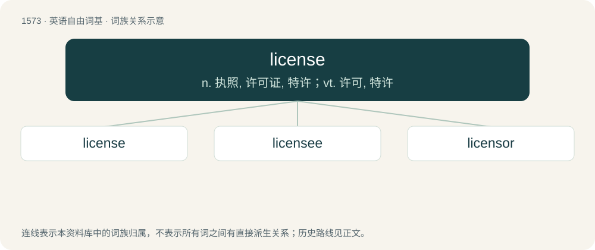

# 1664 · license — n. 执照, 许可证, 特许；vt. 许可, 特许

[总目录](../00_总目录_按常用程度.md)

**类型**：英语自由词基　｜　**来源语言**：见词源记录

## 核心含义与来源

- 核心含义：n. 执照, 许可证, 特许；vt. 许可, 特许
- 英文含义：A legal document giving official permission to do something; a permit.
- 词形：license

**多个词源／构词路径**：同一拼写可能有不同来源；以下按词性和含义分别列出。

**来源记录 1**（名词；A legal document giving official permission to do something; a permit.）

From Middle English licence, licens, lisence, lissens, licance, from Old French licence, from Latin licentia (“license”), from licens, present participle of licere (“to be allowed, be allowable”); compare linquere, Ancient Greek λείπω (leípō, “leave”).

**来源记录 2**（动词；To authorize officially.）

From Middle English licencen, licensen, lisensen, licent, from Old French licencer, licencier, licenciier, licenser, from Medieval Latin licentiō (cf. English licentiate).

## 词族图

## 单词速览（常用到不常用）

| 单词 | 音标 | 释义 |
|---|---|---|
| [license](#w-1) | /ˈlaɪ.səns/ | n. 执照, 许可证, 特许；vt. 许可, 特许 |
| [licensee](#w-2) | /ˌlaɪsənˈsiː/ | n. 获许可的人, 领到执照的人；\[经\] 领有执照(或许可证)者的人 |
| [licensor](#w-3) | /ˈlaɪsənsəɹ/ | \[经\] 许可者, 认可者 |

## 逐词详解

### 1. license

**词性**：名词　｜　**音标**：/ˈlaɪ.səns/

**中文释义**：n. 执照, 许可证, 特许；vt. 许可, 特许

**英文义项**：A legal document giving official permission to do something; a permit. / The legal terms under which a person is allowed to use a product, especially software.

**词源与演化**：

From Middle English licence, licens, lisence, lissens, licance, from Old French licence, from Latin licentia (“license”), from licens, present participle of licere (“to be allowed, be allowable”); compare linquere, Ancient Greek λείπω (leípō, “leave”).

**例句**：

> When liberty becomes license dictatorship is near.

该用例对应义项：excessive freedom; lack of due restraint

### 2. licensee

**词性**：名词　｜　**音标**：/ˌlaɪsənˈsiː/

**中文释义**：n. 获许可的人, 领到执照的人；\[经\] 领有执照(或许可证)者的人

**英文义项**：A person to whom a license is granted. / A publican (because a license is needed to run a pub).

**构词拆分**：From license + -ee.

**词源与演化**：

From license + -ee.

### 3. licensor

**词性**：名词　｜　**音标**：/ˈlaɪsənsəɹ/

**中文释义**：\[经\] 许可者, 认可者

**英文义项**：A party that grants a license to another.

**构词拆分**：license + -or

**词源与演化**：

From license + -or.
