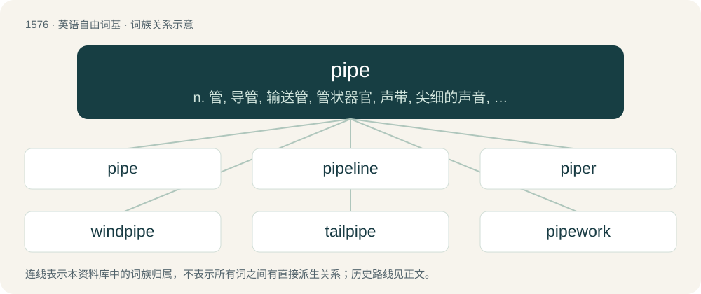

# 1665 · pipe — n. 管, 导管, 输送管, 管状器官, 声带, 尖细的声音, 烟斗, 笛, 管乐器；vt. 以管输送, 吹哨子, 吹奏, 尖声唱；vi. 吹笛, 尖叫, 吹长哨发令

[总目录](../00_总目录_按常用程度.md)

**类型**：英语自由词基　｜　**来源语言**：见词源记录

## 核心含义与来源

- 核心含义：n. 管, 导管, 输送管, 管状器官, 声带, 尖细的声音, 烟斗, 笛, 管乐器；vt. 以管输送, 吹哨子, 吹奏, 尖声唱；vi. 吹笛, 尖叫, 吹长哨发令
- 英文含义：A wind instrument consisting of a tube, often lined with holes to allow for adjustment in pitch, sounded by blowing into the tube.
- 词形：pipe

**来源记录 1**（名词；A wind instrument consisting of a tube, often lined with holes to allow for adjustment in pitch, sounded by blowing into the tube.）

From Middle English pīpe, pype (“hollow cylinder or tube used as a conduit or container; duct or vessel of the body; musical instrument; financial records maintained by the English Exchequer, pipe roll”), from Old English pīpe (“pipe (musical instrument); the channel of a small stream”), from Proto-West Germanic \*pīpā. Reinforced by Vulgar Latin \*pīpa, from Latin pipire, pipiare, pipare, from pīpiō (“to chirp, peep”), of imitative origin. Displaced native Old English fealh and Old English þrūh. Doublet of fife. Cognate with Dutch pijp, German Pfeife, Danish pibe, Norwegian Bokmål and Norwegian Nynorsk pipe, Swedish pipa, Faroese and Icelandic pípa. The “storage container” and “liquid measure” senses are derived from Middle English pīpe (“large storage receptacle, particularly for wine; cask, vat; measure of volume”), from pīpe (above) and Old French pipe (“liquid measure”). In specific contexts, calques similar units of measure such as Portuguese pipa. The verb is from Middle English pīpen, pypyn (“to play a pipe; to make a shrill sound; to speak with a high-pitched tone”), from Old English pīpian (“to pipe”).

## 词族图

## 单词速览（常用到不常用）

| 单词 | 音标 | 释义 |
|---|---|---|
| [pipe](#w-1) | 英 /ˈpaɪp/ | n. 管, 导管, 输送管, 管状器官, 声带, 尖细的声音, 烟斗, 笛, 管乐器；vt. 以管输送, 吹哨子, 吹奏, 尖声唱；vi. 吹笛, 尖叫, 吹长哨发令 |
| [pipeline](#w-2) | /ˈpaɪpˌlaɪn/ | n. 管道, 传递途径；\[化\] 管路; 管线 |
| [piper](#w-3) | 英 /ˈpaɪ.pə/；美 /ˈpaɪ.pɚ/ | n. 吹笛者, 风笛手, 管乐器吹奏者, 管道安装工, 幼鸽 |
| [windpipe](#w-4) | /ˈwɪndpaɪp/ | n. 气管；\[医\] 气管 |
| [tailpipe](#w-5) | /ˈteɪlpaɪp/ | n. \[汽\]排气管 |
| [pipework](#w-6) | /ˈpaɪpwɜːk/ | 管道工程管（组） |
| [drainpipe](#w-7) | 美 /ˈdɹeɪnˌpaɪp/ | n. 排水管 |
| [stovepipe](#w-8) | /ˈstəuvpaip/ | n. 火炉烟囱, 大礼帽 |

## 逐词详解

### 1. pipe

**词性**：名词　｜　**音标**：英 /ˈpaɪp/

**中文释义**：n. 管, 导管, 输送管, 管状器官, 声带, 尖细的声音, 烟斗, 笛, 管乐器；vt. 以管输送, 吹哨子, 吹奏, 尖声唱；vi. 吹笛, 尖叫, 吹长哨发令

**英文义项**：A wind instrument consisting of a tube, often lined with holes to allow for adjustment in pitch, sounded by blowing into the tube. / A tube used to produce sound in an organ; an organ pipe.

**词源与演化**：

From Middle English pīpe, pype (“hollow cylinder or tube used as a conduit or container; duct or vessel of the body; musical instrument; financial records maintained by the English Exchequer, pipe roll”), from Old English pīpe (“pipe (musical instrument); the channel of a small stream”), from Proto-West Germanic \*pīpā. Reinforced by Vulgar Latin \*pīpa, from Latin pipire, pipiare, pipare, from pīpiō (“to chirp, peep”), of imitative origin. Displaced native Old English fealh and Old English þrūh. Doublet of fife. Cognate with Dutch pijp, German Pfeife, Danish pibe, Norwegian Bokmål and Norwegian Nynorsk pipe, Swedish pipa, Faroese and Icelandic pípa. The “storage container” and “liquid measure” senses are derived from Middle English pīpe (“large storage receptacle, particularly for wine; cask, vat; measure of volume”), from pīpe (above) and Old French pipe (“liquid measure”). In specific contexts, calques similar units of measure such as Portuguese pipa. The verb is from Middle English pīpen, pypyn (“to play a pipe; to make a shrill sound; to speak with a high-pitched tone”), from Old English pīpian (“to pipe”).

**例句**：

> A fat pipe is a high-bandwidth connection.

该用例对应义项：A data backbone, or broadband Internet access.

### 2. pipeline

**词性**：名词　｜　**音标**：/ˈpaɪpˌlaɪn/

**中文释义**：n. 管道, 传递途径；\[化\] 管路; 管线

**英文义项**：A conduit made of pipes used to convey water, gas or petroleum, etc. / A channel (either physical or logical) by which information is transmitted sequentially (that is, the first information in is the first information out).

**构词拆分**：pipe + line

**词源与演化**：

From pipe + line.

**例句**：

> A new version of the software is in the pipeline, but has not been rolled out.

该用例对应义项：A system or process through which something is conducted.

### 3. piper

**词性**：名词　｜　**音标**：英 /ˈpaɪ.pə/；美 /ˈpaɪ.pɚ/

**中文释义**：n. 吹笛者, 风笛手, 管乐器吹奏者, 管道安装工, 幼鸽

**英文义项**：A musician who plays a pipe. / A bagpiper.

**构词拆分**：pipe + -er

**词源与演化**：

From Middle English piper, pipere; equivalent to pipe + -er. Piecewise doublet of fifer.

**例句**：

> Piper filed a bill to enjoin Brown from infringing two patents.

### 4. windpipe

**词性**：名词　｜　**音标**：/ˈwɪndpaɪp/

**中文释义**：n. 气管；\[医\] 气管

**英文义项**：The trachea. / Any duct for air or other gas.

**构词拆分**：wind + pipe

**词源与演化**：

From wind + pipe. First attested in the 1520s.

**例句**：

> If you talk while eating, food may go down your windpipe instead of your esophagus.

### 5. tailpipe

**词性**：名词　｜　**音标**：/ˈteɪlpaɪp/

**中文释义**：n. \[汽\]排气管

**英文义项**：An exhaust pipe exhausting to the aft of the vehicle. / An exhaust pipe (on a vehicle) (in any configuration).

**构词拆分**：tail + pipe

**词源与演化**：

From tail + pipe.

**例句**：

> This car doesn't have a tailpipe because it has sidepipes instead.

该用例对应义项：An exhaust pipe exhausting to the aft of the vehicle.

### 6. pipework

**词性**：名词　｜　**音标**：/ˈpaɪpwɜːk/

**中文释义**：管道工程管（组）

**英文义项**：Any system of pipes or tubes; piping. / The pipes and stops of an organ.

**构词拆分**：pipe + work

**词源与演化**：

From pipe + work.

### 7. drainpipe

**词性**：名词　｜　**音标**：美 /ˈdɹeɪnˌpaɪp/

**中文释义**：n. 排水管

**英文义项**：A verticle pipe carrying water from the roof gutter down the side of a building; downspout. / A conduit for carrying rainwater or flood water.

**构词拆分**：drain + pipe

**词源与演化**：

From drain + pipe.

**例句**：

> Rainwater flows from the gutter, down the drainpipe and into the sewer.

### 8. stovepipe

**词性**：名词　｜　**音标**：/ˈstəuvpaip/

**中文释义**：n. 火炉烟囱, 大礼帽

**英文义项**：Sheet-metal tubing used as a chimney for a stove or furnace. / A channel for information which is compartmentalized in such a manner that some parties who might be interested in its use or able to make use of it are restricted from accessing it.

**构词拆分**：stove + pipe

**词源与演化**：

From stove + pipe. The firearms sense is due to the trapped cartridge case resembling a stovepipe of the stove sense.
