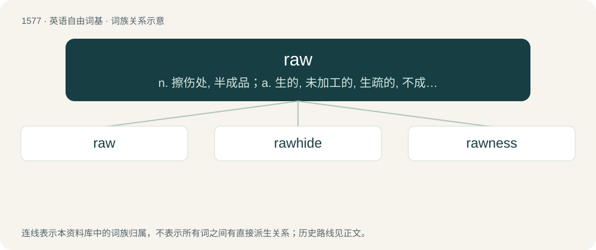

# 1666 · raw — n. 擦伤处, 半成品；a. 生的, 未加工的, 生疏的, 不成熟的, 阴冷的, 刺痛的, 擦掉皮的；vt. 擦伤

[总目录](../00_总目录_按常用程度.md)

**类型**：英语自由词基　｜　**来源语言**：见词源记录

## 核心含义与来源

- 核心含义：n. 擦伤处, 半成品；a. 生的, 未加工的, 生疏的, 不成熟的, 阴冷的, 刺痛的, 擦掉皮的；vt. 擦伤
- 英文含义：(of food) Not cooked.
- 词形：raw

**来源记录 1**（形容词；(of food) Not cooked.）

From Middle English rawe, raw, rau, from Old English hrēaw (“raw, uncooked”), from Proto-West Germanic \*hrau, from Proto-Germanic \*hrawaz, \*hrēwaz (“raw”), from Proto-Indo-European \*krewh₂- (“raw meat, fresh blood”). Cognate with Scots raw (“raw”), Dutch rauw (“raw”), German roh (“raw”), Danish, Norwegian Bokmål, Norwegian Nynorsk, and Swedish rå (“raw”), Faroese ráur (“raw”), Icelandic hrár (“raw”), Latin crūdus (“raw, bloody, uncooked”), Irish cró (“blood”), Lithuanian kraujas (“blood”), Russian кровь (krovʹ, “blood”). Related also to Old English hrēow, hrēoh (“rough, fierce, wild, angry, disturbed, troubled, sad, stormy, tempestuous”). More at ree. Doublet of crude.

## 词族图

## 单词速览（常用到不常用）

| 单词 | 音标 | 释义 |
|---|---|---|
| [raw](#w-1) | 英 /ɹɔː/；美 /ɹɔ/ | n. 擦伤处, 半成品；a. 生的, 未加工的, 生疏的, 不成熟的, 阴冷的, 刺痛的, 擦掉皮的；vt. 擦伤 |
| [rawhide](#w-2) | 英 /ˈɹɔːhaɪd/；美 /ˈɹɔhaɪd/ | n. 生皮, 生皮鞭；vt. (用生皮鞭)抽打 |
| [rawness](#w-3) | /ˈrɒːnis/ | n. 生, 半生不熟, 无经验 |

## 逐词详解

### 1. raw

**词性**：形容词　｜　**音标**：英 /ɹɔː/；美 /ɹɔ/

**中文释义**：n. 擦伤处, 半成品；a. 生的, 未加工的, 生疏的, 不成熟的, 阴冷的, 刺痛的, 擦掉皮的；vt. 擦伤

**英文义项**：(of food) Not cooked. / Subsisting on, or pertaining to, a diet of raw food.

**词源与演化**：

From Middle English rawe, raw, rau, from Old English hrēaw (“raw, uncooked”), from Proto-West Germanic \*hrau, from Proto-Germanic \*hrawaz, \*hrēwaz (“raw”), from Proto-Indo-European \*krewh₂- (“raw meat, fresh blood”). Cognate with Scots raw (“raw”), Dutch rauw (“raw”), German roh (“raw”), Danish, Norwegian Bokmål, Norwegian Nynorsk, and Swedish rå (“raw”), Faroese ráur (“raw”), Icelandic hrár (“raw”), Latin crūdus (“raw, bloody, uncooked”), Irish cró (“blood”), Lithuanian kraujas (“blood”), Russian кровь (krovʹ, “blood”). Related also to Old English hrēow, hrēoh (“rough, fierce, wild, angry, disturbed, troubled, sad, stormy, tempestuous”). More at ree. Doublet of crude.

**例句**：

> There's nothing but raw fish in the freezer.

该用例对应义项：(of food) Not cooked.

### 2. rawhide

**词性**：名词　｜　**音标**：英 /ˈɹɔːhaɪd/；美 /ˈɹɔhaɪd/

**中文释义**：n. 生皮, 生皮鞭；vt. (用生皮鞭)抽打

**英文义项**：Untanned hide. / A whip made from twisted untanned leather.

**构词拆分**：raw + hide

**词源与演化**：

From raw + hide.

### 3. rawness

**词性**：名词　｜　**音标**：/ˈrɒːnis/

**中文释义**：n. 生, 半生不熟, 无经验

**英文义项**：The property of being raw.

**构词拆分**：raw + -ness

**词源与演化**：

From raw + -ness.

**例句**：

> The rawness of his diary made it unpublishable.

该用例对应义项：the state of being crude and incomplete and imperfect
