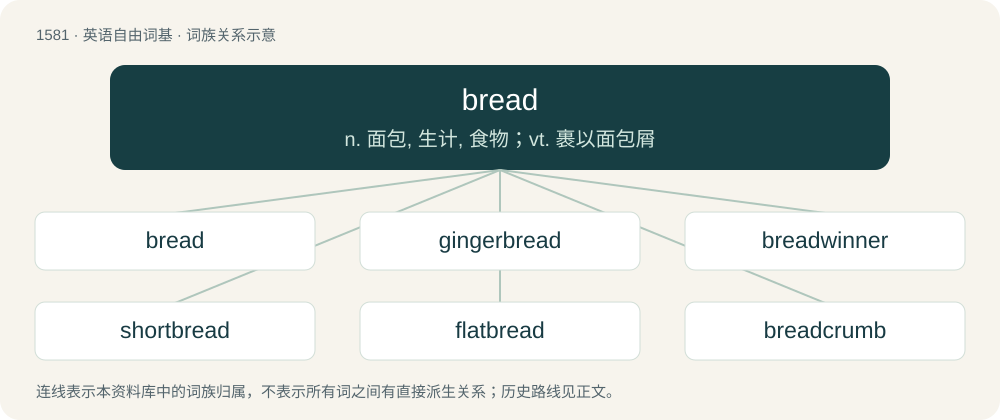

# 1668 · bread — n. 面包, 生计, 食物；vt. 裹以面包屑

[总目录](../00_总目录_按常用程度.md)

**类型**：英语自由词基　｜　**来源语言**：见词源记录

## 核心含义与来源

- 核心含义：n. 面包, 生计, 食物；vt. 裹以面包屑
- 英文含义：A foodstuff made by baking dough made from cereals.
- 词形：bread

**多个词源／构词路径**：同一拼写可能有不同来源；以下按词性和含义分别列出。

**来源记录 1**（名词；A foodstuff made by baking dough made from cereals.）

From Middle English bred, breed, from Old English brēad (“fragment, bit, morsel, crumb", also "bread”), from Proto-West Germanic \*braud, from Proto-Germanic \*braudą (“bread”), from Proto-Indo-European \*bʰerw-, \*bʰrewh₁- (“to boil; to brew”), from \*bʰer- (“to bear, carry”). Alternatively, from Proto-Germanic \*braudaz, \*brauþaz (“broken piece, fragment”), from Proto-Indo-European \*bʰera- (“to split, beat, hew, struggle”) (see brittle). Perhaps a conflation of the two. Possibly a doublet of broa. Cognates Cognate with Scots breid (“bread”), Yola breed (“bread”), North Frisian bruad, Bruar, brüüdj (“bread”), Saterland Frisian Brood (“bread”), West Frisian brea (“bread”), Alemannic German brot, broud, bruat, bròt, bröt (“bread”), Cimbrian proat, pròat (“bread”), Dutch brood (“bread”), German Brot (“bread”), German Low German Brod, Brood, Broot, Brot, Bräot (“bread”), Limburgish broed (“bread”), Luxembourgish Brout (“bread”), Mòcheno proat (“bread”), Vilamovian brūt (“bread; loaf”), Yiddish ברויט (broyt, “bread”), Danish and Norwegian Bokmål brød (“bread”), Elfdalian broð (“bread”), Faroese breyð (“bread”), Icelandic brauð (“bread”), Norn brau, brow (“bread”), Norwegian Nynorsk braud, brød (“bread”), Swedish bröd (“bread”), Crimean Gothic broe (“bread”); also Cornish brys (“thought; mind”), Irish and Scottish Gaelic beir (“bear, give birth to”), Welsh bryd (“aim, intent”), Latin fors (“chance, luck”), Greek φέρνω (férno), φέρω (féro, “to bear, carry”), Albanian brydh (“to ripen, soften; to crumble”), Latvian bērt (“to pour; to scatter, strew”), Lithuanian berti (“to scatter, strew”), Belarusian бру́ха (brúxa, “belly”), Czech břich, břicho, břuch (“belly”), Kashubian brzëch (“belly”), Polish brzuch, brzucho (“belly”), Russian брю́хо (brjúxo, “belly”), Slovak brucho (“belly”), Armenian բերել (berel, “to bring, fetch”), Persian بردن (bordan/burdan, “to bear, carry”), Tocharian A and Tocharian B pär- (“to bear; to wear”), Sanskrit भारयति (bhārayati, “to carry”). Eclipsed non-native Middle English payn (“bread”), borrowed from Old French pain (“bread”). In this sense, mostly replaced loaf, which had been the more common term in Old English (see hlāf), a process which similarly occured in other languages such as German.

**来源记录 2**（动词；To form in meshes; net.）

Variant of braid, from Middle English breden, from Old English brēdan, breġdan (“to braid”).

## 词族图

## 单词速览（常用到不常用）

| 单词 | 音标 | 释义 |
|---|---|---|
| [bread](#w-1) | 英 /bɹɛd/ | n. 面包, 生计, 食物；vt. 裹以面包屑 |
| [gingerbread](#w-2) | 英 /ˈd͡ʒɪn.(d͡)ʒəˌbɹɛd/；美 /ˈd͡ʒɪn.d͡ʒɚˌbɹɛd/ | n. 姜饼, 俗艳的装饰；a. 俗艳的, 华而不实的 |
| [breadwinner](#w-3) | 美 /ˈbɹɛdˌwɪnɚ/ | n. 负担家计的人 |
| [shortbread](#w-4) | /ˈʃɒːtbred/ | n. 白脱甜酥饼 |
| [flatbread](#w-5) | /flætbˈred/ | n. 大饼, 扁面包 |
| [breadcrumb](#w-6) | 美 /ˈbɹɛdˌkɹʌm/ | n. 面包屑 |
| [breadboard](#w-7) | /ˈbredbɔːd/ | \[计\] 实验电路板 |
| [breadbasket](#w-8) | 英 /ˈbɹɛdbɑːskɪt/；美 /ˈbɹɛdˌbæskɪt/ | n. &lt;俚&gt;胃, 腹 |

## 逐词详解

### 1. bread

**词性**：名词　｜　**音标**：英 /bɹɛd/

**中文释义**：n. 面包, 生计, 食物；vt. 裹以面包屑

**英文义项**：A foodstuff made by baking dough made from cereals. / Such foodstuff that is not difficult to chew, being not extremely hard, dense, and dry.

**词源与演化**：

From Middle English bred, breed, from Old English brēad (“fragment, bit, morsel, crumb", also "bread”), from Proto-West Germanic \*braud, from Proto-Germanic \*braudą (“bread”), from Proto-Indo-European \*bʰerw-, \*bʰrewh₁- (“to boil; to brew”), from \*bʰer- (“to bear, carry”). Alternatively, from Proto-Germanic \*braudaz, \*brauþaz (“broken piece, fragment”), from Proto-Indo-European \*bʰera- (“to split, beat, hew, struggle”) (see brittle). Perhaps a conflation of the two. Possibly a doublet of broa. Cognates Cognate with Scots breid (“bread”), Yola breed (“bread”), North Frisian bruad, Bruar, brüüdj (“bread”), Saterland Frisian Brood (“bread”), West Frisian brea (“bread”), Alemannic German brot, broud, bruat, bròt, bröt (“bread”), Cimbrian proat, pròat (“bread”), Dutch brood (“bread”), German Brot (“bread”), German Low German Brod, Brood, Broot, Brot, Bräot (“bread”), Limburgish broed (“bread”), Luxembourgish Brout (“bread”), Mòcheno proat (“bread”), Vilamovian brūt (“bread; loaf”), Yiddish ברויט (broyt, “bread”), Danish and Norwegian Bokmål brød (“bread”), Elfdalian broð (“bread”), Faroese breyð (“bread”), Icelandic brauð (“bread”), Norn brau, brow (“bread”), Norwegian Nynorsk braud, brød (“bread”), Swedish bröd (“bread”), Crimean Gothic broe (“bread”); also Cornish brys (“thought; mind”), Irish and Scottish Gaelic beir (“bear, give birth to”), Welsh bryd (“aim, intent”), Latin fors (“chance, luck”), Greek φέρνω (férno), φέρω (féro, “to bear, carry”), Albanian brydh (“to ripen, soften; to crumble”), Latvian bērt (“to pour; to scatter, strew”), Lithuanian berti (“to scatter, strew”), Belarusian бру́ха (brúxa, “belly”), Czech břich, břicho, břuch (“belly”), Kashubian brzëch (“belly”), Polish brzuch, brzucho (“belly”), Russian брю́хо (brjúxo, “belly”), Slovak brucho (“belly”), Armenian բերել (berel, “to bring, fetch”), Persian بردن (bordan/burdan, “to bear, carry”), Tocharian A and Tocharian B pär- (“to bear; to wear”), Sanskrit भारयति (bhārayati, “to carry”). Eclipsed non-native Middle English payn (“bread”), borrowed from Old French pain (“bread”). In this sense, mostly replaced loaf, which had been the more common term in Old English (see hlāf), a process which similarly occured in other languages such as German.

**例句**：

> We made sandwiches with the bread we bought from the bakery.

该用例对应义项：Such foodstuff that is not difficult to chew, being not extremely hard, dense, and dry.

### 2. gingerbread

**词性**：名词　｜　**音标**：英 /ˈd͡ʒɪn.(d͡)ʒəˌbɹɛd/；美 /ˈd͡ʒɪn.d͡ʒɚˌbɹɛd/

**中文释义**：n. 姜饼, 俗艳的装饰；a. 俗艳的, 华而不实的

**英文义项**：A type of cake whose main flavoring is ginger. / A flamboyant Victorian-era architectural style.

**构词拆分**：ginger + bread

**词源与演化**：

From Middle English gyngebred, gyngebrede, from Old French gingembras, gingimbrat (“preserved ginger”), from Medieval Latin \*gingimbrātus (“gingered”, presumably referring to ginger that perhaps had a pharmaceutical use for some medicinal preparation), with the intrusive m added to gingiber, from Latin zingiber (“ginger”), of earlier Sanskrit origin, through Ancient Greek ζιγγίβερις (zingíberis). The third syllable was earlier confounded with bread, and the insertion of an r in the second syllable completed the semblance of a compound word: ginger + bread.

**例句**：

> The house of the witch is a gingerbread house in a forest.

### 3. breadwinner

**词性**：名词　｜　**音标**：美 /ˈbɹɛdˌwɪnɚ/

**中文释义**：n. 负担家计的人

**英文义项**：The primary income-earner in a household.

**构词拆分**：bread + winner

**词源与演化**：

From bread + winner, where to win = to earn. Compare West Frisian breawinning (“livelihood”, literally “bread-winning”), Dutch broodwinning (“livelihood”).

**例句**：

> Tom became the breadwinner of the family when his father died.

### 4. shortbread

**词性**：名词　｜　**音标**：/ˈʃɒːtbred/

**中文释义**：n. 白脱甜酥饼

**英文义项**：A type of biscuit (cookie), popular in Britain, traditionally made from one part sugar, two parts butter and three parts flour.

**构词拆分**：short + bread

**词源与演化**：

From short (“brittle, of pastry”) + bread.

**例句**：

> We stuffed ourselves with nougat and shortbread cookies during Christmas Holidays.

### 5. flatbread

**词性**：名词　｜　**音标**：/flætbˈred/

**中文释义**：n. 大饼, 扁面包

**英文义项**：A thin, flat bread, often made from unleavened dough.

**构词拆分**：flat + bread

**词源与演化**：

From flat + bread.

### 6. breadcrumb

**词性**：名词　｜　**音标**：美 /ˈbɹɛdˌkɹʌm/

**中文释义**：n. 面包屑

**英文义项**：A tiny piece of bread, either one that falls from bread as it is cut or eaten, or one made deliberately by crumbling bread. / A single link in a chain indicating the hierarchical location of a directory, web page or similar, used as a navigation aid.

**构词拆分**：bread + crumb

**词源与演化**：

From bread + crumb. The computing and figurative senses allude to the German fairy tale Hansel and Gretel, where Hansel leaves a trail of breadcrumbs to find the way back home when venturing into the woods.

**例句**：

> Before Passover, every last breadcrumb has to be removed from a Jewish home.

### 7. breadboard

**词性**：名词　｜　**音标**：/ˈbredbɔːd/

**中文释义**：\[计\] 实验电路板

**英文义项**：A cutting board, especially for cutting bread. / A pull-out cutting board underneath a counter, found in many kitchens.

**构词拆分**：bread + board

**词源与演化**：

From bread + board. Regarding definition 3: the etymology is either that electric circuits used to be prototyped on actual bread boards (definition 1) populated with nails, or that solder breadboards have lots of holes and are usually brown (they visually resemble a slice of bread), or a merging of the two. The etymology is less obvious today given the popularity of solderless breadboards.

### 8. breadbasket

**词性**：名词　｜　**音标**：英 /ˈbɹɛdbɑːskɪt/；美 /ˈbɹɛdˌbæskɪt/

**中文释义**：n. &lt;俚&gt;胃, 腹

**英文义项**：A basket used for storing or carrying bread. / A region which has favourable conditions to produce a large quantity of grain or, by extension, other food products; a food bowl.

**构词拆分**：bread + basket

**词源与演化**：

From bread + basket.

**例句**：

> Algeria needs to create a breadbasket in its high plateaus.
