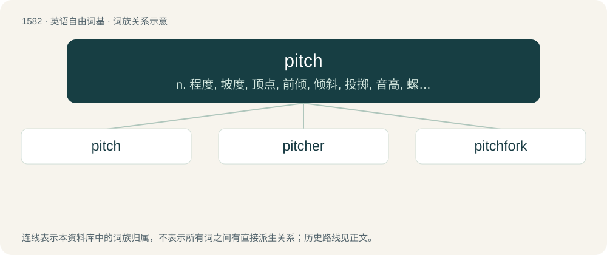

# 1669 · pitch — n. 程度, 坡度, 顶点, 前倾, 倾斜, 投掷, 音高, 螺距, 节距, 摊位, 树脂, 沥青；vt. 投, 掷, 向前倾跌, 扎营, 竭力推销, 为...定调, 定位于, 用沥青涂；vi. 搭帐篷, 投掷, 向前跌, 猛然摔倒, 坠落, 倾斜

[总目录](../00_总目录_按常用程度.md)

**类型**：英语自由词基　｜　**来源语言**：见词源记录

## 核心含义与来源

- 核心含义：n. 程度, 坡度, 顶点, 前倾, 倾斜, 投掷, 音高, 螺距, 节距, 摊位, 树脂, 沥青；vt. 投, 掷, 向前倾跌, 扎营, 竭力推销, 为...定调, 定位于, 用沥青涂；vi. 搭帐篷, 投掷, 向前跌, 猛然摔倒, 坠落, 倾斜
- 英文含义：A sticky, gummy substance secreted by trees; tree sap.
- 词形：pitch

**多个词源／构词路径**：同一拼写可能有不同来源；以下按词性和含义分别列出。

**来源记录 1**（名词；A sticky, gummy substance secreted by trees; tree sap.）

From Middle English picche, piche, pich, from Old English piċ, from Proto-West Germanic \*pik, from Latin pix. Cognate with Ancient Greek πίσσα (píssa, “pitch, tar”), Latin pīnus (“pine”). More at pine. Cognate with Saterland Frisian Pik (“pitch, tar”), Dutch pek (“pitch, tar”), German Low German Pick (“pitch, tar”), German Pech (“pitch, tar”), Catalan pega (“pitch”), Spanish pegar (“to stick, glue”), Franco-Provençal pouatche (“sap from a pine”) and French poix (“sap”). The adjective is probably back-formed from pitch-black, reinterpreting "pitch" as meaning "intense(ly)".

**来源记录 2**（名词；A throw; a toss; a cast, as of something from the hand.）

From Middle English picchen, pycchen (“to thrust in, fasten, settle”), from Old English \*piċċan, from Proto-West Germanic \*pikkijan, a variant of Proto-West Germanic \*pikkōn (“to pick, peck”), whence Middle English pikken, picken (“to pick, pierce”), modern English pick.

**来源记录 3**（名词；The perceived frequency of a sound, note or electromagnetic wave.）

Unknown. Perhaps from the above sense of "inclination", "level", or "degree", or influenced by it.

## 词族图

## 单词速览（常用到不常用）

| 单词 | 音标 | 释义 |
|---|---|---|
| [pitch](#w-1) | /pɪt͡ʃ/ | n. 程度, 坡度, 顶点, 前倾, 倾斜, 投掷, 音高, 螺距, 节距, 摊位, 树脂, 沥青；vt. 投, 掷, 向前倾跌, 扎营, 竭力推销, 为...定调, 定位于, 用沥青涂；vi. 搭帐篷, 投掷, 向前跌, 猛然摔倒, 坠落, 倾斜 |
| [pitcher](#w-2) | 英 /ˈpɪt͡ʃ.ə/；美 /ˈpɪt͡ʃ.ɚ/ | n. 有把的大罐, 瓶状体, 投手, 摊贩 |
| [pitchfork](#w-3) | /ˈpɪt͡ʃˌfɔɹk/ | n. 干草叉, 草靶, 音叉；vt. 骤然把...塞进, 骤然把...抛入 |

## 逐词详解

### 1. pitch

**词性**：名词　｜　**音标**：/pɪt͡ʃ/

**中文释义**：n. 程度, 坡度, 顶点, 前倾, 倾斜, 投掷, 音高, 螺距, 节距, 摊位, 树脂, 沥青；vt. 投, 掷, 向前倾跌, 扎营, 竭力推销, 为...定调, 定位于, 用沥青涂；vi. 搭帐篷, 投掷, 向前跌, 猛然摔倒, 坠落, 倾斜

**英文义项**：A sticky, gummy substance secreted by trees; tree sap. / Anything similar to or derived from tree sap: resin; rosin.

**词源与演化**：

From Middle English picche, piche, pich, from Old English piċ, from Proto-West Germanic \*pik, from Latin pix. Cognate with Ancient Greek πίσσα (píssa, “pitch, tar”), Latin pīnus (“pine”). More at pine. Cognate with Saterland Frisian Pik (“pitch, tar”), Dutch pek (“pitch, tar”), German Low German Pick (“pitch, tar”), German Pech (“pitch, tar”), Catalan pega (“pitch”), Spanish pegar (“to stick, glue”), Franco-Provençal pouatche (“sap from a pine”) and French poix (“sap”). The adjective is probably back-formed from pitch-black, reinterpreting "pitch" as meaning "intense(ly)".

**例句**：

> It was pitch black because there was no moon.

该用例对应义项：A dark, extremely viscous material still remaining after distilling crude oil or natural tar.

### 2. pitcher

**词性**：名词　｜　**音标**：英 /ˈpɪt͡ʃ.ə/；美 /ˈpɪt͡ʃ.ɚ/

**中文释义**：n. 有把的大罐, 瓶状体, 投手, 摊贩

**英文义项**：One who pitches (in any sense) anything / The player who delivers the ball to the batter.

**构词拆分**：pitch + -er

**词源与演化**：

From pitch + -er.

**例句**：

> The pitcher of the new film stands to earn millions.

该用例对应义项：One who makes a pitch or proposal.

### 3. pitchfork

**词性**：名词　｜　**音标**：/ˈpɪt͡ʃˌfɔɹk/

**中文释义**：n. 干草叉, 草靶, 音叉；vt. 骤然把...塞进, 骤然把...抛入

**英文义项**：An agricultural hand tool comprising a fork with sparse, light tines, attached to a long handle, used for pitching hay (especially loose hay) high up onto a stack (as on a wagon or haystack, or into a haymow). / A similar fork with slightly more and heavier tines, used for mucking stalls and pitching soiled bedding into a wagon or manure spreader.

**构词拆分**：pitch (verb) + fork

**词源与演化**：

From Middle English pichfork, pycchefork, pychforke, pikeforke, pikkforke, pic-forcke, equivalent to pitch (verb) + fork (i.e. "a fork used for pitching or throwing material, like hay"). The figurative sense (noun sense 4) is an allusion to a crowd of farmers wielding their farm tools as weapons.

**例句**：

> The city council was facing the pitchforks once the public had realized what the new ordinance entailed.

该用例对应义项：An angry mob; the power or effects of such a mob.
