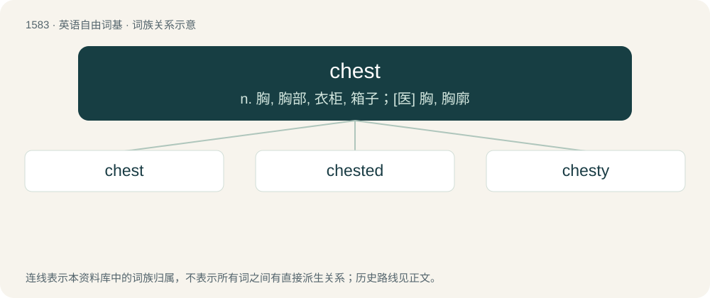

# 1672 · chest — n. 胸, 胸部, 衣柜, 箱子；\[医\] 胸, 胸廓

[总目录](../00_总目录_按常用程度.md)

**类型**：英语自由词基　｜　**来源语言**：见词源记录

## 核心含义与来源

- 核心含义：n. 胸, 胸部, 衣柜, 箱子；\[医\] 胸, 胸廓
- 英文含义：A box, now usually a large strong box with a secure convex lid.
- 词形：chest

**多个词源／构词路径**：同一拼写可能有不同来源；以下按词性和含义分别列出。

**来源记录 1**（名词；A box, now usually a large strong box with a secure convex lid.）

From Middle English cheste, chiste, from Old English ċest, ċist (“chest, casket; coffin; rush basket; box”), from Proto-West Germanic \*kistu (“chest, box”), from Latin cista (“chest, box”), from Ancient Greek κίστη (kístē, “chest, box, basket, hamper”).

**来源记录 2**（名词；Debate; quarrel; strife; enmity.）

From Middle English chest, cheste, cheeste, cheaste, from Old English ċēast, ċēas (“strife, quarrel, quarrelling, contention, murmuring, sedition, scandal; reproof”). Related to Old Frisian kāse (“strife, contention”), Old Saxon caest (“quarrel, dispute”), Old High German kōsa (“speech, story, account”).

## 词族图

## 单词速览（常用到不常用）

| 单词 | 音标 | 释义 |
|---|---|---|
| [chest](#w-1) | /t͡ʃɛst/ | n. 胸, 胸部, 衣柜, 箱子；\[医\] 胸, 胸廓 |
| [chested](#w-2) | 英 /ˈtʃɛst.ɪd/；美 /ˈt͡ʃɛstɪd/ | a. 有...胸腔的 |
| [chesty](#w-3) | /ˈt͡ʃɛsti/ | a. 胸部大的, 胸部丰满的, 骄傲的 |

## 逐词详解

### 1. chest

**词性**：名词　｜　**音标**：/t͡ʃɛst/

**中文释义**：n. 胸, 胸部, 衣柜, 箱子；\[医\] 胸, 胸廓

**英文义项**：A box, now usually a large strong box with a secure convex lid. / The place in which public money is kept; a treasury.

**词源与演化**：

From Middle English cheste, chiste, from Old English ċest, ċist (“chest, casket; coffin; rush basket; box”), from Proto-West Germanic \*kistu (“chest, box”), from Latin cista (“chest, box”), from Ancient Greek κίστη (kístē, “chest, box, basket, hamper”).

**例句**：

> He avoided being seen gazing at her chest, although he dearly longed to stare.

该用例对应义项：A female human's breasts.

### 2. chested

**词性**：形容词　｜　**音标**：英 /ˈtʃɛst.ɪd/；美 /ˈt͡ʃɛstɪd/

**中文释义**：a. 有...胸腔的

**英文义项**：Having a chest (with a specified quality).

**构词拆分**：From chest + -ed.

**词源与演化**：

From chest + -ed.

**例句**：

> Jenny was the most flat-chested of her friends.

该用例对应义项：Having a chest (with a specified quality).

### 3. chesty

**词性**：形容词　｜　**音标**：/ˈt͡ʃɛsti/

**中文释义**：a. 胸部大的, 胸部丰满的, 骄傲的

**英文义项**：Having large breasts; busty. / Not dry; involving the coughing of phlegm.

**构词拆分**：chest + -y

**词源与演化**：

From chest + -y.

**用法示例／搭配（非完整句）**：

> a chesty cough; a chesty cold

该用例对应义项：Not dry; involving the coughing of phlegm.
