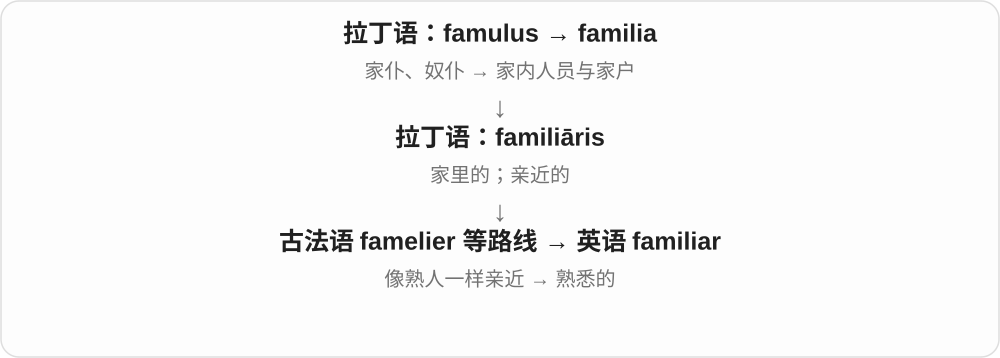
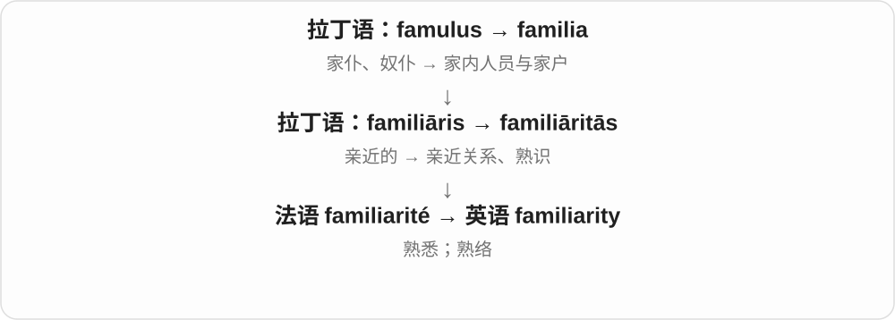
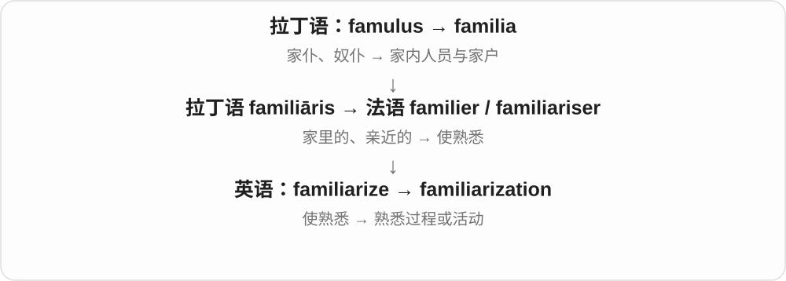
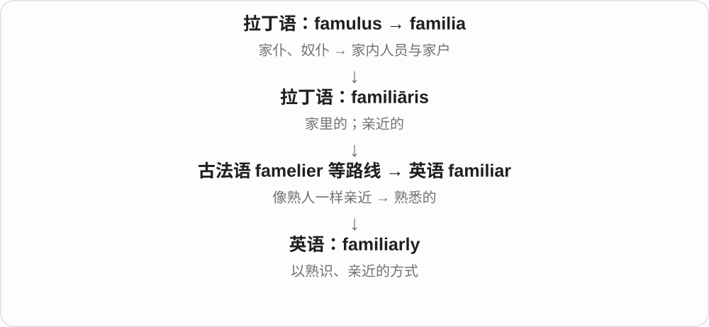

# 1673 · familiar — 熟悉；常见；使熟悉

[逐词精讲目录](../00_逐词精讲目录.md) · [总目录](../00_总目录_按常用程度.md)

## 核心词根与来源

familiar 经法语接拉丁 familia 家庭、家内成员一支，意义走向熟悉、亲近。familiarity 是熟悉，familiarize 是使熟悉，familiarization 是熟悉过程。

**FAMILIAR：见得多、接触过，所以认得和了解**

一张熟悉的脸，或一项自己操作过很多次的任务。

- **熟悉程度**：familiar · unfamiliar · familiarity
- **方式与过程**：familiarly · familiarize · familiarization

## 词形与演化规律

be familiar with 是人了解某物；be familiar to 是某物为人熟知。familiarize someone with；un- 否定，-ly 形成副词。

## 单词速览（按词族由简到繁）

同一基础词的相关扩展放在一起，先读基础形式，再读扩展；各组之间优先读常用的。具体词源关系见各词讲解。

| 单词 | 音标 | 核心意思 |
|---|---|---|
| [familiar](#w-1) | 英 /fəˈmɪliə/；美 /fəˈmɪljər/ | 熟悉的；熟络的；过于随便的 |
| [familiarity](#w-3) | 英 /fəˌmɪliˈærəti/；美 /fəˌmɪliˈerəti/ | 熟悉程度；亲近、熟络；过分随便 |
| [familiarize](#w-4) | 英 /fəˈmɪliəraɪz/；美 /fəˈmɪljəraɪz/ | 使熟悉；让自己熟悉 |
| [familiarization](#w-6) | 英 /fəˌmɪliəraɪˈzeɪʃən/；美 /fəˌmɪljərəˈzeɪʃən/ | 熟悉过程；入门熟悉训练 |
| [familiarly](#w-5) | 英 /fəˈmɪliəli/；美 /fəˈmɪljərli/ | 熟络地；随便亲近地；以熟知的方式 |
| [unfamiliar](#w-2) | 英 /ˌʌnfəˈmɪliə/；美 /ˌʌnfəˈmɪljər/ | 不熟悉的；陌生的 |

## 逐词讲解

### 1. familiar — 熟悉的；熟络的；过于随便的

**音标**：英 /fəˈmɪliə/；美 /fəˈmɪljər/

**先抓住这个画面**

像家里常见的人和东西，不用第一次重新认识，一眼、一听就有“我知道”的感觉。

**怎么拆**

经法语等路线来自拉丁语 familiāris“家里的、亲近的”，与 familia 同族；不是由现代英语 family 临时改拼写而来。

**怎么变成今天的意思**

I am familiar with it 是我熟悉它；It is familiar to me 是它对我来说很熟悉。a familiar tone 还可表示熟络，若越过关系边界，也可能显得失礼。 奇幻或民俗中的名词 a familiar 指与巫师相伴、为其服务的精灵或动物形象，来自 familiar spirit 的用法。

**常见搭配与例句**

familiar with；familiar to；a familiar face；sound familiar。

> Her face looks familiar, but I cannot remember her name.

她看起来面熟，但我想不起她的名字。

> Are you familiar with this software?

你熟悉这个软件吗？

**别混淆**

familiar 是熟悉；familial 是家庭相关。a familiar voice 是熟悉的声音，不一定来自亲属。

### 2. familiarity — 熟悉程度；亲近、熟络；过分随便

**音标**：英 /fəˌmɪliˈærəti/；美 /fəˌmɪliˈerəti/

**先抓住这个画面**

见过、用过很多次，东西在脑中有了位置；人与人相处久了，也可能越来越不拘礼节。

**怎么拆**

经法语 familiarité 来自拉丁语 familiāritās，名词有自己的借入历史；现代与 familiar + -ity 对应。

**怎么变成今天的意思**

familiarity with a subject 是熟悉某领域；excessive familiarity 则是过度亲昵。词尾变化时主重音移到后部。

**常见搭配与例句**

familiarity with the system；a sense of familiarity；excessive familiarity。

> The job requires some familiarity with basic accounting.

这份工作要求对基础会计有所了解。

> He spoke with a familiarity that made her uncomfortable.

他说话过于熟络，让她感到不自在。

**别混淆**

familiarity 是熟悉，不保证 competence“胜任能力”：常见过一种工具，未必会熟练操作。

### 3. familiarize — 使熟悉；让自己熟悉

**音标**：英 /fəˈmɪliəraɪz/；美 /fəˈmɪljəraɪz/

**先抓住这个画面**

带一个人认路、试用工具、了解规则，让原本陌生的东西逐渐变得顺手。

**怎么拆**

现代可拆 familiar + -ize“使……”。历史上也有法语 familiariser 的借入分析，不能只认定为英语新造词；英式也常写 familiarise。

**怎么变成今天的意思**

常见 familiarize yourself with，也可说 familiarize someone with。需要说明谁变熟悉，以及熟悉什么。

**常见搭配与例句**

familiarize yourself with；familiarize new staff with…。

> Take a few minutes to familiarize yourself with the controls.

花几分钟熟悉一下这些控制装置。

> The tour familiarized new students with the campus.

这次参观让新生熟悉了校园。

**别混淆**

familiarize 是使熟悉的过程；be familiar 是已经熟悉的状态。

### 4. familiarization — 熟悉过程；入门熟悉训练

**音标**：英 /fəˌmɪliəraɪˈzeɪʃən/；美 /fəˌmɪljərəˈzeɪʃən/

**先抓住这个画面**

正式开始之前，先认环境、看操作、试一下，让人不再摸不着头脑。

**怎么拆**

familiarize + -ation，也可分析 familiar + -ization；英式有 familiarisation。

**怎么变成今天的意思**

多见于培训、设备操作和新员工入门。一次 familiarization 不必等于完整专业训练。

**常见搭配与例句**

a familiarization session；equipment familiarization。

> New employees attend a familiarization session on their first day.

新员工第一天参加入门熟悉活动。

> The programme includes familiarization with the laboratory equipment.

项目包括熟悉实验室设备的环节。

**别混淆**

familiarity 是已经熟悉的程度；familiarization 是逐渐熟悉的过程。

### 5. familiarly — 熟络地；随便亲近地；以熟知的方式

**音标**：英 /fəˈmɪliəli/；美 /fəˈmɪljərli/

**先抓住这个画面**

说话做事像已经认识很久，少了陌生人之间的客气距离。

**怎么拆**

familiar + -ly，中古英语已有 familierly 等形式。

**怎么变成今天的意思**

可描述友善亲近，也可能暗示不合时宜的随便；是否合适要看双方关系。familiarly known as 还可引出常用昵称。

**常见搭配与例句**

speak familiarly；address someone familiarly；familiarly known as…。

> He greeted the regular customers familiarly.

他熟络地招呼那些老顾客。

> The building is familiarly known as the Red House.

这栋楼被大家习惯地称为“红房子”。

**别混淆**

familiarly 是熟络或熟知的方式；familially 才是较少见的“在家庭关系方面”，不要混读词形。

### 6. unfamiliar — 不熟悉的；陌生的

**音标**：英 /ˌʌnfəˈmɪliə/；美 /ˌʌnfəˈmɪljər/

**先抓住这个画面**

眼前的东西没有接上已有的经验：地方不认识、规则没用过、声音没听惯。

**怎么拆**

un- 否定 familiar。

**怎么变成今天的意思**

可以说 I am unfamiliar with the rules，也可以说 The rules are unfamiliar to me。陌生不一定奇怪或危险。

**常见搭配与例句**

an unfamiliar place；unfamiliar with；unfamiliar to…。

> The map helped us find our way through an unfamiliar city.

地图帮助我们在陌生的城市里找到路。

> The terminology was unfamiliar to most of the students.

大多数学生都不熟悉这些术语。

**别混淆**

unfamiliar 是对某人不熟悉；strange 还可以说事物本身奇怪，含义更宽。

## 这一组要分清什么

a familiar name 是熟悉的名字，不一定是亲戚；过度 familiarity 也可能表示不合适的随便。

## 串起来练习

The introduction will familiarize you with an unfamiliar system.

介绍会帮助你熟悉一个陌生系统。
