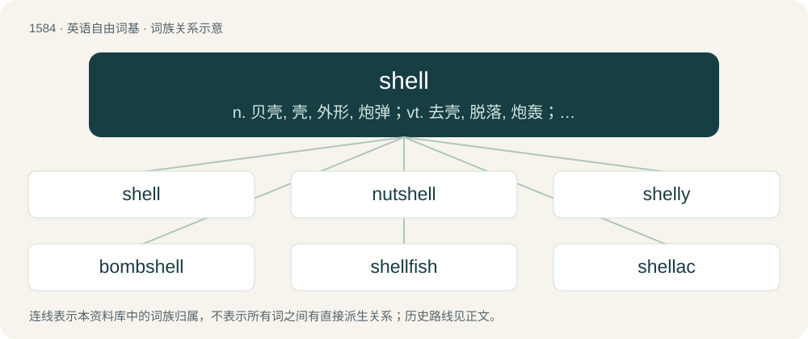

# 1674 · shell — n. 贝壳, 壳, 外形, 炮弹；vt. 去壳, 脱落, 炮轰；vi. 剥落, 脱壳

[总目录](../00_总目录_按常用程度.md)

**类型**：英语自由词基　｜　**来源语言**：见词源记录

## 核心含义与来源

- 核心含义：n. 贝壳, 壳, 外形, 炮弹；vt. 去壳, 脱落, 炮轰；vi. 剥落, 脱壳
- 英文含义：The calcareous or chitinous external covering of mollusks, crustaceans, and some other invertebrates.
- 词形：shell

**来源记录 1**（名词；The calcareous or chitinous external covering of mollusks, crustaceans, and some other invertebrates.）

From Middle English schelle, from Old English sċel, sċell, sċiell, sċil, sċill, sċyl, sċyll, from Proto-West Germanic \*skallju, from Proto-Germanic \*skaljō (“shell; husk; rind; peel”), from Proto-Indo-European \*(s)kelH- (“to cut; to separate, split”). Cognates Cognate with Dutch schil (“bark, rind, skin; crust; shell; slice”), Danish skæl (“scale; dandruff”), Faroese and Icelandic skel (“shell”), Norwegian Bokmål skjell (“shell; scale”), Norwegian Nynorsk skjel (“shell; bivalve; scale; carapace”), Gothic 𐍃𐌺𐌰𐌻𐌾𐌰 (skalja, “brick, tile”), French écaille (“scale; shell”), Friulian scae (“scale”), Italian scaglia (“scale; flake, sliver; splinter”); also Breton killi (“grove”), Cornish kelli (“grove”), Irish coill (“forest, wood”), Manx keyll (“forest, wood; grove, plantation”), Scottish Gaelic coille (“forest”), Welsh celli (“grove”), Latin scalpō (“to scratch; to carve”), Ancient Greek σκᾰ́λλω (skắllō, “to hoe, stir up”), Albanian çel (“to open up; to sprout; to hatch up; to rise”), Lithuanian skelti (“to crack, split”), Bulgarian, Macedonian, and Russian скала́ (skalá, “cliff, rock”), Czech skála (“rock”), Polish skała, skáła, szkała (“rock”), Slovak and Slovene skala (“rock”), Ukrainian скала́ (skalá), ска́ля (skálja, “cliff, rock”), Armenian քաղել (kʻaġel, “to pick; to gather; to mow”), Sanskrit कॢप् (kḷp, “to order; to manage; to perform; to create; to cut”). More at shale. Doublet of sheal. \* (computing): From being viewed as an outer layer of interface between the user and the operating-system internals.

## 词族图

## 单词速览（常用到不常用）

| 单词 | 音标 | 释义 |
|---|---|---|
| [shell](#w-1) | 英 /ʃɛl/；/ʃæl/ | n. 贝壳, 壳, 外形, 炮弹；vt. 去壳, 脱落, 炮轰；vi. 剥落, 脱壳 |
| [nutshell](#w-2) | /ˈnʌt.ʃɛl/ | n. 坚果壳, 极小的东西 |
| [shelly](#w-3) | /ˈʃɛli/ | a. 多壳的, 壳一般的, 有壳的 |
| [bombshell](#w-4) | 英 /ˈbɒmʃɛl/；美 /ˈbɑmʃɛl/ | n. 炸弹, 突发而惊人的事物 |
| [shellfish](#w-5) | /ˈʃɛl.fɪʃ/ | n. 贝, 甲壳类水生物；\[医\] 牡蛎 |
| [shellac](#w-6) | /ʃəˈlæk/ | n. 虫胶；vt. 涂上虫胶, 以虫胶处理, 殴打 |
| [eggshell](#w-7) | /ˈɛɡʃɛl/ | n. 蛋壳 |
| [seashell](#w-8) | 美 /ˈsiˌʃɛl/ | n. 海贝壳 |
| [shuck](#w-9) | /ʃʌk/ | n. 壳, 外皮, 牡蛎壳；v. 剥去, 脱去 |
| [tortoiseshell](#w-10) | /ˈtɔː(ɹ)təˌʃɛl/ | n. 龟甲, 玳瑁壳, 龟板, 玳瑁色 |
| [clamshell](#w-11) | /ˈklæmʃəl/ | n. 蛤壳, 蛤壳状挖泥器 |
| [shellie](#w-12) |  | 【英文】A small or miniature shell. |
| [softshell](#w-13) |  | 【英文】Having a relatively soft shell. |

## 逐词详解

### 1. shell

**词性**：名词　｜　**音标**：英 /ʃɛl/；/ʃæl/

**中文释义**：n. 贝壳, 壳, 外形, 炮弹；vt. 去壳, 脱落, 炮轰；vi. 剥落, 脱壳

**英文义项**：The calcareous or chitinous external covering of mollusks, crustaceans, and some other invertebrates. / Any mollusk having such a covering.

**词源与演化**：

From Middle English schelle, from Old English sċel, sċell, sċiell, sċil, sċill, sċyl, sċyll, from Proto-West Germanic \*skallju, from Proto-Germanic \*skaljō (“shell; husk; rind; peel”), from Proto-Indo-European \*(s)kelH- (“to cut; to separate, split”). Cognates Cognate with Dutch schil (“bark, rind, skin; crust; shell; slice”), Danish skæl (“scale; dandruff”), Faroese and Icelandic skel (“shell”), Norwegian Bokmål skjell (“shell; scale”), Norwegian Nynorsk skjel (“shell; bivalve; scale; carapace”), Gothic 𐍃𐌺𐌰𐌻𐌾𐌰 (skalja, “brick, tile”), French écaille (“scale; shell”), Friulian scae (“scale”), Italian scaglia (“scale; flake, sliver; splinter”); also Breton killi (“grove”), Cornish kelli (“grove”), Irish coill (“forest, wood”), Manx keyll (“forest, wood; grove, plantation”), Scottish Gaelic coille (“forest”), Welsh celli (“grove”), Latin scalpō (“to scratch; to carve”), Ancient Greek σκᾰ́λλω (skắllō, “to hoe, stir up”), Albanian çel (“to open up; to sprout; to hatch up; to rise”), Lithuanian skelti (“to crack, split”), Bulgarian, Macedonian, and Russian скала́ (skalá, “cliff, rock”), Czech skála (“rock”), Polish skała, skáła, szkała (“rock”), Slovak and Slovene skala (“rock”), Ukrainian скала́ (skalá), ска́ля (skálja, “cliff, rock”), Armenian քաղել (kʻaġel, “to pick; to gather; to mow”), Sanskrit कॢप् (kḷp, “to order; to manage; to perform; to create; to cut”). More at shale. Doublet of sheal. \* (computing): From being viewed as an outer layer of interface between the user and the operating-system internals.

**例句**：

> The first lyre may have been made by drawing strings over the underside of a tortoise shell.

该用例对应义项：A string instrument, as a lyre, whose acoustical chamber is formed like a shell.

### 2. nutshell

**词性**：名词　｜　**音标**：/ˈnʌt.ʃɛl/

**中文释义**：n. 坚果壳, 极小的东西

**英文义项**：The shell that surrounds the kernel of a nut. / A short book summarizing an area of law.

**构词拆分**：nut + shell

**词源与演化**：

From Middle English notschelle, from Old English hnutsċiell, from Proto-West Germanic \*hnutskallju, equivalent to nut + shell. Cognate with Saterland Frisian Nuteskele, Nuteskil (“nutshell”), Dutch notenschaal (“nutshell”), German Nussschale (“nutshell”).

**例句**：

> Toki Pona is an attempt to interpret the meaning of life in a nutshell.

### 3. shelly

**词性**：形容词　｜　**音标**：/ˈʃɛli/

**中文释义**：a. 多壳的, 壳一般的, 有壳的

**英文义项**：Composed of the shells of dead marine creatures / Resembling, or comprising, the shell of a mollusc

**构词拆分**：shell + -y

**词源与演化**：

From shell + -y.

**用法示例／搭配（非完整句）**：

> a shelly beach

该用例对应义项：Abounding with shells.

### 4. bombshell

**词性**：名词　｜　**音标**：英 /ˈbɒmʃɛl/；美 /ˈbɑmʃɛl/

**中文释义**：n. 炸弹, 突发而惊人的事物

**英文义项**：Something that is very surprising, shocking, amazing or sensational. / Someone who is very attractive; a sex symbol.

**构词拆分**：bomb + shell

**词源与演化**：

From bomb + shell.

**用法示例／搭配（非完整句）**：

> Diana Dors, the 1950s blonde bombshell

该用例对应义项：Someone who is very attractive; a sex symbol.

### 5. shellfish

**词性**：名词　｜　**音标**：/ˈʃɛl.fɪʃ/

**中文释义**：n. 贝, 甲壳类水生物；\[医\] 牡蛎

**英文义项**：A fisheries and colloquial term for an aquatic invertebrate having an inner or outer shell, such as a mollusc or crustacean, especially when edible. / A culinary and nutritional term for several groups of non-piscine, non-tetrapod, aquatic animals that are used as a food source. The term often exclusively refers to edible aquatic crustaceans, bivalve mollusks and cephalopod mollusks; but sometimes echinoderms may be included as well.

**构词拆分**：shell + fish

**词源与演化**：

Inherited from Middle English schellefyssch, from Old English sċielfisċ. Equivalent to shell + fish.

**例句**：

> Tom and Mary walked on the beach and searched for seashells and shellfish.

### 6. shellac

**词性**：名词　｜　**音标**：/ʃəˈlæk/

**中文释义**：n. 虫胶；vt. 涂上虫胶, 以虫胶处理, 殴打

**英文义项**：A processed secretion of the lac insect, Coccus lacca; used in polishes, varnishes etc. / A beating; a thrashing.

**构词拆分**：shell + lac

**词源与演化**：

From shell + lac, calque of French laque en écailles (literally “lac in scales/shells”).

### 7. eggshell

**词性**：形容词　｜　**音标**：/ˈɛɡʃɛl/

**中文释义**：n. 蛋壳

**英文义项**：Of a pale yellowish-whitish colour, like that of the eggshell. / Exhibiting the thinness, translucency or near-transparency, and fragility of an eggshell.

**构词拆分**：egg + shell

**词源与演化**：

From Middle English eggeshell, ege schelle, egg-shel, egg shelle (also as Middle English eye schell, ey-schel, ey-schelle), partially continuing Old English ǣġsċill, ǣġsċyll (“eggshell”), equivalent to egg + shell. Cognate with Saterland Frisian Oaierskil (“eggshell”), Dutch eierschaal (“eggshell”), German Eierschale (“eggshell”), Danish æggeskal (“eggshell”), Swedish äggskal (“eggshell”).

**例句**：

> This clear varnish is available in gloss, matt and eggshell finishes.

该用例对应义项：Very matt, having a low reflexivity, like an eggshell.

### 8. seashell

**词性**：名词　｜　**音标**：美 /ˈsiˌʃɛl/

**中文释义**：n. 海贝壳

**英文义项**：The empty shell of a marine mollusk. / The animal living inside a seashell.

**构词拆分**：sea + shell

**词源与演化**：

From sea + shell.

**例句**：

> The seashells on the beach are toxic and best avoided.

该用例对应义项：The animal living inside a seashell.

### 9. shuck

**词性**：动词　｜　**音标**：/ʃʌk/

**中文释义**：n. 壳, 外皮, 牡蛎壳；v. 剥去, 脱去

**英文义项**：To remove the shuck from (walnuts, oysters, etc.). / To remove (any outer covering).

**构词拆分**：shell + -ock (diminutive suffix)；shell + -k (diminutive suffix)

**词源与演化**：

Origin unknown. Possibly a dialectal survival of unrecorded Middle English \*schulk(e), \*schullok (“small shell”); either from Old English \*sċylluc, \*sċylloc, diminutive of Old English sċyll (“shell”), or alternatively created in Middle English from Middle English schulle, schelle (“shell, husk, pod”) + -ok, making it equivalent to shell + -ock (diminutive suffix) or shell + -k (diminutive suffix).

**例句**：

> I will shuck my clothes and dive naked into the pool.

该用例对应义项：To remove (any outer covering).

### 10. tortoiseshell

**词性**：名词　｜　**音标**：/ˈtɔː(ɹ)təˌʃɛl/

**中文释义**：n. 龟甲, 玳瑁壳, 龟板, 玳瑁色

**英文义项**：The horny, translucent, mottled covering of the carapace of the hawksbill turtle, used as a veneer etc. / The hawksbill turtle.

**构词拆分**：tortoise + shell

**词源与演化**：

From tortoise + shell.

**例句**：

> I have a tortoiseshell cat. She is so affectionate!

### 11. clamshell

**词性**：名词　｜　**音标**：/ˈklæmʃəl/

**中文释义**：n. 蛤壳, 蛤壳状挖泥器

**英文义项**：The shell of a clam. / Any object that, in (literal or figurative) resemblance to the shell of a clam, has a hinge on one edge and two surfaces that close together.

**构词拆分**：clam + shell

**词源与演化**：

From clam + shell.

**用法示例／搭配（非完整句）**：

> Shut your clamshell!

该用例对应义项：A person's mouth.

### 12. shellie

**词性**：名词

**英文义项**：A small or miniature shell.

**构词拆分**：shell + -ie (diminutive suffix)

**词源与演化**：

From shell + -ie (diminutive suffix).

### 13. softshell

**词性**：形容词

**英文义项**：Having a relatively soft shell.

**构词拆分**：soft + shell

**词源与演化**：

From soft + shell.

**例句**：

> Taking care of Chinese softshell turtles is difficult.
