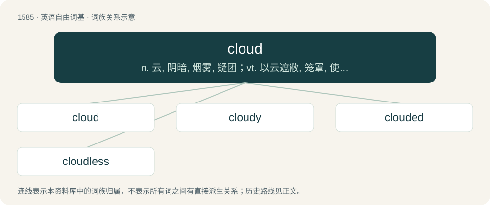

# 1676 · cloud — n. 云, 阴暗, 烟雾, 疑团；vt. 以云遮敝, 笼罩, 使黯然；vi. 乌云密布, 阴沉

[总目录](../00_总目录_按常用程度.md)

**类型**：英语自由词基　｜　**来源语言**：见词源记录

## 核心含义与来源

- 核心含义：n. 云, 阴暗, 烟雾, 疑团；vt. 以云遮敝, 笼罩, 使黯然；vi. 乌云密布, 阴沉
- 英文含义：A visible mass of water droplets suspended in the air.
- 词形：cloud

**来源记录 1**（名词；A visible mass of water droplets suspended in the air.）

From Middle English cloud, from Old English clūd (“mass of stone, rock, boulder, hill”), from Proto-West Germanic \*klūt, from Proto-Germanic \*klūtaz, \*klutaz (“lump, mass, conglomeration”), from Proto-Indo-European \*gel- (“to ball up, clench”). Cognate with Scots clood, clud (“cloud”), Dutch kluit (“lump, mass, clod”), German Low German Kluut, Kluute (“lump, mass, ball”), German Kloß (“lump, ball, dumpling”), Danish klode (“sphere, orb, planet”), Swedish klot (“sphere, orb, ball, globe”), Icelandic klót (“knob on a sword's hilt”). Related to English clod, clot, clump, club. Largely replaced Middle English welkne, from Old English wolcn (whence English welkin), from Proto-Germanic \*wulkną, the original Germanic word for cloud (compare Dutch wolk, German Wolke, North Frisian and West Frisian wolk).

## 词族图

## 单词速览（常用到不常用）

| 单词 | 音标 | 释义 |
|---|---|---|
| [cloud](#w-1) | 英 /ˈklaʊ̯d/；/ˈklæʊ̯d/ | n. 云, 阴暗, 烟雾, 疑团；vt. 以云遮敝, 笼罩, 使黯然；vi. 乌云密布, 阴沉 |
| [cloudy](#w-2) | 英 /ˈklaʊ̯diː/；/ˈklæʊ̯diː/ | a. 多云的, 有愁容的, 云的, 浑浊的；\[建\] (混)浊的 |
| [clouded](#w-3) | 英 /ˈklaʊdɪd/；美 /ˈklaʊdəd/ | a. 阴的, 有暗影的 |
| [cloudless](#w-4) | /ˈklaudlis/ | a. 晴朗的, 无云的 |

## 逐词详解

### 1. cloud

**词性**：名词　｜　**音标**：英 /ˈklaʊ̯d/；/ˈklæʊ̯d/

**中文释义**：n. 云, 阴暗, 烟雾, 疑团；vt. 以云遮敝, 笼罩, 使黯然；vi. 乌云密布, 阴沉

**英文义项**：A visible mass of water droplets suspended in the air. / Any mass of dust, steam or smoke resembling such a mass.

**词源与演化**：

From Middle English cloud, from Old English clūd (“mass of stone, rock, boulder, hill”), from Proto-West Germanic \*klūt, from Proto-Germanic \*klūtaz, \*klutaz (“lump, mass, conglomeration”), from Proto-Indo-European \*gel- (“to ball up, clench”). Cognate with Scots clood, clud (“cloud”), Dutch kluit (“lump, mass, clod”), German Low German Kluut, Kluute (“lump, mass, ball”), German Kloß (“lump, ball, dumpling”), Danish klode (“sphere, orb, planet”), Swedish klot (“sphere, orb, ball, globe”), Icelandic klót (“knob on a sword's hilt”). Related to English clod, clot, clump, club. Largely replaced Middle English welkne, from Old English wolcn (whence English welkin), from Proto-Germanic \*wulkną, the original Germanic word for cloud (compare Dutch wolk, German Wolke, North Frisian and West Frisian wolk).

**例句**：

> The comic-book character's thoughts appeared in a cloud above his head.

该用例对应义项：An elliptical shape or symbol whose outline is a series of semicircles, supposed to resemble a cloud.

### 2. cloudy

**词性**：形容词　｜　**音标**：英 /ˈklaʊ̯diː/；/ˈklæʊ̯diː/

**中文释义**：a. 多云的, 有愁容的, 云的, 浑浊的；\[建\] (混)浊的

**英文义项**：Covered with or characterised by clouds. / Not transparent or clear.

**构词拆分**：cloud + -y

**词源与演化**：

From Middle English cloudy (“cloudy, overcast, gloomy, dark", also "hilly, rocky”), from Old English clūdiġ (“stony, rocky”), equivalent to cloud + -y.

**用法示例／搭配（非完整句）**：

> a cloudy infrastructure

该用例对应义项：Using or relating to cloud computing.

### 3. clouded

**词性**：形容词　｜　**音标**：英 /ˈklaʊdɪd/；美 /ˈklaʊdəd/

**中文释义**：a. 阴的, 有暗影的

**英文义项**：Filled with clouds; cloudy. / Unclear; surrounded in mystery.

**构词拆分**：cloud + -ed

**词源与演化**：

From cloud + -ed.

**用法示例／搭配（非完整句）**：

> the clouded eyes of the sick man

该用例对应义项：Dim or blurry.

### 4. cloudless

**词性**：形容词　｜　**音标**：/ˈklaudlis/

**中文释义**：a. 晴朗的, 无云的

**英文义项**：Without any clouds.

**构词拆分**：cloud + -less

**词源与演化**：

From Middle English cloudeles, equivalent to cloud + -less.

**用法示例／搭配（非完整句）**：

> a cloudless day

该用例对应义项：Without any clouds.
