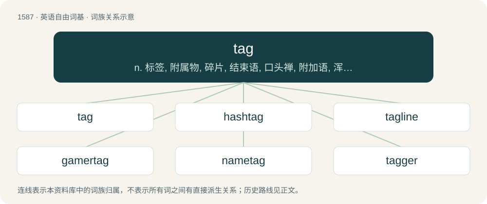

# 1678 · tag — n. 标签, 附属物, 碎片, 结束语, 口头禅, 附加语, 浑名, 标记, 标记符；vt. 附以签条, 尾随, 添饰, 起浑名, 连接；vi. 紧紧跟随

[总目录](../00_总目录_按常用程度.md)

**类型**：英语自由词基　｜　**来源语言**：见词源记录

## 核心含义与来源

- 核心含义：n. 标签, 附属物, 碎片, 结束语, 口头禅, 附加语, 浑名, 标记, 标记符；vt. 附以签条, 尾随, 添饰, 起浑名, 连接；vi. 紧紧跟随
- 英文含义：A small label.
- 词形：tag

**多个词源／构词路径**：同一拼写可能有不同来源；以下按词性和含义分别列出。

**来源记录 1**（名词；A small label.）

From Middle English tagge (“small piece hanging from a garment”), probably of North Germanic origin. Compare Norwegian tagg (“point; prong; barb; tag”), Swedish tagg (“thorn; prickle; tine”), Icelandic tág (“a willow-twig”). Compare also tack.

**来源记录 2**（名词；A decoration drawn over some Hebrew letters in Jewish scrolls, especially in Stam style.）

Borrowed from Aramaic תגא (taga, “crown”). Doublet of taj.

## 词族图

## 单词速览（常用到不常用）

| 单词 | 音标 | 释义 |
|---|---|---|
| [tag](#w-1) | 英 /tæɡ/；/teɪɡ/ | n. 标签, 附属物, 碎片, 结束语, 口头禅, 附加语, 浑名, 标记, 标记符；vt. 附以签条, 尾随, 添饰, 起浑名, 连接；vi. 紧紧跟随 |
| [hashtag](#w-2) | 美 /ˈhæʃˌtæɡ/ | n. 井号(#)标签（微博twitter中用来标注线索主题的标签） |
| [tagline](#w-3) |  | n. 宣传词; 标签行; 作为一个口号或信条 |
| [gamertag](#w-4) |  | 【英文】A pseudonym by which an individual playing an online game with others is identified |
| [nametag](#w-5) | /ˈneim,tæɡ/ | n. 名牌；用户标签 |
| [tagger](#w-6) | /ˈtæɡə(ɹ)/ | n. 垂下物, 尾随者, 薄铁片, 附加物 |

## 逐词详解

### 1. tag

**词性**：名词　｜　**音标**：英 /tæɡ/；/teɪɡ/

**中文释义**：n. 标签, 附属物, 碎片, 结束语, 口头禅, 附加语, 浑名, 标记, 标记符；vt. 附以签条, 尾随, 添饰, 起浑名, 连接；vi. 紧紧跟随

**英文义项**：A small label. / A skin tag, an excrescence of skin.

**词源与演化**：

From Middle English tagge (“small piece hanging from a garment”), probably of North Germanic origin. Compare Norwegian tagg (“point; prong; barb; tag”), Swedish tagg (“thorn; prickle; tine”), Icelandic tág (“a willow-twig”). Compare also tack.

**例句**：

> The subwoofer in the trunk was so loud, it vibrated the tag like an aluminum can.

该用例对应义项：A vehicle number plate; a medal bearing identification data (animals, soldiers).

### 2. hashtag

**词性**：名词　｜　**音标**：美 /ˈhæʃˌtæɡ/

**中文释义**：n. 井号(#)标签（微博twitter中用来标注线索主题的标签）

**英文义项**：A metadata tag, signaled by a preceding hash sign (#), used to label content. / The hash sign itself, especially when used as part of a hashtag.

**构词拆分**：hash (sign) + tag

**词源与演化**：

From earlier hash tag, from hash (sign) + tag. The hash sign # was initially proposed as tag hash by Chris Messina to create groups on Twitter, modeled after the IRC channel prefix. First published use as hash tag by Stowe Boyd in 2007.

**例句**：

> Since 2019, the hashtag #okboomer has been used 3.7 billion times on TikTok.

### 3. tagline

**词性**：名词

**中文释义**：n. 宣传词; 标签行; 作为一个口号或信条

**英文义项**：The punch line of a joke. / An advertising slogan.

**构词拆分**：tag + line

**词源与演化**：

From tag + line.

**例句**：

> The website's tagline has to let people know what that business does and how it differs from the competition.

### 4. gamertag

**词性**：名词

**英文义项**：A pseudonym by which an individual playing an online game with others is identified

**构词拆分**：gamer + tag

**词源与演化**：

From gamer + tag.

### 5. nametag

**词性**：名词　｜　**音标**：/ˈneim,tæɡ/

**中文释义**：n. 名牌；用户标签

**英文义项**：A tag with one's name inscribed on it.

**构词拆分**：name + tag

**词源与演化**：

From name + tag.

**例句**：

> We'd better put nametags in the children's school uniforms, in case they get mixed up.

该用例对应义项：A tag with one's name inscribed on it.

### 6. tagger

**词性**：名词　｜　**音标**：/ˈtæɡə(ɹ)/

**中文释义**：n. 垂下物, 尾随者, 薄铁片, 附加物

**英文义项**：The player who tries to catch others in the game of tag. / A person who writes graffiti using a specific mark

**构词拆分**：From tag + -er.

**词源与演化**：

From tag + -er.

**例句**：

> A theory that was simply added on by some anonymous tagger.

该用例对应义项：someone who appends or joins one thing to another
