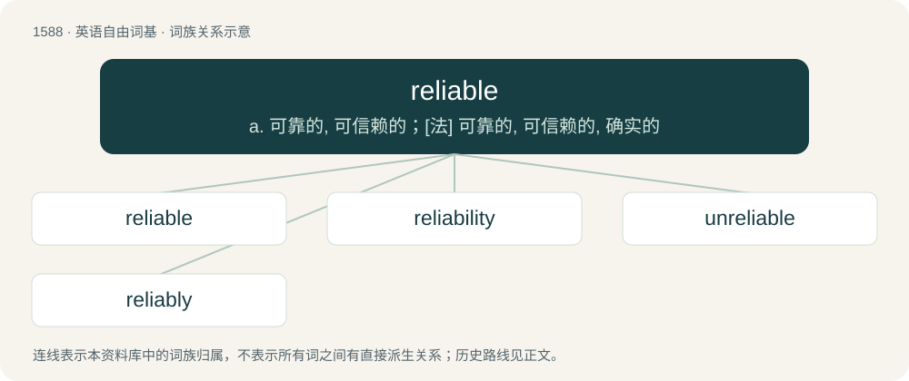

# 1679 · reliable — a. 可靠的, 可信赖的；\[法\] 可靠的, 可信赖的, 确实的

[总目录](../00_总目录_按常用程度.md)

**类型**：英语自由词基　｜　**来源语言**：见词源记录

## 核心含义与来源

- 核心含义：a. 可靠的, 可信赖的；\[法\] 可靠的, 可信赖的, 确实的
- 英文含义：Suitable or fit to be relied on; worthy of dependence, reliance or trust; dependable, trustworthy
- 词形：reliable

**来源记录 1**（形容词；Suitable or fit to be relied on; worthy of dependence, reliance or trust; dependable, trustworthy）

From rely + -able.

## 词族图

## 单词速览（常用到不常用）

| 单词 | 音标 | 释义 |
|---|---|---|
| [reliable](#w-1) | /ɹɪˈlaɪəbl̩/ | a. 可靠的, 可信赖的；\[法\] 可靠的, 可信赖的, 确实的 |
| [reliability](#w-2) | /ri.laiəˈbiliti/ | n. 信度, 可靠性；\[计\] 可靠性 |
| [unreliable](#w-3) | 英 /ˌʌn.ɹɪˈlaɪ.ə.bl̩/；美 /ˌʌn.ɹəˈlaɪ.ə.bəl/ | a. 不可靠的；\[法\] 不可靠的, 靠不住的 |
| [reliably](#w-4) | /riˈlaiəbli/ | adv. 可靠地, 可信赖地 |

## 逐词详解

### 1. reliable

**词性**：形容词　｜　**音标**：/ɹɪˈlaɪəbl̩/

**中文释义**：a. 可靠的, 可信赖的；\[法\] 可靠的, 可信赖的, 确实的

**英文义项**：Suitable or fit to be relied on; worthy of dependence, reliance or trust; dependable, trustworthy / Such that either a sent packet will reach its destination, even if it requires retransmission, or the sender will be told that it didn't.

**构词拆分**：rely + -able

**词源与演化**：

From rely + -able.

**例句**：

> A reliable source of information.

该用例对应义项：worthy of reliance or trust

### 2. reliability

**词性**：名词　｜　**音标**：/ri.laiəˈbiliti/

**中文释义**：n. 信度, 可靠性；\[计\] 可靠性

**英文义项**：The quality of being reliable, dependable, or trustworthy. / the ability to measure the same thing consistently (of a measurement indicating the degree to which the measure is consistent); that is, repeated measurements would give the same result (See also validity).

**构词拆分**：reliable + -ity

**词源与演化**：

From reliable + -ity.

**例句**：

> RAID-1 focuses on reliability, at the expense of storage size.

### 3. unreliable

**词性**：形容词　｜　**音标**：英 /ˌʌn.ɹɪˈlaɪ.ə.bl̩/；美 /ˌʌn.ɹəˈlaɪ.ə.bəl/

**中文释义**：a. 不可靠的；\[法\] 不可靠的, 靠不住的

**英文义项**：Not reliable.

**构词拆分**：un- + reliable

**词源与演化**：

From un- + reliable.

**例句**：

> In the early 1950s computers were large and expensive and unreliable.

该用例对应义项：not worthy of reliance or trust

### 4. reliably

**词性**：副词　｜　**音标**：/riˈlaiəbli/

**中文释义**：adv. 可靠地, 可信赖地

**英文义项**：In a reliable manner.

**构词拆分**：reliable + -ly

**词源与演化**：

From reliable + -ly.

**例句**：

> Genuine cowards follow the wicked and cannot reliably sustain any virtue.

该用例对应义项：In a reliable manner.
