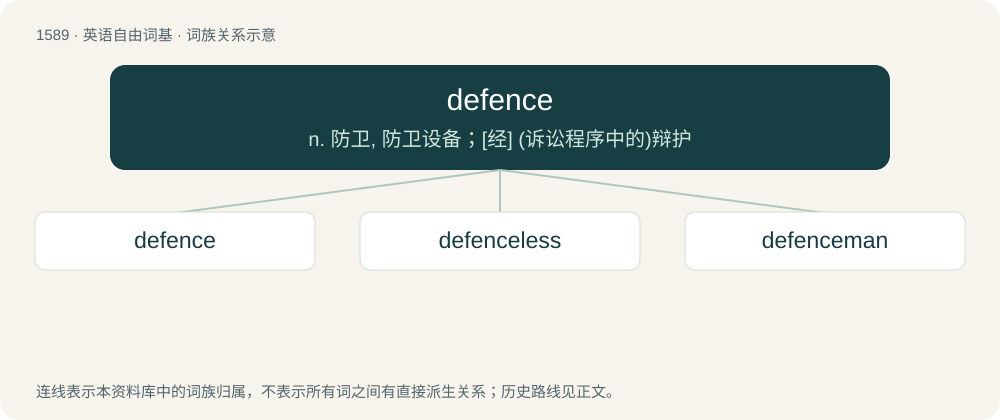

# 1680 · defence — n. 防卫, 防卫设备；\[经\] (诉讼程序中的)辩护

[总目录](../00_总目录_按常用程度.md)

**类型**：英语自由词基　｜　**来源语言**：见词源记录

## 核心含义与来源

- 核心含义：n. 防卫, 防卫设备；\[经\] (诉讼程序中的)辩护
- 英文含义：The action of defending, of protecting from attack, danger or injury.
- 词形：defence

**来源记录 1**（名词；The action of defending, of protecting from attack, danger or injury.）

From Middle English defens, defense, from Old French defens, defense, from Late Latin dēfēnsa (“protection”). Displaced Old English bewering.

## 词族图

## 单词速览（常用到不常用）

| 单词 | 音标 | 释义 |
|---|---|---|
| [defence](#w-1) | 英 /dɪˈfɛns/ | n. 防卫, 防卫设备；\[经\] (诉讼程序中的)辩护 |
| [defenceless](#w-2) | 英 /dɪˈfɛnsləs/ | a. 无防御的, 没有保护的, 无助的, 无防备的 |
| [defenceman](#w-3) |  | 【英文】In ice hockey and lacrosse, a player position with a primary responsibility to prevent the opposing team from scoring goals; same as defender in many other ballgames. |

## 逐词详解

### 1. defence

**词性**：名词　｜　**音标**：英 /dɪˈfɛns/

**中文释义**：n. 防卫, 防卫设备；\[经\] (诉讼程序中的)辩护

**英文义项**：The action of defending, of protecting from attack, danger or injury. / Something used to oppose attacks.

**词源与演化**：

From Middle English defens, defense, from Old French defens, defense, from Late Latin dēfēnsa (“protection”). Displaced Old English bewering.

**用法示例／搭配（非完整句）**：

> Department of Defence

该用例对应义项：Government policy or (infra)structure related to the military.

### 2. defenceless

**词性**：形容词　｜　**音标**：英 /dɪˈfɛnsləs/

**中文释义**：a. 无防御的, 没有保护的, 无助的, 无防备的

**英文义项**：Without defence; undefended.

**构词拆分**：defence + -less

**词源与演化**：

From defence + -less.

**例句**：

> Paralysed, the old man was defenceless; and the robbers easily stole all of his money.

该用例对应义项：Without defence; undefended.

### 3. defenceman

**词性**：名词

**英文义项**：In ice hockey and lacrosse, a player position with a primary responsibility to prevent the opposing team from scoring goals; same as defender in many other ballgames.

**构词拆分**：From defence + -man.

**词源与演化**：

From defence + -man.
