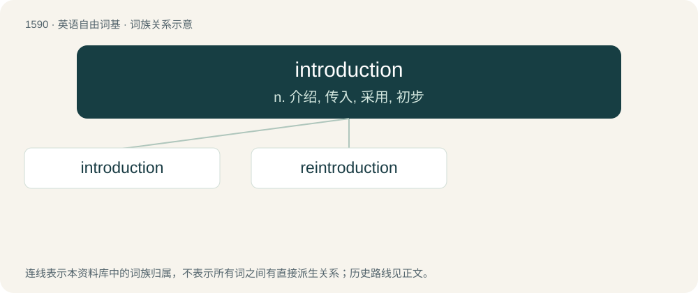

# 1682 · introduction — n. 介绍, 传入, 采用, 初步

[总目录](../00_总目录_按常用程度.md)

**类型**：英语自由词基　｜　**来源语言**：见词源记录

## 核心含义与来源

- 核心含义：n. 介绍, 传入, 采用, 初步
- 英文含义：The act or process of introducing.
- 词形：introduction

**来源记录 1**（名词；The act or process of introducing.）

From Middle English introduccioun, introduccyon, borrowed from Old French introduction, itself a borrowing from Latin intrōdūctiōnem, accusative of Latin intrōdūctiō, from intrōdūcō. By surface analysis, intro- + Latin dūctiō or introduce + -tion.

## 词族图

## 单词速览（常用到不常用）

| 单词 | 音标 | 释义 |
|---|---|---|
| [introduction](#w-1) | /ˌɪntɹəˈdʌkʃn̩/ | n. 介绍, 传入, 采用, 初步 |
| [reintroduction](#w-2) | /.riːintrə-ˈdʌkʃən/ | n. 再介绍；再引入 |

## 逐词详解

### 1. introduction

**词性**：名词　｜　**音标**：/ˌɪntɹəˈdʌkʃn̩/

**中文释义**：n. 介绍, 传入, 采用, 初步

**英文义项**：The act or process of introducing. / A means, such as a personal letter, of presenting one person to another.

**构词拆分**：introduce + -tion

**词源与演化**：

From Middle English introduccioun, introduccyon, borrowed from Old French introduction, itself a borrowing from Latin intrōdūctiōnem, accusative of Latin intrōdūctiō, from intrōdūcō. By surface analysis, intro- + Latin dūctiō or introduce + -tion.

**例句**：

> David was feeling groggy at his introduction to Sophie, and didn't remember her name.

该用例对应义项：A means, such as a personal letter, of presenting one person to another.

### 2. reintroduction

**词性**：名词　｜　**音标**：/.riːintrə-ˈdʌkʃən/

**中文释义**：n. 再介绍；再引入

**英文义项**：The act of introducing something again. / The release of animals from captivity into the wild, especially, into an area where they have become extirpated or greatly reduced.

**构词拆分**：re- + introduction

**词源与演化**：

From re- + introduction.
