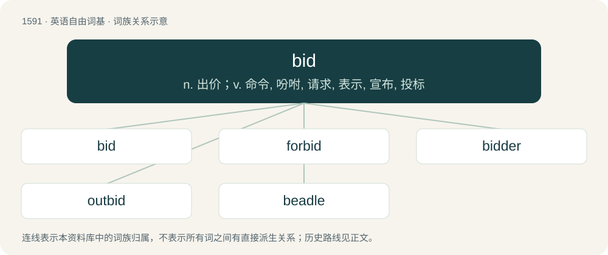

# 1684 · bid — n. 出价；v. 命令, 吩咐, 请求, 表示, 宣布, 投标

[总目录](../00_总目录_按常用程度.md)

**类型**：英语自由词基　｜　**来源语言**：见词源记录

## 核心含义与来源

- 核心含义：n. 出价；v. 命令, 吩咐, 请求, 表示, 宣布, 投标
- 英文含义：To issue a command; to tell.
- 词形：bid

**多个词源／构词路径**：同一拼写可能有不同来源；以下按词性和含义分别列出。

**来源记录 1**（动词；To issue a command; to tell.）

From Middle English bidden, from Old English biddan (“to ask, demand”), from Proto-West Germanic \*biddjan, from Proto-Germanic \*bidjaną (“to ask”), from Proto-Indo-European \*gʷʰedʰ-. Conflated with Old English bēodan (“to offer, announce”) (see Etymology 2 below). Compare West Frisian bidde, Low German bidden, Dutch bidden ("to pray"), German bitten, Danish bede, Norwegian Bokmål be.

**来源记录 2**（动词；To make an offer to pay or accept a certain price.）

From Middle English beden, from Old English bēodan (“to offer, announce”), from Proto-Germanic \*beudaną (“to offer”), from Proto-Indo-European \*bʰewdʰ- (“be awake, aware”). Conflated with Old English biddan (“to ask, demand”) (see Etymology 1 above). Compare Low German bieden, beden, Dutch bieden, German bieten, Danish byde, Norwegian Bokmål by. More at bede.

## 词族图

## 单词速览（常用到不常用）

| 单词 | 音标 | 释义 |
|---|---|---|
| [bid](#w-1) | /bɪd/ | n. 出价；v. 命令, 吩咐, 请求, 表示, 宣布, 投标 |
| [forbid](#w-2) | 英 /fəˈbɪd/；美 /fɚˈbɪd/ | vt. 禁止, 不准, 妨碍；\[法\] 不许, 禁止, 阻止 |
| [bidder](#w-3) | 英 /ˈbɪd.ə/；美 /ˈbɪ.dɚ/ | n. 出价人, 投标人；\[经\] 投标人, 出价人, 投标商 |
| [outbid](#w-4) | /aʊtˈbɪd/ | vt. 出高于...的价钱 |
| [beadle](#w-5) | /ˈbiːdəl/ | n. 教区执事, 英国大学典礼仪仗官；\[法\] 牧师助理, 小官吏, (英国大学的)游行领队 |

## 逐词详解

### 1. bid

**词性**：动词　｜　**音标**：/bɪd/

**中文释义**：n. 出价；v. 命令, 吩咐, 请求, 表示, 宣布, 投标

**英文义项**：To issue a command; to tell. / To invite; to summon.

**词源与演化**：

From Middle English bidden, from Old English biddan (“to ask, demand”), from Proto-West Germanic \*biddjan, from Proto-Germanic \*bidjaną (“to ask”), from Proto-Indo-European \*gʷʰedʰ-. Conflated with Old English bēodan (“to offer, announce”) (see Etymology 2 below). Compare West Frisian bidde, Low German bidden, Dutch bidden ("to pray"), German bitten, Danish bede, Norwegian Bokmål be.

**例句**：

> I bid you greetings and may there be peace through fellowship between us.

### 2. forbid

**词性**：动词　｜　**音标**：英 /fəˈbɪd/；美 /fɚˈbɪd/

**中文释义**：vt. 禁止, 不准, 妨碍；\[法\] 不许, 禁止, 阻止

**英文义项**：To disallow; to proscribe. / To deny, exclude from, or warn off, by express command.

**构词拆分**：for- (“from, away”) + bid (“to offer, proclaim”)

**词源与演化**：

From Middle English forbeden, from Old English forbēodan (“to forbid, prohibit, restrain, refuse, repeal, annul”), from Proto-Germanic \*furibeudaną, from \*furi + \*beudaną. Equivalent to for- (“from, away”) + bid (“to offer, proclaim”). Cognate with Dutch verbieden (“to forbid”), German verbieten (“to forbid”), Danish forbyde (“to forbid”), Norwegian Bokmål forby (“to forbid”), Swedish förbjuda (“to forbid”), Gothic 𐍆𐌰𐌿𐍂𐌱𐌹𐌿𐌳𐌰𐌽 (faurbiudan). Related to forbode.

**例句**：

> An impassable river forbids the approach of the army.

该用例对应义项：To oppose, hinder, or prevent, as if by an effectual command.

### 3. bidder

**词性**：名词　｜　**音标**：英 /ˈbɪd.ə/；美 /ˈbɪ.dɚ/

**中文释义**：n. 出价人, 投标人；\[经\] 投标人, 出价人, 投标商

**英文义项**：Someone who bids (all senses), but most commonly, one offers to pay a specified price at an auction. / One who commands or orders.

**构词拆分**：bid + -er

**词源与演化**：

From Middle English bidder, biddere, equivalent to bid + -er. Cognate with Saterland Frisian Bidder, German Bitter.

**例句**：

> The highest bidder shall get the house.

该用例对应义项：Someone who bids (all senses), but most commonly, one offers to pay a specified price at an auction.

### 4. outbid

**词性**：动词　｜　**音标**：/aʊtˈbɪd/

**中文释义**：vt. 出高于...的价钱

**英文义项**：To bid more than (somebody else) in an auction.

**构词拆分**：out- + bid

**词源与演化**：

From out- + bid.

**例句**：

> Ziri outbid everyone at the auction.

### 5. beadle

**词性**：名词　｜　**音标**：/ˈbiːdəl/

**中文释义**：n. 教区执事, 英国大学典礼仪仗官；\[法\] 牧师助理, 小官吏, (英国大学的)游行领队

**英文义项**：A parish constable, a uniformed minor (lay) official, who ushers and keeps order. / An attendant to the minister.

**构词拆分**：bid + -le

**词源与演化**：

From Middle English bedel, bidel, from Old English bydel (“warrant officer, apparitor”), from Proto-West Germanic \*budil, from Proto-Germanic \*budilaz (“herald”), equivalent to bid + -le. Cognate with Dutch beul, German Büttel. More at bid.
