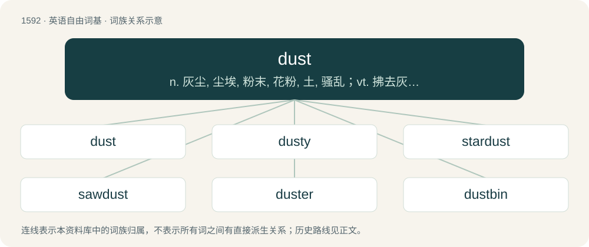

# 1685 · dust — n. 灰尘, 尘埃, 粉末, 花粉, 土, 骚乱；vt. 拂去灰尘, 撒, 弄成粉末；vi. 拂去灰尘, 化为粉末

[总目录](../00_总目录_按常用程度.md)

**类型**：英语自由词基　｜　**来源语言**：见词源记录

## 核心含义与来源

- 核心含义：n. 灰尘, 尘埃, 粉末, 花粉, 土, 骚乱；vt. 拂去灰尘, 撒, 弄成粉末；vi. 拂去灰尘, 化为粉末
- 英文含义：Fine, dry particles of matter found in the air and covering the surface of objects, typically consisting of soil lifted up by the wind, pollen, hair, fiber debris, dead skin cells, etc.
- 词形：dust

**来源记录 1**（名词；Fine, dry particles of matter found in the air and covering the surface of objects, typically consisting of soil lifted up by the wind, pollen, hair, fiber debris, dead skin cells, etc.）

From Middle English dust, doust, from Old English dūst (“dust, dried earth reduced to powder; other dry material reduced to powder”), from the fusion of Proto-Germanic \*dustą (“dust”) and \*dunstą (“mist, dust, evaporation”), both from Proto-Indo-European \*dʰewh₂- (“to smoke, raise dust”). Cognate with Scots dust, dist (“dust”), Dutch duist (“pollen, dust”) and dons (“down, fuzz”), German Dust (“dust”) and Dunst (“haze”), Swedish dust (“dust”), Icelandic dust (“dust”), Latin fūmus (“smoke, steam”). Also related to Swedish dun (“down, fluff”), Icelandic dúnn (“down, fluff”). See down.

## 词族图

## 单词速览（常用到不常用）

| 单词 | 音标 | 释义 |
|---|---|---|
| [dust](#w-1) | /dʌst/ | n. 灰尘, 尘埃, 粉末, 花粉, 土, 骚乱；vt. 拂去灰尘, 撒, 弄成粉末；vi. 拂去灰尘, 化为粉末 |
| [dusty](#w-2) | /ˈdʌsti/ | a. 灰尘多的, 无聊的, 含糊的, 粉末状的 |
| [stardust](#w-3) | 英 /ˈstɑːdʌst/；美 /ˈstɑɹˌdʌst/ | n. 星团, 幻觉 |
| [sawdust](#w-4) | /ˈsɔːˌdʌst/ | n. 锯屑；\[机\] 锯屑 |
| [duster](#w-5) | 英 /ˈdʌstə/；美 /ˈdʌstɚ/ | n. 掸子, 打扫灰尘的人 |
| [dustbin](#w-6) | 英 /ˈdʌstbɪn/ | n. 垃圾箱 |

## 逐词详解

### 1. dust

**词性**：名词　｜　**音标**：/dʌst/

**中文释义**：n. 灰尘, 尘埃, 粉末, 花粉, 土, 骚乱；vt. 拂去灰尘, 撒, 弄成粉末；vi. 拂去灰尘, 化为粉末

**英文义项**：Fine, dry particles of matter found in the air and covering the surface of objects, typically consisting of soil lifted up by the wind, pollen, hair, fiber debris, dead skin cells, etc. / Any substance reduced to fine particles; powder.

**词源与演化**：

From Middle English dust, doust, from Old English dūst (“dust, dried earth reduced to powder; other dry material reduced to powder”), from the fusion of Proto-Germanic \*dustą (“dust”) and \*dunstą (“mist, dust, evaporation”), both from Proto-Indo-European \*dʰewh₂- (“to smoke, raise dust”). Cognate with Scots dust, dist (“dust”), Dutch duist (“pollen, dust”) and dons (“down, fuzz”), German Dust (“dust”) and Dunst (“haze”), Swedish dust (“dust”), Icelandic dust (“dust”), Latin fūmus (“smoke, steam”). Also related to Swedish dun (“down, fluff”), Icelandic dúnn (“down, fluff”). See down.

**用法示例／搭配（非完整句）**：

> to raise, or kick up, a dust

该用例对应义项：A tumult, disturbance, commotion, uproar.

### 2. dusty

**词性**：形容词　｜　**音标**：/ˈdʌsti/

**中文释义**：a. 灰尘多的, 无聊的, 含糊的, 粉末状的

**英文义项**：Covered with dust. / Powdery and resembling dust.

**构词拆分**：dust + -y

**词源与演化**：

From Middle English dusty, dusti, from Old English dūstiġ, dystiġ, dȳstiġ (“dusty”), equivalent to dust + -y. Cognate with Dutch donzig (“cottony, downy, woolly”), German dunstig (“hazy, misty”).

**用法示例／搭配（非完整句）**：

> a dusty peach color

该用例对应义项：Grey or greyish.

### 3. stardust

**词性**：名词　｜　**音标**：英 /ˈstɑːdʌst/；美 /ˈstɑɹˌdʌst/

**中文释义**：n. 星团, 幻觉

**英文义项**：Small fragments of dustlike material found in space; specifically, a type of cosmic dust that formed from cooling gases ejected from presolar stars, which was then incorporated into the cloud from which the Solar System condensed. / A distant cluster of stars resembling a cloud of dust, especially if the individual stars of which cannot be resolved with a telescope.

**构词拆分**：star + dust

**词源与演化**：

From star + dust.

**例句**：

> My sister’s eyes were full of stardust – she’d spend hours lazily planning her future life when she would make her big break in the movies.

该用例对应义项：An imaginary magic dust or powder that, when in one's eyes, supposedly causes one to view a person or thing favourably, even though this might not actually be warranted.

### 4. sawdust

**词性**：名词　｜　**音标**：/ˈsɔːˌdʌst/

**中文释义**：n. 锯屑；\[机\] 锯屑

**英文义项**：The fine particles (dust) created by sawing wood or other material. / Food that is unpleasantly powdery and tasteless.

**构词拆分**：saw + dust

**词源与演化**：

From saw + dust.

**例句**：

> And underneath his sawhorse there was a little pile of sawdust.

### 5. duster

**词性**：名词　｜　**音标**：英 /ˈdʌstə/；美 /ˈdʌstɚ/

**中文释义**：n. 掸子, 打扫灰尘的人

**英文义项**：An object, such as a cloth or a purpose-made soft and puffy pad or mitt, used for dusting surfaces etc. / Someone who dusts.

**构词拆分**：dust + -er

**词源与演化**：

From dust + -er.

**例句**：

> Tom, you're the duster this week. Mary, you're the sweeper. I'm the dishwasher.

### 6. dustbin

**词性**：名词　｜　**音标**：英 /ˈdʌstbɪn/

**中文释义**：n. 垃圾箱

**英文义项**：A bin for holding rubbish until it can be collected; a garbage can.

**构词拆分**：dust + bin

**词源与演化**：

From dust + bin, as used for disposing of dust (originally ash from domestic fires) and other rubbish.

**例句**：

> The roast potatoes are burnt. They're only fit for the dustbin, I'm afraid.
