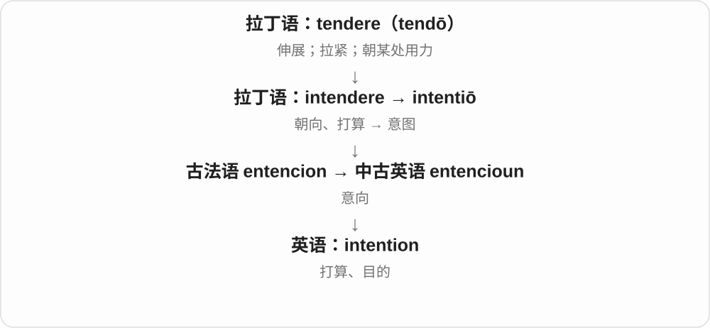
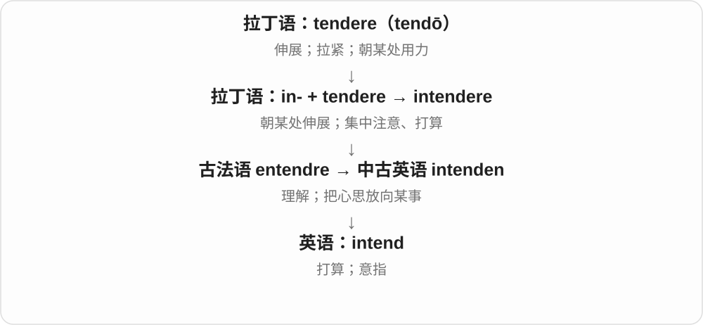

# 1686 · intention — 意图这一名词，以及怀有某种意图的形容词

[逐词精讲目录](../00_逐词精讲目录.md) · [总目录](../00_总目录_按常用程度.md)

## 核心词根与来源

把想达到的目的、出发点与实际结果分开。这样 well intentioned but unhelpful 就不矛盾。

**INTENTIONED：看出发点怎样，不先断定效果怎样**

intention → intentioned，常搭配 well、badly 等限定。

- **意图与出发点性质**：intention · intentioned
- **intention → intentions：心思朝着一个目标伸去**：intend · intention · intentions

## 词形与演化规律

intention + -ed，具有某种意图；这个 -ed 不是普通动词过去时。

拉丁 intentio 经法语 entencion 借入，现代与 intend、intent 配套，不颠倒所有借入先后。

## 单词速览（按词族由简到繁）

同一基础词的相关扩展放在一起，先读基础形式，再读扩展；各组之间优先读常用的。具体词源关系见各词讲解。

| 单词 | 音标 | 核心意思 |
|---|---|---|
| [intention](#w-1) | /ɪnˈtenʃən/ | 意图；打算；目的 |
| [intentions](#w-3) | /ɪnˈtenʃənz/ | 意图、打算、目的〔复数〕 |
| [intentioned](#w-2) | /ɪnˈtenʃənd/ | 怀有某种意图的〔通常带限定词〕 |
| [intend](#w-4) | /ɪnˈtend/ | 打算；意在；指定供……使用 |

## 逐词讲解

### 1. intention — 意图；打算；目的

**音标**：/ɪnˈtenʃən/

**先抓住这个画面**

intention 是行动前心里指向的目标：你本来想让什么发生。

**怎么拆**

来自拉丁语 intentiō，经古法语 entencion；现代可与 intend / intent 对照，但不是英语 intent 生出所有历史形式。

**怎么变成今天的意思**

have no intention of doing 是完全不打算做；good intentions 不保证最后效果好。

**常见搭配与例句**

with the intention of；have every intention of；good intentions。

> My intention was to help, not to interrupt.

我原本是想帮忙，不是打断。

> She has no intention of leaving the team.

她完全没有离开团队的打算。

**别混淆**

intention 是想达到的目的；result 是实际发生的结果。

### 2. intentions — 意图、打算、目的〔复数〕

**音标**：/ɪnˈtenʃənz/

**先抓住这个画面**

事情还没做，心里的方向先朝一个结果伸过去，这些打算、目的就是 intentions。

**怎么拆**

intention + -s，/n/ 后读 /z/。intention 经古法语 entencion 接拉丁 intentio，较早连 intendere 的伸向、指向材料；与 intend、intent 同族但有独立名词借入史。

**怎么变成今天的意思**

**拉丁 intentio → 古法语 entencion → intention**  
伸向、注意指向 → 目的、打算

↓

**intention + -s → intentions**  
多个目的、打算；也泛谈一个人的用意

good intentions 好意；intentions for the future 对未来的打算；make intentions clear 说清意图。

**常见搭配与例句**

the best intentions 最好的用意；intentions behind a decision 决定背后的意图。

> She explained her intentions clearly.

她清楚说明了自己的打算。

> The plan began with good intentions but needed more detail.

计划的出发点是好的，但需要更多细节。

**别混淆**

intentions 是心里的目的，不等于实际结果。good intentions 可以是真好意，也可能最后没办成好事，句子要继续读。

### 3. intentioned — 怀有某种意图的〔通常带限定词〕

**音标**：/ɪnˈtenʃənd/

**先抓住这个画面**

这个词常需要前面交代意图怎样：well intentioned 本意良好，badly intentioned 怀着坏意。它给人或行为的出发点加说明。

**怎么拆**

intention 意图 + -ed，这里的 -ed 形成具有某种东西的形容词，不是 intention 这个名词自己发生过去动作。词尾常读 /ʃənd/，不多加 /ɪd/。

**怎么变成今天的意思**

**拉丁 intentiō 经法语等 → intention**  
意图、心中指向的目的

↓

**intention + -ed → intentioned**  
具有某种意图；通常由 well 等说明性质

well intentioned 本意良好的，badly intentioned 怀有恶意的。放在名词前常写作 a well-intentioned suggestion，连字符标出整体修饰关系。

**常见搭配与例句**

well intentioned；badly intentioned；a well-intentioned suggestion。

> The advice was well intentioned but unhelpful.

建议出于好意，却没有帮助。

> She appreciated his well-intentioned efforts.

她感激他出于好意所作的努力。

**别混淆**

well intentioned 评价出发点，effective 评价有没有用。好心建议也可能效果差；intentional 则是故意的，不等于出于好意。

### 4. intend — 打算；意在；指定供……使用

**音标**：/ɪnˈtend/

**先抓住这个画面**

intend 是把心思朝某个目标指去：还没做，也已经有了打算。

**怎么拆**

in-（朝向）+ tendere → intendere，经法语 entendre 传入。

**怎么变成今天的意思**

intend to do 是打算做；be intended for 是原本为某人、某用途准备。

**常见搭配与例句**

intend to return；intend someone to do；be intended for beginners。

> We intend to reopen the shop in June.

我们打算六月重新开店。

> This guide is intended for beginners.

这份指南是为初学者准备的。

**别混淆**

intend 是意愿；tend to 是倾向。The book is intended for children 说目标读者。

## 这一组要分清什么

intentioned 通常带限定；intentional 故意的与 well intentioned 出于好意不同。

## 串起来练习

Her intention was to help, and the suggestion was well intentioned.

她的意图是提供帮助，那条建议也是出于好意。
