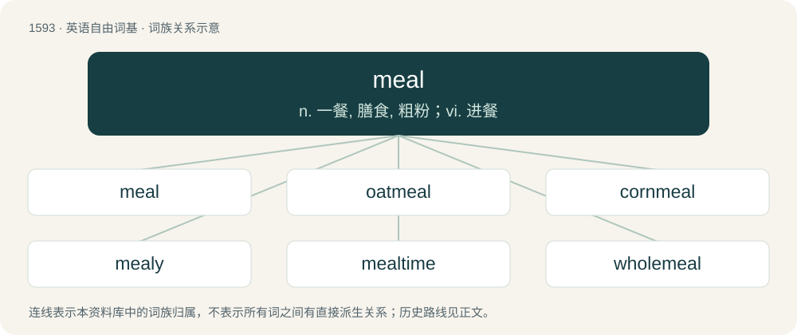

# 1686 · meal — n. 一餐, 膳食, 粗粉；vi. 进餐

[总目录](../00_总目录_按常用程度.md)

**类型**：英语自由词基　｜　**来源语言**：见词源记录

## 核心含义与来源

- 核心含义：n. 一餐, 膳食, 粗粉；vi. 进餐
- 英文含义：Food that is prepared and eaten, usually at a specific time, and usually in a comparatively large quantity.
- 词形：meal

**多个词源／构词路径**：同一拼写可能有不同来源；以下按词性和含义分别列出。

**来源记录 1**（名词；Food that is prepared and eaten, usually at a specific time, and usually in a comparatively large quantity.）

From Middle English mel, from Old English mǣl (“measure, time, occasion, set time, time for eating, meal”), from Proto-West Germanic \*māl, from Proto-Germanic \*mēlą, from Proto-Indo-European \*meh₁- (“to measure”). Cognate with West Frisian miel, Dutch maal (“meal, time, occurrence”), German Mal (“time”), Mahl (“meal”), Norwegian Bokmål mål (“meal”), Swedish mål (“meal”); and (from Proto-Indo-European) with Ancient Greek μέτρον (métron, “measure”), Latin mensus, Russian ме́ра (méra, “measure”), Lithuanian mẽtas. Related to Old English mǣþ (“measure, degree, proportion”).

**来源记录 2**（名词；The ground-up edible part of various grains, used as a basis of food or feed; either flour or a coarser blend than flour (usage varies).）

From Middle English mele, from Old English melu (“meal, flour”), from Proto-West Germanic \*melu, from Proto-Germanic \*melwą (“meal, flour”), from Proto-Indo-European \*melh₂- (“to grind, mill”). Cognates Cognate with West Frisian moal, Dutch meel, German Mehl, Albanian miell, Proto-Slavic \*melvo (“grain to be ground”) (Bulgarian мливо (mlivo)), Dutch malen (“to grind”), German mahlen (“to grind”), Old Irish melim (“I grind”), Latin molō (“to grind”), Tocharian A/B malywët (“you press”)/melye (“they tread on”), Lithuanian málti, Old Church Slavonic млѣти (mlěti), Ancient Greek μύλη (múlē, “mill”). More at mill.

**来源记录 3**（名词；A speck or spot.）

Variation of mole (compare Scots mail), from Middle English mole, mool, from Old English māl, mǣl (“spot, mark, blemish”), from Proto-Germanic \*mailą (“wrinkle, spot”), from Proto-Indo-European \*mey- (“to soil”). More at mole.

## 词族图

## 单词速览（常用到不常用）

| 单词 | 音标 | 释义 |
|---|---|---|
| [meal](#w-1) | /ˈmiːl/ | n. 一餐, 膳食, 粗粉；vi. 进餐 |
| [oatmeal](#w-2) | 英 /ˈəʊtmiːl/；美 /ˈoʊtmil/ | n. 燕麦片, 燕麦粥；\[医\] 燕麦片 |
| [cornmeal](#w-3) | 英 /ˈkɔːnˌmiːl/；美 /ˈkɔɹnˌmil/ | n. 玉蜀黍粉, 玉米片, 麦片 |
| [mealy](#w-4) | /ˈmiːli/ | a. 粉状的 |
| [mealtime](#w-5) | /ˈmiːltaim/ | n. 进餐时间 |
| [wholemeal](#w-6) | /ˈhoʊlmiːl/ | n. 全麦面粉 |

## 逐词详解

### 1. meal

**词性**：名词　｜　**音标**：/ˈmiːl/

**中文释义**：n. 一餐, 膳食, 粗粉；vi. 进餐

**英文义项**：Food that is prepared and eaten, usually at a specific time, and usually in a comparatively large quantity. / Food served or eaten as a repast.

**词源与演化**：

From Middle English mel, from Old English mǣl (“measure, time, occasion, set time, time for eating, meal”), from Proto-West Germanic \*māl, from Proto-Germanic \*mēlą, from Proto-Indo-European \*meh₁- (“to measure”). Cognate with West Frisian miel, Dutch maal (“meal, time, occurrence”), German Mal (“time”), Mahl (“meal”), Norwegian Bokmål mål (“meal”), Swedish mål (“meal”); and (from Proto-Indo-European) with Ancient Greek μέτρον (métron, “measure”), Latin mensus, Russian ме́ра (méra, “measure”), Lithuanian mẽtas. Related to Old English mǣþ (“measure, degree, proportion”).

**例句**：

> Breakfast is the morning meal, lunch is the noon meal, and dinner, or supper, is the evening meal.

该用例对应义项：Food that is prepared and eaten, usually at a specific time, and usually in a comparatively large quantity.

### 2. oatmeal

**词性**：名词　｜　**音标**：英 /ˈəʊtmiːl/；美 /ˈoʊtmil/

**中文释义**：n. 燕麦片, 燕麦粥；\[医\] 燕麦片

**英文义项**：Meal made from rolled or round oats. / A breakfast cereal made from rolled oats, cooked in milk or water.

**构词拆分**：oat + meal

**词源与演化**：

From Middle English otemele, from ote (“oat”) + mele (“meal, coarse-ground grains”). Equivalent to oat + meal.

**例句**：

> Tom adds a tablespoon of ground flaxseeds to his oatmeal every morning.

### 3. cornmeal

**词性**：名词　｜　**音标**：英 /ˈkɔːnˌmiːl/；美 /ˈkɔɹnˌmil/

**中文释义**：n. 玉蜀黍粉, 玉米片, 麦片

**英文义项**：Dried corn (maize) milled (ground) to a meal, especially a coarse one.

**构词拆分**：corn + meal

**词源与演化**：

From corn + meal.

**例句**：

> She made a kind of polenta from cornmeal and chicken broth, with some cheese sprinkled on top.

该用例对应义项：Dried corn (maize) milled (ground) to a meal, especially a coarse one.

### 4. mealy

**词性**：形容词　｜　**音标**：/ˈmiːli/

**中文释义**：a. 粉状的

**英文义项**：Resembling meal (the foodstuff). / Of the pale yellow color of a canary.

**构词拆分**：meal + -y

**词源与演化**：

From meal + -y. Cognate with German mehlig.

**例句**：

> Below the hole the mice made in the woodwork was a pile of mealy sawdust.

该用例对应义项：Resembling meal (the foodstuff).

### 5. mealtime

**词性**：名词　｜　**音标**：/ˈmiːltaim/

**中文释义**：n. 进餐时间

**英文义项**：The appointed time at which a meal is served or eaten.

**构词拆分**：meal + time

**词源与演化**：

From Middle English meeltime, from Old English mǣltīma (“mealtime”), equivalent to meal + time. Compare mealtide, Old English mǣltīd (“mealtime”), Dutch maaltijd (“meal”), German Mahlzeit (“meal, mealtime”), Danish måltid (“meal, mealtime”), Icelandic máltíð (“meal”), Icelandic matmálstími (“mealtime”).

**例句**：

> My youngest son has a special cry for mealtimes.

该用例对应义项：The appointed time at which a meal is served or eaten.

### 6. wholemeal

**词性**：形容词　｜　**音标**：/ˈhoʊlmiːl/

**中文释义**：n. 全麦面粉

**英文义项**：Containing or made from the whole grain, including the bran. / Whole-wheat.

**构词拆分**：whole + meal

**词源与演化**：

From whole + meal.

**例句**：

> Modern healthy eating experts put emphasis on eating wholemeal bread and eating more vegetables.
