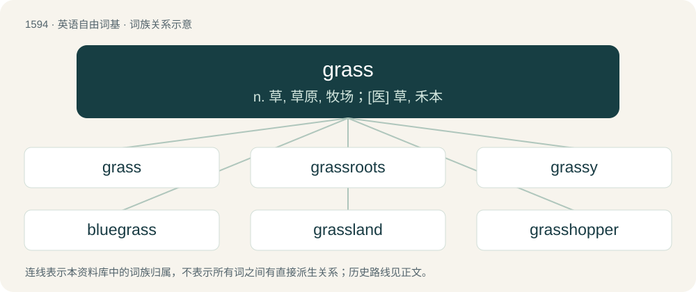

# 1687 · grass — n. 草, 草原, 牧场；\[医\] 草, 禾本

[总目录](../00_总目录_按常用程度.md)

**类型**：英语自由词基　｜　**来源语言**：见词源记录

## 核心含义与来源

- 核心含义：n. 草, 草原, 牧场；\[医\] 草, 禾本
- 英文含义：Any plant of the family Poaceae, characterized by leaves that arise from nodes in the stem and leaf bases that wrap around the stem, especially those grown as ground cover rather than for grain.
- 词形：grass

**来源记录 1**（名词；Any plant of the family Poaceae, characterized by leaves that arise from nodes in the stem and leaf bases that wrap around the stem, especially those grown as ground cover rather than for grain.）

Inherited from Middle English gras, from Old English græs, from Proto-West Germanic \*gras, from Proto-Germanic \*grasą (“grass”), from Proto-Indo-European \*gʰreh₁- (“to grow”). Cognates Cognate with Scots gress (“grass”), North Frisian gaars, geers, Gērs, gjars, gjas, gäärs (“grass”), Saterland Frisian Gäärs (“grass”), West Frisian gers (“grass”), Cimbrian gras, grass (“grass”), German and Luxembourgish Gras (“grass, weed”), Dutch gras (“grass, turf, pasture”), Mòcheno and Vilamovian gros (“grass”), West Flemish ges (“grass”), Yiddish גראָז (groz, “grass”), Danish græs (“grass”), Faroese, Icelandic, and Norwegian Nynorsk gras (“grass”), Norwegian Bokmål gras, gress (“grass”), Swedish gräs (“grass”), Gothic 𐌲𐍂𐌰𐍃 (gras, “herb”); also Latin herba (“plant, weed, grass”), Albanian grath (“grass blade, spike”). Related to grow, green. The "informer" sense is probably a shortening of grasshopper (“police officer, informant”), rhyming slang for copper (“police officer”) or shopper (“informant”); the exact sequence of derivation is unclear.

## 词族图

## 单词速览（常用到不常用）

| 单词 | 音标 | 释义 |
|---|---|---|
| [grass](#w-1) | /ɡɹɑːs/ | n. 草, 草原, 牧场；\[医\] 草, 禾本 |
| [grassroots](#w-2) | 英 /ˈɡɹɑːs.ɹuːts/；美 /ˈɡɹæs.ɹuːts/ | a. 草根的；基层的；乡村的 |
| [grassy](#w-3) | 英 /ˈɡɹɑːsi/；美 /ˈɡɹæsi/ | a. 草绿色的, 象草的, 长满草的 |
| [bluegrass](#w-4) | /ˈbluːgræs/ | n. 六月禾, 早熟禾熟植物 |
| [grassland](#w-5) | /ˈgræslænd/ | n. 牧草地, 草原 |
| [grasshopper](#w-6) | 英 /ˈɡɹɑːsˌhɒpə(ɹ)/；美 /ˈɡɹæsˌhɑpəɹ/ | n. 蚱蜢, 蝗虫 |
| [lemongrass](#w-7) | /ˈlemən^rɑːs;-^ræs/ | n. 柠檬香草 |
| [seagrass](#w-8) | 美 /ˈsiˌɡɹæs/ | 海草 |
| [wheatgrass](#w-9) | /ˈhwiːtgræs/ | n. 麦草, 冰草 |
| [sawgrass](#w-10) | /ˈsɔːgrɑːs/ | n. 索格拉斯球场 |
| [supergrass](#w-11) | 英 /ˈs(j)uːpə(ɹ)ˌɡɹɑːs/ | n. &lt;英&gt;向警方提供大量罪犯活动情报的人（尤指本人也是罪犯的人） |

## 逐词详解

### 1. grass

**词性**：名词　｜　**音标**：/ɡɹɑːs/

**中文释义**：n. 草, 草原, 牧场；\[医\] 草, 禾本

**英文义项**：Any plant of the family Poaceae, characterized by leaves that arise from nodes in the stem and leaf bases that wrap around the stem, especially those grown as ground cover rather than for grain. / Any of the various plants that are not in the family Poaceae that resemble grasses.

**词源与演化**：

Inherited from Middle English gras, from Old English græs, from Proto-West Germanic \*gras, from Proto-Germanic \*grasą (“grass”), from Proto-Indo-European \*gʰreh₁- (“to grow”). Cognates Cognate with Scots gress (“grass”), North Frisian gaars, geers, Gērs, gjars, gjas, gäärs (“grass”), Saterland Frisian Gäärs (“grass”), West Frisian gers (“grass”), Cimbrian gras, grass (“grass”), German and Luxembourgish Gras (“grass, weed”), Dutch gras (“grass, turf, pasture”), Mòcheno and Vilamovian gros (“grass”), West Flemish ges (“grass”), Yiddish גראָז (groz, “grass”), Danish græs (“grass”), Faroese, Icelandic, and Norwegian Nynorsk gras (“grass”), Norwegian Bokmål gras, gress (“grass”), Swedish gräs (“grass”), Gothic 𐌲𐍂𐌰𐍃 (gras, “herb”); also Latin herba (“plant, weed, grass”), Albanian grath (“grass blade, spike”). Related to grow, green. The "informer" sense is probably a shortening of grasshopper (“police officer, informant”), rhyming slang for copper (“police officer”) or shopper (“informant”); the exact sequence of derivation is unclear.

**例句**：

> What just happened must remain secret. Don't be a grass.

该用例对应义项：An informer; snitch, police informer; one who betrays a group (of criminals, etc) to the authorities.

### 2. grassroots

**词性**：形容词　｜　**音标**：英 /ˈɡɹɑːs.ɹuːts/；美 /ˈɡɹæs.ɹuːts/

**中文释义**：a. 草根的；基层的；乡村的

**英文义项**：Of, or relating to people or society at the local level, particularly in politics, social movements, etc.; of the grass roots.

**构词拆分**：grass + roots

**词源与演化**：

From grass + roots.

**例句**：

> A grassroots movement for nuclear disarmament.

该用例对应义项：of or involving the common people as constituting a fundamental political and economic group

### 3. grassy

**词性**：形容词　｜　**音标**：英 /ˈɡɹɑːsi/；美 /ˈɡɹæsi/

**中文释义**：a. 草绿色的, 象草的, 长满草的

**英文义项**：Covered with grass. / Resembling grass.

**构词拆分**：grass + -y

**词源与演化**：

From Middle English grasy, from Old English \*græsiġ, \*gærsiġ, from Proto-West Germanic \*grasagrōnī, from Proto-Germanic \*grasagrōniz, equivalent to grass + -y. Compare Saterland Frisian gäärsich (“grassy”), Dutch grazig (“grassy”), German grasig (“grassy”), Icelandic grösugur (“grassy”).

**例句**：

> We threw his grassy shorts straight into the washing machine.

该用例对应义项：Covered with grass.

### 4. bluegrass

**词性**：名词　｜　**音标**：/ˈbluːgræs/

**中文释义**：n. 六月禾, 早熟禾熟植物

**英文义项**：Kentucky bluegrass (Poa pratensis).

**构词拆分**：blue + grass

**词源与演化**：

From blue + grass, from the bluish appearance of the massed grass in late Spring.

**例句**：

> It's widely used in Western orchestral music, rock music, jazz, and bluegrass.

### 5. grassland

**词性**：名词　｜　**音标**：/ˈgræslænd/

**中文释义**：n. 牧草地, 草原

**英文义项**：An area dominated by grass or grasslike vegetation.

**构词拆分**：grass + land

**词源与演化**：

From grass + land. Compare Dutch grasland (“grassland”), Faroese graslendi (“grassland”), Icelandic graslendi (“grassland”). Compare also Old English græsmolde (“grassland”).

**例句**：

> The steppe ecosystem is a grassland biome that is found in temperate regions around the world.

### 6. grasshopper

**词性**：名词　｜　**音标**：英 /ˈɡɹɑːsˌhɒpə(ɹ)/；美 /ˈɡɹæsˌhɑpəɹ/

**中文释义**：n. 蚱蜢, 蝗虫

**英文义项**：A mostly herbivorous insect of the order Orthoptera, noted for its ability to jump long distances and for the habit of some species communicating by stridulation; they are related to but distinct from crickets. / In the strict sense, refers to insects in the suborder Caelifera, particularly those in the family Acrididae.

**构词拆分**：grass + hopper

**词源与演化**：

From Middle English grashoppere, alteration of earlier grashoppe, from Old English græshoppa (“grasshopper”). Equivalent to grass + hopper. Cognate with Saterland Frisian Gäärshupper, Dutch grashupper, grashipper, German Low German Grashüpper, Gresshüpper, German Grashüpfer, Danish græshoppe, Swedish gräshoppa, Norwegian gresshoppe.

**例句**：

> A grasshopper landed in the middle of the salad at the picnic.

### 7. lemongrass

**词性**：名词　｜　**音标**：/ˈlemən^rɑːs;-^ræs/

**中文释义**：n. 柠檬香草

**英文义项**：One of various species of grass of the genus Cymbopogon, especially Cymbopogon citratus, which have a lemon-like taste and aroma, and are used in cooking, for tea, and for fragrance. / Sourgrass (Oxalis pes-caprae).

**构词拆分**：lemon + grass

**词源与演化**：

From lemon + grass.

**例句**：

> The salmon was seasoned with wild garlic and lemongrass.

### 8. seagrass

**词性**：名词　｜　**音标**：美 /ˈsiˌɡɹæs/

**中文释义**：海草

**英文义项**：Any of various grass-like marine plants that grow underwater in salt water.

**构词拆分**：sea + grass

**词源与演化**：

From sea + grass.

**例句**：

> Seagrass provides a protective environment in which young fish can develop.

该用例对应义项：any of various seaweeds that grow underwater in shallow beds

### 9. wheatgrass

**词性**：名词　｜　**音标**：/ˈhwiːtgræs/

**中文释义**：n. 麦草, 冰草

**英文义项**：Young grass of the common wheat plant, Triticum aestivum, used freshly juiced or dried into powder for animal and human consumption. / A grass of the genus Agropyron, commonly known as crested-wheat grass.

**构词拆分**：wheat + grass

**词源与演化**：

From wheat + grass.

### 10. sawgrass

**词性**：名词　｜　**音标**：/ˈsɔːgrɑːs/

**中文释义**：n. 索格拉斯球场

**英文义项**：Any of several Cladium species, long sedges with saw-like sharp, serrated edges, such as Cladium californicum, Cladium jamaicense, and Cladium mariscoides

**构词拆分**：saw + grass

**词源与演化**：

From saw + grass.

### 11. supergrass

**词性**：名词　｜　**音标**：英 /ˈs(j)uːpə(ɹ)ˌɡɹɑːs/

**中文释义**：n. &lt;英&gt;向警方提供大量罪犯活动情报的人（尤指本人也是罪犯的人）

**英文义项**：An informer providing substantial quantities of information on criminal or terrorist activities to the police.

**构词拆分**：super- + grass

**词源与演化**：

From super- + grass, from grass (“an informer”).
