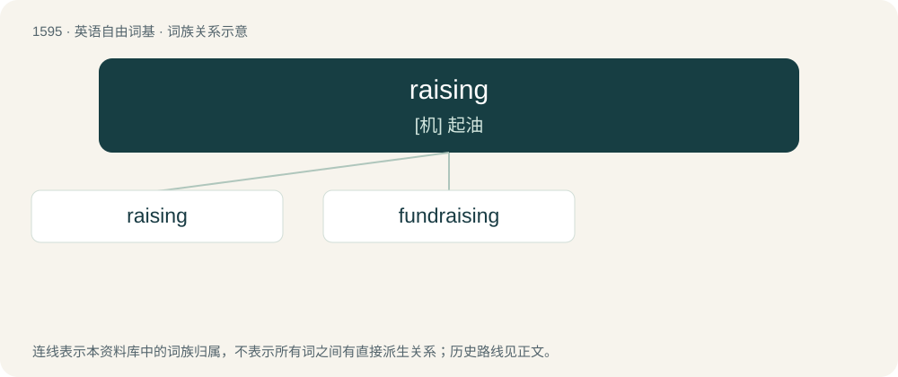

# 1688 · raising — \[机\] 起油

[总目录](../00_总目录_按常用程度.md)

**类型**：英语自由词基　｜　**来源语言**：见词源记录

## 核心含义与来源

- 核心含义：\[机\] 起油
- 英文含义：Elevation.
- 词形：raising

**来源记录 1**（名词；Elevation.）

Inherited from Middle English reysynge; equivalent to raise + -ing.

## 词族图

## 单词速览（常用到不常用）

| 单词 | 音标 | 释义 |
|---|---|---|
| [raising](#w-1) | /ˈɹeɪzɪŋ/ | \[机\] 起油 |
| [fundraising](#w-2) | /ˈfʌndˌɹeɪzɪŋ/ | n. 筹款, 募款；a. 筹款的 |

## 逐词详解

### 1. raising

**词性**：名词　｜　**音标**：/ˈɹeɪzɪŋ/

**中文释义**：\[机\] 起油

**英文义项**：Elevation. / Nurturing; cultivation; providing sustenance and protection for a living thing from conception to maturity.

**构词拆分**：raise + -ing

**词源与演化**：

Inherited from Middle English reysynge; equivalent to raise + -ing.

**用法示例／搭配（非完整句）**：

> cattle raising

该用例对应义项：Nurturing; cultivation; providing sustenance and protection for a living thing from conception to maturity.

### 2. fundraising

**词性**：名词　｜　**音标**：/ˈfʌndˌɹeɪzɪŋ/

**中文释义**：n. 筹款, 募款；a. 筹款的

**英文义项**：The process of collecting money by requesting donations from individuals and businesses.

**构词拆分**：fund + raising

**词源与演化**：

From fund + raising.

**例句**：

> Tom said that the fundraising event was a success.
