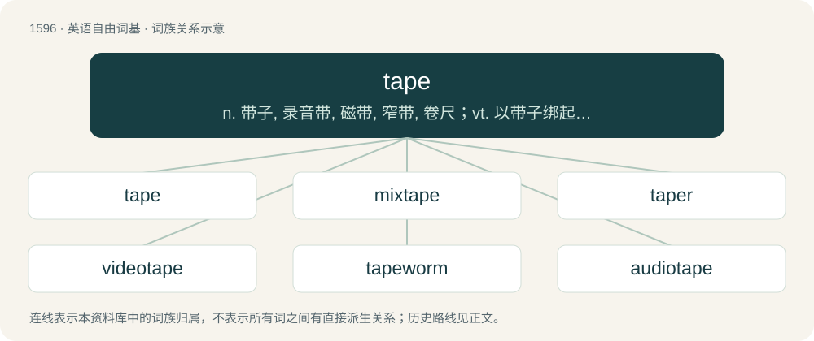

# 1689 · tape — n. 带子, 录音带, 磁带, 窄带, 卷尺；vt. 以带子绑起, 测量, 录音；\[计\] 带

[总目录](../00_总目录_按常用程度.md)

**类型**：英语自由词基　｜　**来源语言**：见词源记录

## 核心含义与来源

- 核心含义：n. 带子, 录音带, 磁带, 窄带, 卷尺；vt. 以带子绑起, 测量, 录音；\[计\] 带
- 英文含义：Flexible material in a roll with a sticky surface on one or both sides; adhesive tape.
- 词形：tape

**来源记录 1**（名词；Flexible material in a roll with a sticky surface on one or both sides; adhesive tape.）

From Middle English tape, tappe, from Old English tæppa, tæppe (“ribbon, tape”); further origin unclear. Probably akin to Old Frisian tapia (“to pull, rip, tear”), Middle Low German tappen, tāpen (“to grab, pull, rip, tear, snatch”), Middle High German zāfen, zāven (“to pull, tear”).

## 词族图

## 单词速览（常用到不常用）

| 单词 | 音标 | 释义 |
|---|---|---|
| [tape](#w-1) | 英 /teɪ̯p/ | n. 带子, 录音带, 磁带, 窄带, 卷尺；vt. 以带子绑起, 测量, 录音；\[计\] 带 |
| [mixtape](#w-2) |  | 【英文】A compilation of songs assembled into a single sequence, usually encompassing many different artists and assembled by fans; often curated around a theme, mood, or personal taste; traditionally without legal permissio |
| [taper](#w-3) | 英 /ˈteɪpə/；美 /ˈteɪpɚ/ | 【英文】One who operates a tape machine. |
| [videotape](#w-4) |  | n. 录相磁带；vt. 把电视节目录在录像磁带上 |
| [tapeworm](#w-5) | 美 /ˈteɪpˌwɝm/ | n. 绦虫；\[医\] 绦虫 |
| [audiotape](#w-6) | /ˈɔːdiəuteip/ | n. 录音磁带 |

## 逐词详解

### 1. tape

**词性**：名词　｜　**音标**：英 /teɪ̯p/

**中文释义**：n. 带子, 录音带, 磁带, 窄带, 卷尺；vt. 以带子绑起, 测量, 录音；\[计\] 带

**英文义项**：Flexible material in a roll with a sticky surface on one or both sides; adhesive tape. / Thin and flat paper, plastic or similar flexible material, usually produced in the form of a roll.

**词源与演化**：

From Middle English tape, tappe, from Old English tæppa, tæppe (“ribbon, tape”); further origin unclear. Probably akin to Old Frisian tapia (“to pull, rip, tear”), Middle Low German tappen, tāpen (“to grab, pull, rip, tear, snatch”), Middle High German zāfen, zāven (“to pull, tear”).

**例句**：

> Old couples will sometimes play tapes at each other during a fight.

该用例对应义项：An unthinking, patterned response triggered by a particular stimulus.

### 2. mixtape

**词性**：名词

**英文义项**：A compilation of songs assembled into a single sequence, usually encompassing many different artists and assembled by fans; often curated around a theme, mood, or personal taste; traditionally without legal permission. / A playlist-style compilation of songs created on any medium (CD, digital file, streaming playlist), often shared among friends or online communities.

**构词拆分**：mix + tape

**词源与演化**：

From mix + tape; originally mix tape. Originally referring to a homemade compilation recorded onto a cassette tape and circulated informally, especially within hip-hop culture, mixtape has broadened in sense. In contemporary usage it often denotes a musical project released outside the conventional album framework, typically characterized by looser structure, experimental material, or informal distribution, even when no physical tape medium is involved.

**例句**：

> Welcome to the New Administration was a mixtape released by American rock band Fall Out Boy and featured tracks by fellow artists from their label.

该用例对应义项：A label-curated compilation designed to showcase multiple artists (especially emerging acts), often serving promotional or scene-building purposes.

### 3. taper

**词性**：名词　｜　**音标**：英 /ˈteɪpə/；美 /ˈteɪpɚ/

**英文义项**：One who operates a tape machine. / Someone who works with tape or tapes.

**构词拆分**：tape + -er

**词源与演化**：

From tape + -er.

### 4. videotape

**词性**：名词

**中文释义**：n. 录相磁带；vt. 把电视节目录在录像磁带上

**英文义项**：A relatively wide magnetic tape used for recording visual images and sounds (as of a television production) for subsequent playback or broadcasting. / Synonym of videocassette (“cassette containing videotape”).

**构词拆分**：video + tape

**词源与演化**：

From video + tape, a trademark of media company Ampex.

**例句**：

> I promise to return this videotape within a week.

### 5. tapeworm

**词性**：名词　｜　**音标**：美 /ˈteɪpˌwɝm/

**中文释义**：n. 绦虫；\[医\] 绦虫

**英文义项**：Any parasitical worm of the class or infraclass Cestoda, which infests the intestines of animals, including humans, often infecting different host species during their life cycle. / A broad fish tapeworm, Diphyllobothrium latum.

**构词拆分**：tape + worm

**词源与演化**：

From tape + worm.

**例句**：

> A tapeworm can live in your intestines for years.

### 6. audiotape

**词性**：名词　｜　**音标**：/ˈɔːdiəuteip/

**中文释义**：n. 录音磁带

**英文义项**：A magnetic tape that stores analog sound for later playback on a tape player. / Any of a cassette tape, eight-track tape, reel-to-reel tape, DAT, etc.

**构词拆分**：audio + tape

**词源与演化**：

From audio + tape.
