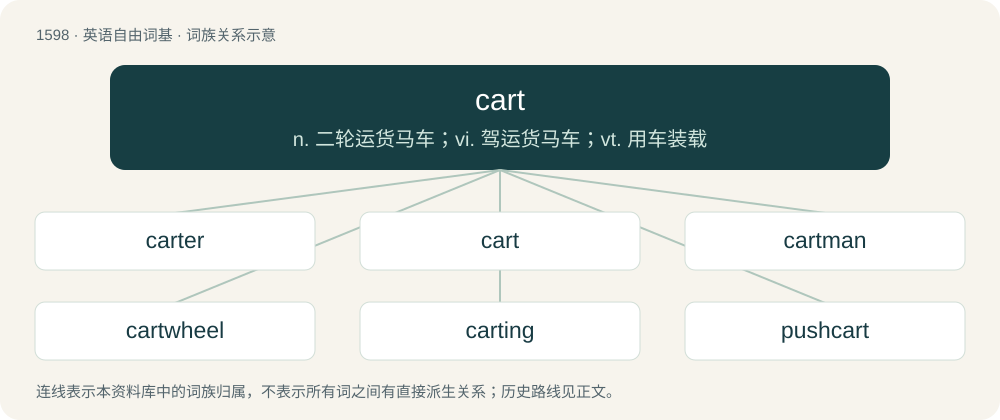

# 1692 · cart — n. 二轮运货马车；vi. 驾运货马车；vt. 用车装载

[总目录](../00_总目录_按常用程度.md)

**类型**：英语自由词基　｜　**来源语言**：见词源记录

## 核心含义与来源

- 核心含义：n. 二轮运货马车；vi. 驾运货马车；vt. 用车装载
- 英文含义：A small, open, wheeled vehicle, drawn or pushed by a person or animal, often with two wheels on one axle, more often used for transporting goods than passengers.
- 词形：cart

**多个词源／构词路径**：同一拼写可能有不同来源；以下按词性和含义分别列出。

**来源记录 1**（名词；A small, open, wheeled vehicle, drawn or pushed by a person or animal, often with two wheels on one axle, more often used for transporting goods than passengers.）

From Middle English cart, kart, from Old Norse kartr (“wagon; cart”), merged with native Old English cræt (“a chariot; cart”), from Proto-Germanic \*krattaz, \*krattijô, \*kradō, from Proto-Indo-European \*gret- (“tracery; wattle; cradle; cage; basket”), from \*ger- (“to turn, wind”). Cognate with West Frisian kret (“wheelbarrow for hauling dung”), Dutch krat, kret (“crate; wheelbarrow for hauling dung”), German Krätze (“basket; pannier”). Wider cognates include Sanskrit ग्रन्थ (grantha, “a binding”).

**来源记录 2**（名词；A tape cartridge used for pre-recorded material such as jingles and advertisements.）

Clipping of cartridge.

## 词族图

## 单词速览（常用到不常用）

| 单词 | 音标 | 释义 |
|---|---|---|
| [carter](#w-1) | 英 /ˈkɑːtə/；美 /ˈkɑɹtɚ/ | n. 运货马车夫 |
| [cart](#w-2) | 英 /kɑːt/；美 /kɑɹt/ | n. 二轮运货马车；vi. 驾运货马车；vt. 用车装载 |
| [cartman](#w-3) | /ˈkɑːtmæn/ | n. 赶大车(或轻型二轮车)的人,卡车司机 |
| [cartwheel](#w-4) | 英 /ˈkɑːtˌwiːl/；美 /ˈkɑɹtˌwil/ | n. 车轮(货车的车轮), 侧手翻 |
| [carting](#w-5) | 英 /ˈkɑːtɪŋ/ | 运出 |
| [pushcart](#w-6) | 美 /ˈpʊʃˌkɑɹt/ | n. 手推车 |

## 逐词详解

### 1. carter

**词性**：名词　｜　**音标**：英 /ˈkɑːtə/；美 /ˈkɑɹtɚ/

**中文释义**：n. 运货马车夫

**英文义项**：A person who transports a load on a cart that is drawn by a beast of burden. / A fish, the whiff or Marysole.

**构词拆分**：cart + -er

**词源与演化**：

From Middle English carter, cartere, cartare, equivalent to cart + -er. Merged with Middle English careter, caretier (“coachman, charioteer”, a surname), from Anglo-Norman careter (compare French charretier).

**例句**：

> Jimmy Carter is the first U.S. President to live to be 100.

### 2. cart

**词性**：名词　｜　**音标**：英 /kɑːt/；美 /kɑɹt/

**中文释义**：n. 二轮运货马车；vi. 驾运货马车；vt. 用车装载

**英文义项**：A small, open, wheeled vehicle, drawn or pushed by a person or animal, often with two wheels on one axle, more often used for transporting goods than passengers. / A small motor vehicle resembling a car; a go-cart.

**词源与演化**：

From Middle English cart, kart, from Old Norse kartr (“wagon; cart”), merged with native Old English cræt (“a chariot; cart”), from Proto-Germanic \*krattaz, \*krattijô, \*kradō, from Proto-Indo-European \*gret- (“tracery; wattle; cradle; cage; basket”), from \*ger- (“to turn, wind”). Cognate with West Frisian kret (“wheelbarrow for hauling dung”), Dutch krat, kret (“crate; wheelbarrow for hauling dung”), German Krätze (“basket; pannier”). Wider cognates include Sanskrit ग्रन्थ (grantha, “a binding”).

**例句**：

> The grocer delivered his goods by cart.

该用例对应义项：A small, open, wheeled vehicle, drawn or pushed by a person or animal, often with two wheels on one axle, more often used for transporting goods than passengers.

### 3. cartman

**词性**：名词　｜　**音标**：/ˈkɑːtmæn/

**中文释义**：n. 赶大车(或轻型二轮车)的人,卡车司机

**英文义项**：A person who transports goods or people by horse and cart; a carman. / A private garbage collection and haulage worker or contractor.

**构词拆分**：cart + -man

**词源与演化**：

From cart + -man.

### 4. cartwheel

**词性**：动词　｜　**音标**：英 /ˈkɑːtˌwiːl/；美 /ˈkɑɹtˌwil/

**中文释义**：n. 车轮(货车的车轮), 侧手翻

**英文义项**：To perform the gymnastics feat of a cartwheel. / To flip end over end: normally said of a crashing vehicle or aircraft.

**构词拆分**：cart + wheel

**词源与演化**：

From cart + wheel.

**例句**：

> The race car hit a bump and cartwheeled over the finish line.

该用例对应义项：To flip end over end: normally said of a crashing vehicle or aircraft.

### 5. carting

**词性**：名词　｜　**音标**：英 /ˈkɑːtɪŋ/

**中文释义**：运出

**英文义项**：The transport of goods by cart. / The transport of someone in a cart through the streets as part of a public punishment or humiliation.

**构词拆分**：cart + -ing

**词源与演化**：

From cart + -ing.

**例句**：

> We watched the dustmen carting away the rubbish.

### 6. pushcart

**词性**：名词　｜　**音标**：美 /ˈpʊʃˌkɑɹt/

**中文释义**：n. 手推车

**英文义项**：A small cart, normally with two or four wheels, that can be pushed by hand.

**构词拆分**：push + cart

**词源与演化**：

From push + cart.

**例句**：

> Their pushcart was piled high with groceries.

该用例对应义项：wheeled vehicle that can be pushed by a person; may have one or two or four wheels
