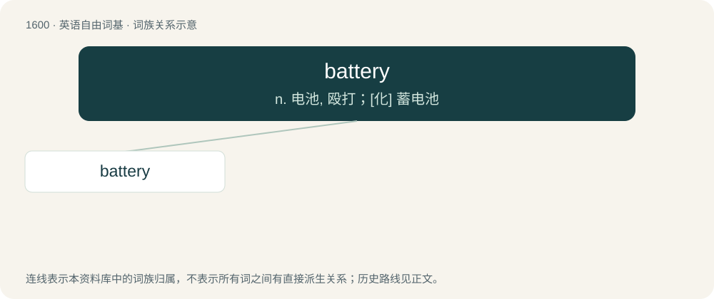

# 1694 · battery — n. 电池, 殴打；\[化\] 蓄电池

[总目录](../00_总目录_按常用程度.md)

**类型**：英语自由词基　｜　**来源语言**：见词源记录

## 核心含义与来源

- 核心含义：n. 电池, 殴打；\[化\] 蓄电池
- 英文含义：A device used to power electric devices, consisting of one or more electrically connected electrochemical cells or (archaically) electrostatic cells.
- 词形：battery

**来源记录 1**（名词；A device used to power electric devices, consisting of one or more electrically connected electrochemical cells or (archaically) electrostatic cells.）

Borrowed from Middle French batterie, from Old French baterie (“action of beating”), from batre (“beat”), from Latin battuō (“beat”), from Gaulish. Doublet of batterie. By surface analysis, batter + -y. The electrical sense was coined by American polymath Benjamin Franklin by analogy with a military battery that his series of Leyden jars resembled.

## 词族图

## 单词速览（常用到不常用）

| 单词 | 音标 | 释义 |
|---|---|---|
| [battery](#w-1) | 英 /ˈbæt.(ə)ɹi/；美 /ˈbæt.əɹi/ | n. 电池, 殴打；\[化\] 蓄电池 |

## 逐词详解

### 1. battery

**词性**：名词　｜　**音标**：英 /ˈbæt.(ə)ɹi/；美 /ˈbæt.əɹi/

**中文释义**：n. 电池, 殴打；\[化\] 蓄电池

**英文义项**：A device used to power electric devices, consisting of one or more electrically connected electrochemical cells or (archaically) electrostatic cells. / Such a device that has multiple cells.

**词源与演化**：

Borrowed from Middle French batterie, from Old French baterie (“action of beating”), from batre (“beat”), from Latin battuō (“beat”), from Gaulish. Doublet of batterie. By surface analysis, batter + -y. The electrical sense was coined by American polymath Benjamin Franklin by analogy with a military battery that his series of Leyden jars resembled.

**例句**：

> Her phone needs a new battery because its present battery no longer holds a charge well.

该用例对应义项：Such a device that has multiple cells.
