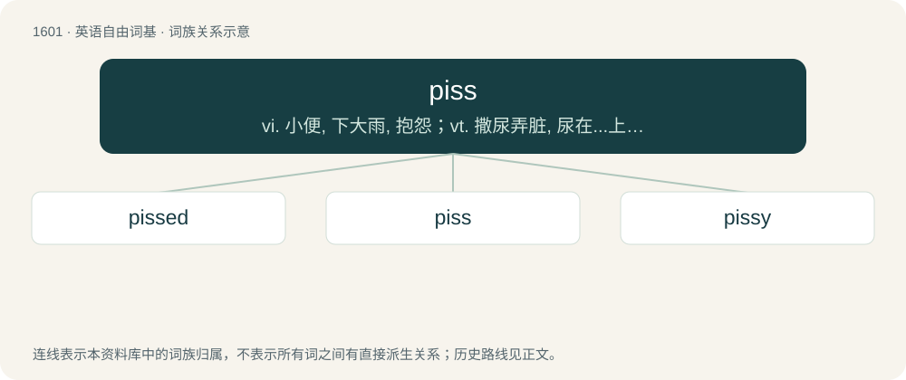

# 1696 · piss — vi. 小便, 下大雨, 抱怨；vt. 撒尿弄脏, 尿在...上；n. 小便

[总目录](../00_总目录_按常用程度.md)

**类型**：英语自由词基　｜　**来源语言**：见词源记录

## 核心含义与来源

- 核心含义：vi. 小便, 下大雨, 抱怨；vt. 撒尿弄脏, 尿在...上；n. 小便
- 英文含义：Urine.
- 词形：piss

**来源记录 1**（名词；Urine.）

From Middle English pisse (noun) and pissen (verb), from Old French pissier, possibly from Vulgar Latin \*pīssiāre, probably of imitative origin. Compare Old Norse pissa (“to urinate, piss”). Displaced Old English miċġe (“urine”) and mīgan (“to urinate”).

## 词族图

## 单词速览（常用到不常用）

| 单词 | 音标 | 释义 |
|---|---|---|
| [pissed](#w-1) | /pɪst/ | a. 喝醉的 |
| [piss](#w-2) | /pɪs/ | vi. 小便, 下大雨, 抱怨；vt. 撒尿弄脏, 尿在...上；n. 小便 |
| [pissy](#w-3) | /ˈpɪsi/ | a. 低劣的；臭尿一样的；讨厌的 |

## 逐词详解

### 1. pissed

**词性**：形容词　｜　**音标**：/pɪst/

**中文释义**：a. 喝醉的

**英文义项**：Drunk. / Annoyed, angry.

**构词拆分**：piss + -ed

**词源与演化**：

From Middle English pissed, pissede, pyssyd, pisside, equivalent to piss + -ed.

**例句**：

> It really pissed me off that Robert was still lying to me.

### 2. piss

**词性**：名词　｜　**音标**：/pɪs/

**中文释义**：vi. 小便, 下大雨, 抱怨；vt. 撒尿弄脏, 尿在...上；n. 小便

**英文义项**：Urine. / The act of urinating.

**词源与演化**：

From Middle English pisse (noun) and pissen (verb), from Old French pissier, possibly from Vulgar Latin \*pīssiāre, probably of imitative origin. Compare Old Norse pissa (“to urinate, piss”). Displaced Old English miċġe (“urine”) and mīgan (“to urinate”).

**例句**：

> This toilet is disgusting. There's piss all over the floor.

该用例对应义项：Urine.

### 3. pissy

**词性**：形容词　｜　**音标**：/ˈpɪsi/

**中文释义**：a. 低劣的；臭尿一样的；讨厌的

**英文义项**：Soaked or dirtied by urine. / Resembling or smelling like urine.

**构词拆分**：piss + -y

**词源与演化**：

From piss + -y.

**例句**：

> I wish these pissy rain showers would either build up into a storm or go away.

该用例对应义项：Weak and drizzly.
