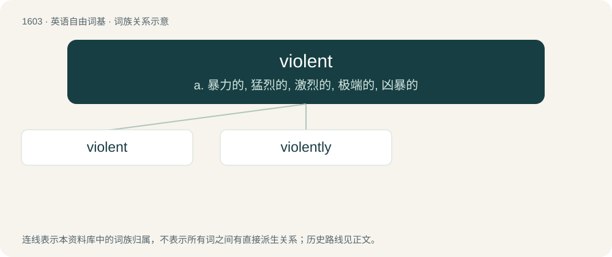

# 1697 · violent — a. 暴力的, 猛烈的, 激烈的, 极端的, 凶暴的

[总目录](../00_总目录_按常用程度.md)

**类型**：英语自由词基　｜　**来源语言**：见词源记录

## 核心含义与来源

- 核心含义：a. 暴力的, 猛烈的, 激烈的, 极端的, 凶暴的
- 英文含义：Involving extreme force or motion.
- 词形：violent

**来源记录 1**（形容词；Involving extreme force or motion.）

From Middle English violent, from Old French violent, from Latin violentus, from vīs (“strength”). Displaced native Old English stræc. For the verb, compare French violenter.

## 词族图

## 单词速览（常用到不常用）

| 单词 | 音标 | 释义 |
|---|---|---|
| [violent](#w-1) | /ˈvaɪ.ə.lənt/ | a. 暴力的, 猛烈的, 激烈的, 极端的, 凶暴的 |
| [violently](#w-2) | /ˈvaɪ(ə)ləntli/ | adv. 猛烈地, 激烈地, 极端地 |

## 逐词详解

### 1. violent

**词性**：形容词　｜　**音标**：/ˈvaɪ.ə.lənt/

**中文释义**：a. 暴力的, 猛烈的, 激烈的, 极端的, 凶暴的

**英文义项**：Involving extreme force or motion. / Involving physical conflict.

**词源与演化**：

From Middle English violent, from Old French violent, from Latin violentus, from vīs (“strength”). Displaced native Old English stræc. For the verb, compare French violenter.

**例句**：

> We would rather negotiate, but we will use violent means if necessary.

该用例对应义项：Involving physical conflict.

### 2. violently

**词性**：副词　｜　**音标**：/ˈvaɪ(ə)ləntli/

**中文释义**：adv. 猛烈地, 激烈地, 极端地

**英文义项**：In a violent manner. / To an intense degree; extremely; strongly; intensely.

**构词拆分**：violent + -ly

**词源与演化**：

From Middle English violently; equivalent to violent + -ly.

**例句**：

> I found myself violently disagreeing with him.

该用例对应义项：To an intense degree; extremely; strongly; intensely.
