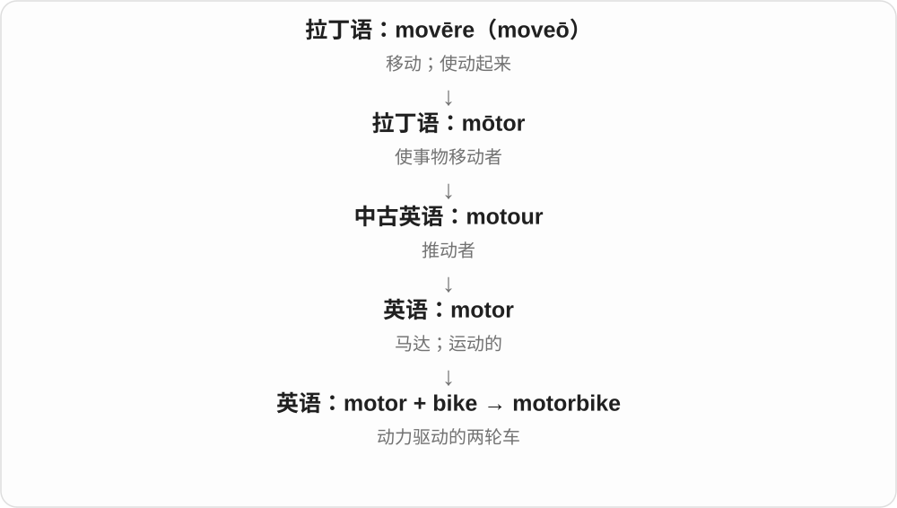

# 1698 · bike — 长名称缩短成骑车日常用词

[逐词精讲目录](../00_逐词精讲目录.md) · [总目录](../00_总目录_按常用程度.md)

## 核心词根与来源

bike 短，不等于历史比 bicycle 更早；biker 也不能只凭字形就固定一种交通工具。

**BIKE：先看骑的是自行车还是摩托**

bike → biker；bike + way → bikeway；motorbike、superbike 选摩托类别。

- **车辆与骑行动作**：bike
- **骑行人物与通道**：biker · bikeway
- **摩托组合**：motorbike · superbike
- **bike → bikes：短名称与骑车**：bike · bikes

## 词形与演化规律

bicycle 缩短 → bike；bike + -er → biker；bike + way → bikeway；motor/super + bike。

bicycle 的缩短形式，按现代读音与用途学习。

## 单词速览（按词族由简到繁）

同一基础词的相关扩展放在一起，先读基础形式，再读扩展；各组之间优先读常用的。具体词源关系见各词讲解。

| 单词 | 音标 | 核心意思 |
|---|---|---|
| [bike](#w-1) | /baɪk/ | 自行车；摩托车〔依语境〕；骑车 |
| [bikes](#w-6) | /baɪks/ | 自行车；摩托车〔复数，视语境〕；骑车〔第三人称单数〕 |
| [biker](#w-2) | 英 /ˈbaɪkə/；美 /ˈbaɪkər/ | 摩托车骑手；骑自行车的人 |
| [bikeway](#w-5) | /ˈbaɪkweɪ/ | 自行车道、骑行通道 |
| [motorbike](#w-3) | 英 /ˈməʊtəbaɪk/；美 /ˈmoʊtərbaɪk/ | 摩托车 |
| [superbike](#w-4) | 英 /ˈsuːpəbaɪk/；美 /ˈsuːpərbaɪk/ | 超级摩托车；高性能摩托车；超级摩托车赛事类别 |

## 逐词讲解

### 1. bike — 自行车；摩托车〔依语境〕；骑车

**音标**：/baɪk/

**先抓住这个画面**

日常不用每次把 bicycle 说完整，就叫 bike；说运动型摩托、骑手社群时，bike 又可能是 motorbike。

**怎么拆**

由 bicycle 缩短而来，/k/ 与现代拼写、截短方式有关，不能只把原词按第一个音节剪下来就得到全部读音。动词 bike 从车辆名转为骑车。

**怎么变成今天的意思**

**bicycle → 缩短形式 bike**  
较长自行车名称缩成日常短词，拼写和读音一起定型

↓

**骑行对象的扩展**  
自行车，也可在相应语境指摩托车

↓

**直接派生与组合**  
biker 骑行者；bikeway 骑行通道；motorbike、superbike 指车辆类别

ride a bike 骑车，a mountain bike 山地自行车，a motorbike 摩托车，bike to work 骑车上班。

**常见搭配与例句**

ride a bike；a mountain bike；bike to work；on a bike。

> She rides her bike to school.

她骑自行车上学。

> We biked along the river.

我们沿河骑了车。

**别混淆**

bike 原来接 bicycle，但现代语境可指摩托；看到 biker 也先看交通工具，不能默认都在骑自行车。

### 2. bikes — 自行车；摩托车〔复数，视语境〕；骑车〔第三人称单数〕

**音标**：/baɪks/

**先抓住这个画面**

较长的 bicycle 缩成日常短词 bike，多辆便是 bikes。骑行谈话里也可能指摩托车，先看所说的车辆。

**怎么拆**

bike + -s，/k/ 后读 /s/。bike 从 bicycle 缩短而来，短词的拼写、/baɪk/ 读音一起定型；英语又由车辆名发展出骑车动词。

**怎么变成今天的意思**

**bicycle → bike**  
自行车名称缩短；有时扩用于摩托车

↓

**bike + -s → bikes；名词转动词**  
多辆车；单数主语骑车

mountain bikes 山地自行车；ride bikes 骑自行车；bikes to school 骑车上学。

**常见搭配与例句**

bikes in the garage；bikes along the canal。

> We left our bikes beside the café.

我们把自行车停在了咖啡馆旁边。

> He bikes to work when the weather is dry.

天气干燥时，他骑车上班。

**别混淆**

He bikes to work 中 bikes 是动词，后面 to 说明目的地；His bikes are outside 中是复数名词。bike 的结尾 e 不单独发音。

### 3. biker — 摩托车骑手；骑自行车的人

**音标**：英 /ˈbaɪkə/；美 /ˈbaɪkər/

**先抓住这个画面**

bike 的人：有时是皮夹克摩托车手，有时只是山地骑行者；前面的修饰词能把画面定下来。

**怎么拆**

bike + -er，末尾不发音 e 不重复保留。人物后缀接骑车动作或相应车辆活动。

**怎么变成今天的意思**

**bicycle → 缩短形式 bike**  
较长自行车名称缩成日常短词，拼写和读音一起定型

↓

**骑行对象的扩展**  
自行车，也可在相应语境指摩托车

↓

**bike + -er → biker**  
以骑 bike 为活动的人

a mountain biker 山地自行车骑行者，a group of bikers 一群骑手，a biker club 摩托车手俱乐部等。

**常见搭配与例句**

a mountain biker；a group of bikers；a biker club。

> Several mountain bikers stopped beside the trail.

几位山地自行车骑手在小径旁停了下来。

> The bikers parked their motorcycles outside the café.

摩托车手把车停在咖啡馆外。

**别混淆**

biker 经常用于摩托文化，cyclist 较明确自行车骑行者；mountain biker 却普通指山地自行车手，不能靠一个词固定全部场景。

### 4. bikeway — 自行车道、骑行通道

**音标**：/ˈbaɪkweɪ/

**先抓住这个画面**

给自行车通行的一段路或路线；way 说通道，但具体是不是与机动车完全隔离，还要看道路设计。

**怎么拆**

bike 自行车 + way 道路，组合为交通通道名称。取自行车义，不把所有摩托车能走的路都叫 bikeway。

**怎么变成今天的意思**

**bicycle → 缩短形式 bike**  
较长自行车名称缩成日常短词，拼写和读音一起定型

↓

**bike + way → bikeway**  
为自行车交通设置的路线、通道

a protected bikeway 有隔离保护的自行车道，a riverside bikeway 滨河骑行道，a bikeway network 自行车通道网络。

**常见搭配与例句**

a protected bikeway；a riverside bikeway；a bikeway network。

> The city built a bikeway along the canal.

城市沿运河修建了一条自行车道。

> The new bridge connects two parts of the bikeway network.

新桥连接起自行车道网络的两部分。

**别混淆**

bikeway 范围可包括不同自行车通道形式；bike lane 常明确车道划分，path 常侧重路面路径，具体地区命名也会有差异。

### 5. motorbike — 摩托车

**音标**：英 /ˈməʊtəbaɪk/；美 /ˈmoʊtərbaɪk/

**先抓住这个画面**

motorbike 像 bike 加上 motor，成为靠发动机行驶的两轮车。

**怎么拆**

motor + bike；bike 是 bicycle 的口语缩短形式。

**怎么变成今天的意思**

常用作 motorcycle 的口语近义词，有时更让人想到轻型摩托车，但并非各地都严格区分。

**常见搭配与例句**

ride a motorbike；a motorbike rider；a motorbike engine。

> He parked his motorbike outside the café.

他把摩托车停在咖啡馆外。

> We heard a motorbike coming down the road.

我们听见一辆摩托车沿路驶来。

**别混淆**

bike 单独使用可指自行车，也可能在语境里指摩托车；motorbike 更明确。

### 6. superbike — 超级摩托车；高性能摩托车；超级摩托车赛事类别

**音标**：英 /ˈsuːpəbaɪk/；美 /ˈsuːpərbaɪk/

**先抓住这个画面**

把摩托车的动力和赛道性能推到高端，也用于特定的生产型赛车类别。

**怎么拆**

英语 super- + bike；bike 在这里通常缩自 motorbike，不是自行车。

**怎么变成今天的意思**

**拉丁 super**  
在上方、超过、越过

↓

**英语构词成分 super-**  
超出一般程度；在上、额外或超过某界限

↓

**英语 super- + bike → superbike**  
高性能摩托车及相应赛车类别

日常可泛称高性能摩托车；赛事里有具体技术规定，不能只凭外观或一个排量数字断定类别。

**常见搭配与例句**

a superbike rider；superbike racing。

> The rider tested the superbike on a closed circuit.

车手在封闭赛道上测试了这辆超级摩托车。

> She began watching superbike racing as a teenager.

她十几岁时开始看超级摩托车比赛。

**别混淆**

motorcycle 是一般摩托车；superbike 带高性能和竞赛定位。

## 这一组要分清什么

biker/cyclist 摩托常见用法与较明确自行车人物；bikeway 不自动保证全程隔离。

## 串起来练习

The mountain biker followed the bikeway beside the river.

山地自行车骑手沿河边自行车道前行。
